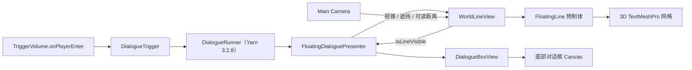
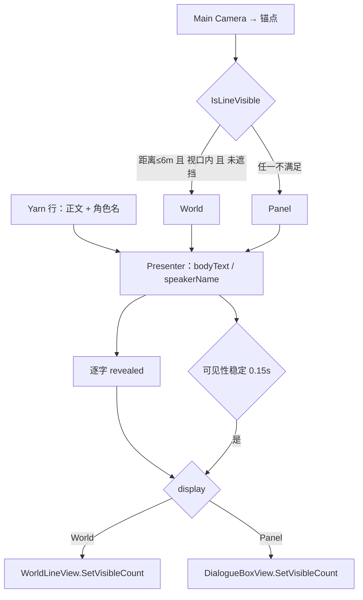
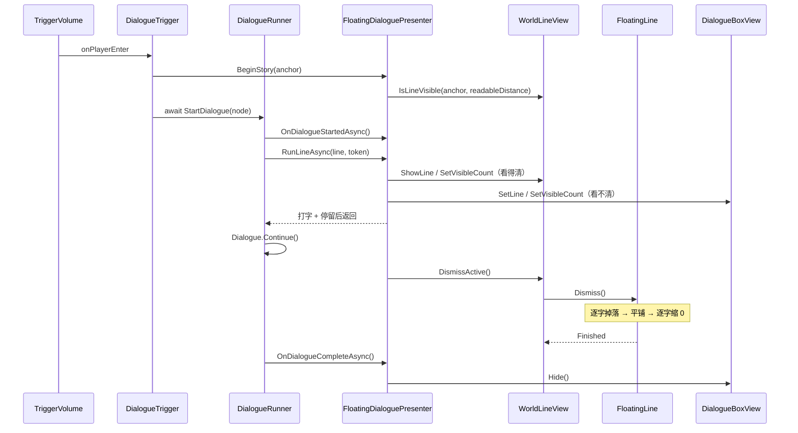

# 米塔式 3D 飘字对话 实现计划

> **面向 AI 代理的工作者：** 必需子技能：使用 superpowers:subagent-driven-development（推荐）或 superpowers:executing-plans 逐任务实现此计划。步骤使用复选框（`- [ ]`）语法来跟踪进度。

**目标：** 剧情开始时在锚点上方显示带打字机效果的 3D 飘字；**显示方式只由玩家视角决定**——3D 字在画面里且看得清（视锥内、未被遮挡、相机到字距离不超过可读距离）就用 3D 字，否则改用底部对话框显示同一句、同一进度，不按与触发点的距离切换；每句结束后 3D 字逐字像纸片一样掉落、带随机旋转地摔成平铺，全部落地后逐字缩放到零。

**架构：** 一个 `FloatingDialoguePresenter`（继承 Yarn Spinner 3.2.8 的 `DialoguePresenterBase`）持有当前行、逐字进度和显示方式，每帧向 `WorldLineView.IsLineVisible` 询问可见性并做时间防抖；`WorldLineView` 与 `DialogueBoxView` 只负责按进度渲染；`FloatingLine` 用 TMP 网格顶点做逐字掉落与缩小；`DialogueTrigger` 在 TriggerVolume 进入时启动 Yarn 节点。

> **变更记录（实现后修订）：** 本文任务里的代码块是首版实现（按玩家与锚点的 XZ 距离 + near/far 滞回判定、整句下落缩放、预制体 scale `0.016`）。实现后按用户要求改了三处，**以当前代码与 spec 为准**：① 显示方式改为视角可见性判定（`IsLineVisible(worldPosition, readableDistance)`：距离 ≤ 6m + 视口内 + `Linecast` 不遮挡），用 `displaySwitchDelay = 0.15s` 防抖；② 收尾改为逐字纸片掉落 + 平铺 + 逐字缩到 0；③ 预制体 scale 改 `0.075`（`0.016` 时 320×180 下只有约 4px）。下面 §1.1 的三张图与 §3 验收清单已同步为新逻辑。

**技术栈：** Unity 2022.3.62f3c1、URP 14.0.12、Yarn Spinner 3.2.8、DOTween、Odin Inspector、TextMeshPro、新 Input System（本功能不使用输入）。

**规格：** [2026-11-14-floating-3d-dialogue-design.md](../specs/2026-11-14-floating-3d-dialogue-design.md)

---

## 0. 硬约束与验证方式

- **不写测试脚本、不跑 `-batchmode`。** 本项目没有 CI、没有无头测试脚本，`AGENTS.md` 明确不要臆造 Unity 批处理命令。TDD 的“先写失败测试”在本项目不可执行；本计划用 **Unity 编译 + Play 验收** 替代，每个任务给出可观察的预期结果。不要写伪造的测试命令或测试文件。
- **不执行任何 git 写操作。** 按全局约定，只允许查询类 git 操作；不要 `git add`、`git commit`、`git checkout`、`git stash`。每个任务完成后由用户决定是否提交。
- **不改第三方与框架目录。** `Assets/Plugins`、`Assets/QFramework` 只读。
- **不改 `.meta`。** 移动、重命名、删除资产时连同 `.meta` 一起处理，用 Unity 编辑器或 Unity MCP。
- **场景、预制体、`.asset`、`.yarnproject` 不手写 YAML。** 用 Unity 编辑器或 Unity MCP 修改。
- **不静默处理错误。** 空引用、缺地面、池耗尽、配置非法都要 `Debug.LogError` / `Debug.LogWarning`；不要用默认值悄悄吞掉。
- **不新建 asmdef。** 脚本编入 `Assembly-CSharp`。
- **不实现选项、语音、头像、本地化。** 测试节点不得包含选项。
- **Yarn API 以 3.2.8 包源码为准。** 已核对：`StartDialogue` 是 `async YarnTask`；`RunLineAsync` 的第二个参数是 `LineCancellationToken`；`RunLineAsync` 正常返回后 Runner 会自动 `Dialogue.Continue()`，**不要调用 `RequestNextLine()`**。

### 编译检查命令

用 Unity MCP（可用时）：

```text
refresh_unity(scope="scripts", compile="request", wait_for_ready=true)
read_console(action="get", types=["error"], count=20)
```

MCP 不可用时：切回 Unity 编辑器，等待编译结束，打开 Console 确认无红色错误。不要用 `Unity.exe -batchmode`。

### Play 检查命令

用 Unity MCP（可用时）：

```text
manage_editor(action="play")
read_console(action="get", types=["error", "warning"], count=30)
manage_editor(action="stop")
```

MCP 不可用时：手动点 Play / Stop，观察 Game 视图与 Console。

---

## 1. 文件结构

| 文件 | 职责 |
| --- | --- |
| `Assets/Scripts/Dialogue/FloatingLine.cs` | 单条 3D TMP：朝向相机、上下浮动、逐字纸片掉落平铺、逐字缩到 0 |
| `Assets/Scripts/Dialogue/WorldLineView.cs` | 最多 4 个 `FloatingLine` 实例池；显示/更新/可见性判定/收尾/全部隐藏 |
| `Assets/Scripts/Dialogue/DialogueBoxView.cs` | 底部对话框：CanvasGroup 淡入淡出、按字数截断 |
| `Assets/Scripts/Dialogue/FloatingDialoguePresenter.cs` | 继承 `DialoguePresenterBase`：行状态、打字进度、显示方式（3D/对话框）、阶段切换 |
| `Assets/Scripts/Dialogue/DialogueTrigger.cs` | 剧情触发：校验引用、`BeginStory`、`await StartDialogue` |
| `Assets/Prefabs/Dialogue/FloatingLine.prefab` | 3D TMP 飘字预制体 |
| `Assets/Materials/Dialogue/FloatingLine.mat` | 3D TMP 材质（白字黑描边） |
| `Assets/Scenes/Game.unity` | `DialogueSystem`、`WorldLines`、`DialogueCanvas/DialogueBox`、`DialogueTrigger` 接线 |
| `Assets/Yarn/TestDialogue.yarn` | 临时测试台词（3 句，无选项） |
| `Assets/Yarn/TestDialogue.yarnproject` | 通过 Yarn Spinner 编辑器创建，不手写 |
| `AGENTS.md` | 最后用 `agents-gen` 技能补一行“剧情对话 / 3D 飘字”能力 |

---

## 1.1 架构、数据流与调用链

### 架构



### 数据流



### 调用链



---

## 2. 任务

### 任务 1：实现 `FloatingLine`

**文件：**
- 创建：`Assets/Scripts/Dialogue/FloatingLine.cs`

- [ ] **步骤 1：写脚本**

```csharp
using DG.Tweening;
using Sirenix.OdinInspector;
using TMPro;
using UnityEngine;

namespace Game.Dialogue
{
    /// <summary>
    /// 单条 3D 飘字。打字进度由外部设置，自己负责朝向、浮动、落地与缩小。
    /// </summary>
    public sealed class FloatingLine : MonoBehaviour
    {
        enum LineState
        {
            Idle,
            Active,
            Falling,
            Landed,
            Shrinking,
            Finished,
        }

        [SerializeField, LabelText("文本")] TMP_Text text;
        [SerializeField, LabelText("面向相机")] Camera faceCamera;
        [SerializeField, LabelText("浮动幅度"), MinValue(0f)] float bobAmplitude = 0.04f;
        [SerializeField, LabelText("浮动速度"), MinValue(0f)] float bobSpeed = 2f;
        [SerializeField, LabelText("重力"), MinValue(0.01f)] float gravity = 18f;
        [SerializeField, LabelText("地面层")] LayerMask groundMask;
        [SerializeField, LabelText("落地偏移")] float groundOffset = 0.02f;
        [SerializeField, LabelText("碰撞停顿"), MinValue(0f)] float impactPause = 0.05f;
        [SerializeField, LabelText("缩小时间"), MinValue(0.01f)] float shrinkDuration = 0.25f;

        Vector3 baseScale;
        Vector3 basePosition;
        Vector3 velocity;
        float groundY;
        float landingCenterY;
        float textHalfHeight;
        float landTimer;
        LineState state;

        public event System.Action<FloatingLine> Finished;

        /// <summary>由 WorldLineView 注入世界相机与地面层。</summary>
        public void Configure(Camera camera, LayerMask mask)
        {
            faceCamera = camera;
            groundMask = mask;
        }

        void Awake()
        {
            if (text == null)
            {
                Debug.LogError("FloatingLine 未指定 TMP_Text", this);
                enabled = false;
                return;
            }

            baseScale = transform.localScale;
            if (baseScale.sqrMagnitude < 0.0001f)
            {
                Debug.LogError("FloatingLine 的初始缩放不能为 0", this);
                enabled = false;
                return;
            }

            state = LineState.Idle;
        }

        /// <summary>显示一条新台词，并立即设置可见字数。</summary>
        public void Show(string content, int visibleCount, Vector3 worldPosition)
        {
            if (text == null)
            {
                Debug.LogError("FloatingLine 未指定 TMP_Text", this);
                return;
            }

            gameObject.SetActive(true);
            transform.DOKill();
            transform.SetPositionAndRotation(worldPosition, transform.rotation);
            transform.localScale = baseScale;

            text.text = content;
            text.ForceMeshUpdate();
            SetVisibleCount(visibleCount);

            basePosition = worldPosition;
            velocity = Vector3.zero;
            landTimer = 0f;
            state = LineState.Active;
        }

        /// <summary>设置当前可见字数，超出范围自动夹取。</summary>
        public void SetVisibleCount(int count)
        {
            if (text == null) return;
            text.maxVisibleCharacters = Mathf.Clamp(count, 0, text.textInfo.characterCount);
        }

        /// <summary>开始下落；没有地面时原地缩小并记录警告。</summary>
        public void Dismiss()
        {
            if (state != LineState.Active) return;

            if (text == null)
            {
                Debug.LogError("FloatingLine 未指定 TMP_Text，无法下落", this);
                HideImmediate();
                return;
            }

            text.ForceMeshUpdate();
            textHalfHeight = text.bounds.extents.y;
            float startY = transform.position.y;

            if (!Physics.Raycast(transform.position, Vector3.down, out RaycastHit hit, 50f,
                    groundMask, QueryTriggerInteraction.Ignore))
            {
                Debug.LogWarning("FloatingLine 下方没有地面，改为原地缩小", this);
                groundY = startY - textHalfHeight;
                landingCenterY = startY;
                state = LineState.Landed;
                landTimer = 0f;
                return;
            }

            groundY = hit.point.y + groundOffset;
            landingCenterY = groundY + textHalfHeight;
            if (landingCenterY > startY)
            {
                Debug.LogWarning("FloatingLine 计算出的地面高于起点，改为原地缩小", this);
                groundY = startY - textHalfHeight;
                landingCenterY = startY;
            }

            velocity = Vector3.zero;
            state = LineState.Falling;
        }

        /// <summary>立刻隐藏并复位，用于回收或清场。</summary>
        public void HideImmediate()
        {
            transform.DOKill();
            state = LineState.Idle;
            velocity = Vector3.zero;
            landTimer = 0f;
            transform.localScale = baseScale;
            gameObject.SetActive(false);
        }

        void Update()
        {
            switch (state)
            {
                case LineState.Active:
                    transform.position = basePosition +
                                         Vector3.up * (Mathf.Sin(Time.time * bobSpeed) * bobAmplitude);
                    break;

                case LineState.Falling:
                    velocity += Vector3.down * (gravity * Time.deltaTime);
                    transform.position += velocity * Time.deltaTime;
                    if (transform.position.y <= landingCenterY)
                    {
                        Vector3 p = transform.position;
                        p.y = landingCenterY;
                        transform.position = p;
                        state = LineState.Landed;
                        landTimer = 0f;
                    }
                    break;

                case LineState.Landed:
                    landTimer += Time.deltaTime;
                    if (landTimer >= impactPause)
                    {
                        StartShrink();
                    }
                    break;
            }
        }

        void LateUpdate()
        {
            if (faceCamera == null) return;
            float yaw = faceCamera.transform.eulerAngles.y;
            transform.rotation = Quaternion.Euler(0f, yaw, 0f);
        }

        void StartShrink()
        {
            state = LineState.Shrinking;
            float startScale = Mathf.Max(0.0001f, transform.localScale.x);

            transform.DOScale(Vector3.zero, shrinkDuration)
                .OnUpdate(() =>
                {
                    float factor = Mathf.Clamp01(transform.localScale.x / startScale);
                    Vector3 p = transform.position;
                    p.y = groundY + textHalfHeight * factor;
                    transform.position = p;
                })
                .OnComplete(Finish);
        }

        void Finish()
        {
            state = LineState.Finished;
            Finished?.Invoke(this);
        }

        void OnDestroy()
        {
            transform.DOKill();
        }
    }
}
```

- [ ] **步骤 2：编译**

运行 `refresh_unity` 与 `read_console`。预期：`FloatingLine` 编译通过，Console 无红色错误。

- [ ] **步骤 3：检查**

在 Project 窗口选中 `FloatingLine.cs`，确认脚本无编译错误；此时还没有预制体，不需要场景操作。

- [ ] **步骤 4：不提交**

按全局 git 约定，不执行 `git add/commit`；把结果留给用户查看。

---

### 任务 2：实现 `WorldLineView`

**文件：**
- 创建：`Assets/Scripts/Dialogue/WorldLineView.cs`

- [ ] **步骤 1：写脚本**

```csharp
using System.Collections.Generic;
using Sirenix.OdinInspector;
using UnityEngine;

namespace Game.Dialogue
{
    /// <summary>
    /// 3D 飘字实例池。同一时间只维护一条 active；旧句下落时 active 置空，
    /// 新句可以立刻复用或创建新实例。
    /// </summary>
    public sealed class WorldLineView : MonoBehaviour
    {
        [SerializeField, Required, LabelText("3D 字预制体")] FloatingLine prefab;
        [SerializeField, LabelText("池根节点")] Transform poolRoot;
        [SerializeField, Required, LabelText("世界相机")] Camera worldCamera;
        [SerializeField, LabelText("地面层")] LayerMask groundMask;
        [SerializeField, LabelText("最大实例数"), MinValue(1)] int maxLines = 4;

        readonly List<FloatingLine> allLines = new List<FloatingLine>();
        readonly Queue<FloatingLine> idle = new Queue<FloatingLine>();
        FloatingLine active;

        public bool HasActive => active != null;

        void Awake()
        {
            if (prefab == null)
            {
                Debug.LogError("WorldLineView 未指定 FloatingLine 预制体", this);
                enabled = false;
                return;
            }

            if (worldCamera == null)
            {
                Debug.LogError("WorldLineView 未指定世界相机", this);
                enabled = false;
                return;
            }

            if (maxLines <= 0)
            {
                Debug.LogError("WorldLineView 最大实例数必须大于 0", this);
                enabled = false;
                return;
            }

            if (groundMask == 0)
            {
                Debug.LogWarning("WorldLineView 地面层为 Nothing，3D 字不会落到地面", this);
            }
        }

        /// <summary>显示一条新 3D 字；已有 active 时拒绝并警告。</summary>
        public void ShowLine(string text, int visibleCount, Vector3 worldPosition)
        {
            if (prefab == null)
            {
                Debug.LogError("WorldLineView 未指定 FloatingLine 预制体", this);
                return;
            }

            if (worldCamera == null)
            {
                Debug.LogError("WorldLineView 未指定世界相机", this);
                return;
            }

            if (active != null)
            {
                Debug.LogWarning("WorldLineView 已有 active，忽略新的 3D 字", this);
                return;
            }

            FloatingLine line = GetLine();
            if (line == null) return;

            active = line;
            line.Configure(worldCamera, groundMask);
            line.Show(text, visibleCount, worldPosition);
        }

        public void SetVisibleCount(int count)
        {
            if (active == null) return;
            active.SetVisibleCount(count);
        }

        public void DismissActive()
        {
            if (active == null) return;

            FloatingLine line = active;
            active = null;
            line.Dismiss();
        }

        public void HideAll()
        {
            active = null;
            idle.Clear();

            foreach (FloatingLine line in allLines)
            {
                if (line == null) continue;
                line.HideImmediate();
                if (!idle.Contains(line)) idle.Enqueue(line);
            }
        }

        FloatingLine GetLine()
        {
            while (idle.Count > 0)
            {
                FloatingLine line = idle.Dequeue();
                if (line != null) return line;
            }

            if (allLines.Count < maxLines)
            {
                FloatingLine line = CreateLine();
                if (line != null) return line;
            }

            if (allLines.Count == 0) return null;

            FloatingLine oldest = allLines[0];
            allLines.RemoveAt(0);
            allLines.Add(oldest);
            if (oldest == null) return null;

            Debug.LogWarning("WorldLineView 池已满，复用最老的 3D 字", this);
            oldest.HideImmediate();
            return oldest;
        }

        FloatingLine CreateLine()
        {
            Transform parent = poolRoot != null ? poolRoot : transform;
            FloatingLine line = Instantiate(prefab, parent);
            line.gameObject.SetActive(false);
            line.Finished += OnLineFinished;
            allLines.Add(line);
            return line;
        }

        void OnLineFinished(FloatingLine line)
        {
            if (line == null) return;
            if (active == line) active = null;
            line.gameObject.SetActive(false);
            if (!idle.Contains(line)) idle.Enqueue(line);
        }

        void OnValidate()
        {
            if (maxLines < 1) maxLines = 1;
        }
    }
}
```

- [ ] **步骤 2：编译**

`refresh_unity` + `read_console`。预期：`WorldLineView` 编译通过；因为 `FloatingLine` 已存在，不应报类型错误。

- [ ] **步骤 3：检查**

确认 `WorldLineView` 的 Inspector 出现 `3D 字预制体`、`池根节点`、`世界相机`、`地面层`、`最大实例数` 五个字段；`3D 字预制体` 和 `世界相机` 为空时会显示 Odin 的 Required 提示。

---

### 任务 3：实现 `DialogueBoxView`

**文件：**
- 创建：`Assets/Scripts/Dialogue/DialogueBoxView.cs`

- [ ] **步骤 1：写脚本**

```csharp
using DG.Tweening;
using Sirenix.OdinInspector;
using TMPro;
using UnityEngine;

namespace Game.Dialogue
{
    /// <summary>
    /// 底部对话框。只负责显示文本、按字数截断和淡入淡出；不处理输入。
    /// </summary>
    public sealed class DialogueBoxView : MonoBehaviour
    {
        [SerializeField, Required, LabelText("画布组")] CanvasGroup canvasGroup;
        [SerializeField, Required, LabelText("正文")] TMP_Text bodyText;
        [SerializeField, Required, LabelText("角色名")] TMP_Text speakerText;
        [SerializeField, LabelText("角色名根节点")] GameObject speakerRoot;
        [SerializeField, LabelText("淡入时间"), MinValue(0f)] float fadeInDuration = 0.15f;
        [SerializeField, LabelText("淡出时间"), MinValue(0f)] float fadeOutDuration = 0.12f;

        void Awake()
        {
            if (canvasGroup == null)
            {
                Debug.LogError("DialogueBoxView 未指定 CanvasGroup", this);
                enabled = false;
                return;
            }

            if (bodyText == null)
            {
                Debug.LogError("DialogueBoxView 未指定正文", this);
                enabled = false;
                return;
            }

            if (speakerText == null)
            {
                Debug.LogError("DialogueBoxView 未指定角色名", this);
                enabled = false;
                return;
            }

            canvasGroup.alpha = 0f;
            canvasGroup.blocksRaycasts = false;
            canvasGroup.interactable = false;
            bodyText.raycastTarget = false;
            speakerText.raycastTarget = false;
            if (speakerRoot != null) speakerRoot.SetActive(false);
        }

        /// <summary>设置一句台词，并按 visibleCount 截断正文。</summary>
        public void SetLine(string speaker, string body, int visibleCount)
        {
            if (bodyText == null)
            {
                Debug.LogError("DialogueBoxView 未指定正文", this);
                return;
            }

            bodyText.text = body ?? string.Empty;
            bodyText.ForceMeshUpdate();
            SetVisibleCount(visibleCount);

            bool hasSpeaker = !string.IsNullOrWhiteSpace(speaker);
            if (speakerRoot != null) speakerRoot.SetActive(hasSpeaker);

            if (speakerText != null)
            {
                speakerText.text = hasSpeaker ? speaker : string.Empty;
                speakerText.ForceMeshUpdate();
            }
        }

        public void SetVisibleCount(int count)
        {
            if (bodyText == null) return;
            bodyText.maxVisibleCharacters = Mathf.Clamp(count, 0, bodyText.textInfo.characterCount);
        }

        public void Show()
        {
            if (canvasGroup == null) return;

            canvasGroup.DOKill();
            canvasGroup.blocksRaycasts = false;
            canvasGroup.interactable = false;
            if (canvasGroup.alpha >= 0.999f) return;
            canvasGroup.DOFade(1f, fadeInDuration).SetEase(Ease.OutQuad);
        }

        public void Hide()
        {
            if (canvasGroup == null) return;

            canvasGroup.DOKill();
            canvasGroup.blocksRaycasts = false;
            canvasGroup.interactable = false;
            if (canvasGroup.alpha <= 0.001f) return;
            canvasGroup.DOFade(0f, fadeOutDuration).SetEase(Ease.InQuad);
        }

        void OnDestroy()
        {
            if (canvasGroup != null) canvasGroup.DOKill();
        }
    }
}
```

- [ ] **步骤 2：编译**

`refresh_unity` + `read_console`。预期：`DialogueBoxView` 编译通过。

- [ ] **步骤 3：检查**

确认 Inspector 出现 `画布组`、`正文`、`角色名`、`角色名根节点`、`淡入时间`、`淡出时间`；`画布组`/`正文`/`角色名` 为空时有 Required 提示。

---

### 任务 4：实现 `FloatingDialoguePresenter`

**文件：**
- 创建：`Assets/Scripts/Dialogue/FloatingDialoguePresenter.cs`

- [ ] **步骤 1：写脚本**

```csharp
using Sirenix.OdinInspector;
using UnityEngine;
using Yarn.Unity;

namespace Game.Dialogue
{
    /// <summary>
    /// 持有当前行、逐字进度和远近模式；3D 视图与对话框只按进度渲染。
    /// </summary>
    public sealed class FloatingDialoguePresenter : DialoguePresenterBase
    {
        enum DistanceMode
        {
            Near,
            Far,
        }

        enum LinePhase
        {
            Idle,
            Revealing,
            Holding,
            Dismissing,
        }

        [SerializeField, Required, LabelText("玩家")] Transform player;
        [SerializeField, Required, LabelText("对话框")] DialogueBoxView dialogueBox;
        [SerializeField, Required, LabelText("3D 字视图")] WorldLineView worldLines;
        [SerializeField, LabelText("默认近距"), MinValue(0f)] float defaultNearDistance = 6f;
        [SerializeField, LabelText("默认远距"), MinValue(0f)] float defaultFarDistance = 9f;
        [SerializeField, LabelText("每秒字数"), MinValue(1f)] float charsPerSecond = 25f;
        [SerializeField, LabelText("每句停留"), MinValue(0f)] float holdAfterLine = 1.2f;

        Transform anchor;
        float nearDistance;
        float farDistance;
        DistanceMode mode;
        LinePhase phase;
        string bodyText = string.Empty;
        string speakerName = string.Empty;
        int revealed;
        bool isDialogueActive;

        /// <summary>对话是否正在进行；用于阻止同一剧情点重复触发。</summary>
        public bool IsBusy => isDialogueActive;

        /// <summary>由 DialogueTrigger 在 StartDialogue 前调用；失败返回 false。</summary>
        public bool BeginStory(Transform storyAnchor, float near, float far)
        {
            if (player == null)
            {
                Debug.LogError("FloatingDialoguePresenter 未指定玩家", this);
                return false;
            }

            if (storyAnchor == null)
            {
                Debug.LogError("FloatingDialoguePresenter 未指定锚点", this);
                return false;
            }

            if (dialogueBox == null)
            {
                Debug.LogError("FloatingDialoguePresenter 未指定对话框", this);
                return false;
            }

            if (worldLines == null)
            {
                Debug.LogError("FloatingDialoguePresenter 未指定 3D 字视图", this);
                return false;
            }

            if (near <= 0f || far <= near)
            {
                Debug.LogWarning("FloatingDialoguePresenter 的 near/far 不合法，改用默认值", this);
                near = defaultNearDistance;
                far = defaultFarDistance;
            }

            if (far <= near)
            {
                Debug.LogError("FloatingDialoguePresenter 的默认 near/far 不合法", this);
                return false;
            }

            anchor = storyAnchor;
            nearDistance = near;
            farDistance = far;

            bodyText = string.Empty;
            speakerName = string.Empty;
            revealed = 0;
            phase = LinePhase.Idle;
            isDialogueActive = false;

            float distance = CalculateDistance();
            mode = distance > farDistance ? DistanceMode.Far : DistanceMode.Near;

            worldLines.HideAll();
            dialogueBox.Hide();
            return true;
        }

        public override YarnTask OnDialogueStartedAsync()
        {
            if (anchor == null)
            {
                Debug.LogError("FloatingDialoguePresenter 未调用 BeginStory", this);
                return YarnTask.CompletedTask;
            }

            if (dialogueBox == null || worldLines == null)
            {
                Debug.LogError("FloatingDialoguePresenter 缺少对话框或 3D 字视图", this);
                return YarnTask.CompletedTask;
            }

            isDialogueActive = true;
            phase = LinePhase.Idle;
            EvaluateMode();
            return YarnTask.CompletedTask;
        }

        public override async YarnTask RunLineAsync(LocalizedLine line, LineCancellationToken token)
        {
            if (!isDialogueActive)
            {
                Debug.LogError("FloatingDialoguePresenter 未激活，无法显示台词", this);
                return;
            }

            bodyText = line.TextWithoutCharacterName.Text;
            speakerName = line.CharacterName ?? string.Empty;
            revealed = 0;
            phase = LinePhase.Revealing;
            ApplyMode();

            int total = bodyText.Length;
            int delayMs = Mathf.Max(1, Mathf.RoundToInt(1000f / charsPerSecond));

            while (revealed < total)
            {
                if (token.IsNextContentRequested)
                {
                    CleanupLine();
                    return;
                }

                revealed = Mathf.Min(total, revealed + 1);
                ApplyReveal();

                await YarnTask.Delay(delayMs, token.NextContentToken).SuppressCancellationThrow();

                if (token.IsNextContentRequested)
                {
                    CleanupLine();
                    return;
                }
            }

            phase = LinePhase.Holding;
            int holdMs = Mathf.RoundToInt(holdAfterLine * 1000f);
            await YarnTask.Delay(holdMs, token.NextContentToken).SuppressCancellationThrow();

            if (token.IsNextContentRequested)
            {
                CleanupLine();
                return;
            }

            if (mode == DistanceMode.Near)
            {
                worldLines.DismissActive();
                phase = LinePhase.Dismissing;
            }
            else
            {
                dialogueBox.SetVisibleCount(total);
                phase = LinePhase.Idle;
            }
        }

        public override YarnTask OnDialogueCompleteAsync()
        {
            isDialogueActive = false;
            if (dialogueBox != null) dialogueBox.Hide();

            if (phase == LinePhase.Revealing || phase == LinePhase.Holding)
            {
                if (worldLines != null) worldLines.HideAll();
            }

            phase = LinePhase.Idle;
            bodyText = string.Empty;
            speakerName = string.Empty;
            revealed = 0;
            return YarnTask.CompletedTask;
        }

        /// <summary>StartDialogue 抛异常或进入异常状态时的兜底清理。</summary>
        public void CancelStory()
        {
            isDialogueActive = false;
            phase = LinePhase.Idle;
            bodyText = string.Empty;
            speakerName = string.Empty;
            revealed = 0;

            if (worldLines != null) worldLines.HideAll();
            if (dialogueBox != null) dialogueBox.Hide();
        }

        void Update()
        {
            if (!isDialogueActive) return;
            EvaluateMode();
        }

        void EvaluateMode()
        {
            if (anchor == null) return;

            float distance = CalculateDistance();
            DistanceMode next = mode;

            if (mode == DistanceMode.Near && distance > farDistance)
            {
                next = DistanceMode.Far;
            }
            else if (mode == DistanceMode.Far && distance < nearDistance)
            {
                next = DistanceMode.Near;
            }

            if (next == mode) return;

            mode = next;
            ApplyMode();
        }

        void ApplyMode()
        {
            if (dialogueBox == null || worldLines == null) return;

            if (mode == DistanceMode.Near)
            {
                dialogueBox.Hide();

                if (phase == LinePhase.Revealing || phase == LinePhase.Holding)
                {
                    if (worldLines.HasActive)
                    {
                        worldLines.SetVisibleCount(revealed);
                    }
                    else
                    {
                        worldLines.ShowLine(bodyText, revealed, anchor.position);
                    }
                }
                else if (phase == LinePhase.Idle && worldLines.HasActive)
                {
                    worldLines.DismissActive();
                }

                return;
            }

            worldLines.HideAll();

            if (phase == LinePhase.Dismissing)
            {
                dialogueBox.Hide();
                phase = LinePhase.Idle;
                return;
            }

            if (phase == LinePhase.Revealing || phase == LinePhase.Holding)
            {
                dialogueBox.SetLine(speakerName, bodyText, revealed);
                dialogueBox.Show();
                return;
            }

            dialogueBox.Hide();
        }

        void ApplyReveal()
        {
            if (mode == DistanceMode.Near)
            {
                if (worldLines != null) worldLines.SetVisibleCount(revealed);
            }
            else
            {
                if (dialogueBox != null) dialogueBox.SetVisibleCount(revealed);
            }
        }

        void CleanupLine()
        {
            if (mode == DistanceMode.Near)
            {
                if (worldLines != null) worldLines.HideAll();
            }
            else
            {
                if (dialogueBox != null) dialogueBox.Hide();
            }

            phase = LinePhase.Idle;
            revealed = 0;
        }

        float CalculateDistance()
        {
            if (player == null || anchor == null) return 0f;

            Vector2 playerXZ = new Vector2(player.position.x, player.position.z);
            Vector2 anchorXZ = new Vector2(anchor.position.x, anchor.position.z);
            return Vector2.Distance(playerXZ, anchorXZ);
        }

        void OnValidate()
        {
            if (defaultNearDistance < 0f) defaultNearDistance = 0f;
            if (defaultFarDistance <= defaultNearDistance) defaultFarDistance = defaultNearDistance + 1f;
            if (charsPerSecond <= 0f) charsPerSecond = 25f;
            if (holdAfterLine < 0f) holdAfterLine = 0f;
        }
    }
}
```

- [ ] **步骤 2：编译**

`refresh_unity` + `read_console`。预期：无错误。若出现 `LineCancellationToken` 或 `YarnTask` 找不到，说明 Yarn Spinner 版本/命名空间不对，停止并报告，不要改成旧 API。

- [ ] **步骤 3：检查关键语义**

在代码中确认：
- `RunLineAsync` 正常返回后不调用 `RequestNextLine()`。
- `token.NextContentToken` 只用于 `YarnTask.Delay`；`token.IsNextContentRequested` 用于取消判断。
- `BeginStory` 不把 `isDialogueActive` 设为 true；`OnDialogueStartedAsync` 才设。
- `OnDialogueCompleteAsync` 在 `Dismissing` 阶段不 `HideAll()`。
- `OnDialogueStartedAsync`/`OnDialogueCompleteAsync`/`ApplyMode`/`ApplyReveal`/`CleanupLine` 都有空引用 guard。

---

### 任务 5：实现 `DialogueTrigger`

**文件：**
- 创建：`Assets/Scripts/Dialogue/DialogueTrigger.cs`

- [ ] **步骤 1：写脚本**

```csharp
using System;
using Sirenix.OdinInspector;
using UnityEngine;
using Yarn.Unity;

namespace Game.Dialogue
{
    /// <summary>由 TriggerVolume 的进入事件调用；校验并启动指定 Yarn 节点。</summary>
    public sealed class DialogueTrigger : MonoBehaviour
    {
        [SerializeField, Required, LabelText("对话运行器")] DialogueRunner runner;
        [SerializeField, Required, LabelText("飘字对话 Presenter")] FloatingDialoguePresenter presenter;
        [SerializeField, Required, LabelText("文字锚点")] Transform textAnchor;
        [SerializeField, LabelText("剧情节点")] string nodeName = "Start";
        [SerializeField, LabelText("近距阈值"), MinValue(0.01f)] float nearDistance = 6f;
        [SerializeField, LabelText("远距阈值"), MinValue(0.01f)] float farDistance = 9f;

        public async void StartDialogue()
        {
            if (runner == null)
            {
                Debug.LogError("DialogueTrigger 未指定 DialogueRunner", this);
                return;
            }

            if (presenter == null)
            {
                Debug.LogError("DialogueTrigger 未指定 FloatingDialoguePresenter", this);
                return;
            }

            if (textAnchor == null)
            {
                Debug.LogError("DialogueTrigger 未指定文字锚点", this);
                return;
            }

            if (string.IsNullOrWhiteSpace(nodeName))
            {
                Debug.LogError("DialogueTrigger 的剧情节点为空", this);
                return;
            }

            if (nearDistance <= 0f || farDistance <= nearDistance)
            {
                Debug.LogError("DialogueTrigger 的 near/far 不合法", this);
                return;
            }

            if (runner.IsDialogueRunning)
            {
                Debug.LogWarning("DialogueTrigger 忽略重复触发：对话已在运行", this);
                return;
            }

            if (presenter.IsBusy)
            {
                Debug.LogWarning("DialogueTrigger 忽略重复触发：Presenter 正忙", this);
                return;
            }

            if (runner.YarnProject == null)
            {
                Debug.LogError("DialogueTrigger 的 DialogueRunner 没有 Yarn Project", this);
                return;
            }

            if (runner.YarnProject.Program == null)
            {
                Debug.LogError("DialogueTrigger 的 Yarn Project 没有有效 Program", this);
                return;
            }

            if (!presenter.BeginStory(textAnchor, nearDistance, farDistance)) return;

            try
            {
                await runner.StartDialogue(nodeName);
            }
            catch (Exception e)
            {
                Debug.LogException(e, this);
                presenter.CancelStory();
            }
        }

        void OnValidate()
        {
            if (nearDistance <= 0f)
            {
                Debug.LogWarning("DialogueTrigger 的 near 必须大于 0，已纠正为 0.1", this);
                nearDistance = 0.1f;
            }

            if (farDistance <= nearDistance)
            {
                Debug.LogWarning("DialogueTrigger 的 far 必须大于 near，已纠正", this);
                farDistance = nearDistance + 1f;
            }
        }
    }
}
```

- [ ] **步骤 2：编译**

`refresh_unity` + `read_console`。预期：无错误。若 `StartDialogue` 不能 `await`，说明核对到的 API 不对，停止并报告。

- [ ] **步骤 3：检查**

确认 `StartDialogue` 是 `async void`，并且只在 `BeginStory` 返回 true 后调用 `await runner.StartDialogue(nodeName)`；异常分支调用 `presenter.CancelStory()`。

---

### 任务 6：创建 3D 飘字预制体

**文件：**
- 创建：`Assets/Prefabs/Dialogue/FloatingLine.prefab`
- 创建：`Assets/Materials/Dialogue/FloatingLine.mat`

- [ ] **步骤 1：创建 3D TMP 对象**

在 `Game.unity` 中：
1. `GameObject > 3D Object > Text - TextMeshPro`，命名 `FloatingLine`。
2. 选中它，在 TextMeshPro 组件设置：
   - Font Asset：`Assets/Fonts/SourceHanSansCN-Medium SDF.asset`
   - Font Size：`48`
   - Auto Size：勾选；Min `28`；Max `48`
   - Alignment：Center / Middle
   - Wrapping：勾选
   - Overflow：Overflow
   - Color：白色
3. 把 `RectTransform` 的 Width/Height 设为 `400 × 120`，Scale 设为 `0.016`，Position 归零。

- [ ] **步骤 2：创建描边材质**

1. 在 Project 窗口展开 `SourceHanSansCN-Medium SDF.asset`，找到它的材质子资产。
2. 选中材质，`Ctrl+D` 复制，命名 `FloatingLine.mat`，移动到 `Assets/Materials/Dialogue/`（没有目录就先建）。
3. 把 `FloatingLine.mat` 赋给 3D TMP 的 Material 槽。
4. 在材质 Inspector 中启用 Outline：颜色黑色，宽度 `0.15`；Face 颜色保持白色。
5. 如果材质面板没有 Outline 折叠项，确认 Shader 是 `TextMeshPro/Distance Field`。
6. 如果无法复制字体材质的子资产：新建 Material，Shader 选 `TextMeshPro/Distance Field`，把字体资产的 Atlas 贴图赋给 Main Texture，再赋给 3D TMP；Outline 设置同上。

- [ ] **步骤 3：挂 `FloatingLine` 并赋值**

1. 给 `FloatingLine` 对象添加 `FloatingLine` 组件。
2. 赋值：`文本` = 该对象的 3D TextMeshPro 组件；`面向相机` 留空（运行时注入）；`浮动幅度` `0.04`；`浮动速度` `2`；`重力` `18`；`地面层` 选 `Default`；`落地偏移` `0.02`；`碰撞停顿` `0.05`；`缩小时间` `0.25`。
3. 确认对象根节点是 **active**（预制体资产保持 active，`WorldLineView` 实例化后再隐藏）。

- [ ] **步骤 4：保存预制体**

1. 把 `FloatingLine` 从 Hierarchy 拖到 `Assets/Prefabs/Dialogue/`，命名为 `FloatingLine.prefab`。
2. 删除场景里的这个临时实例（预制体已保存）。
3. 选中预制体，确认 Scale 仍是 `0.016`，`FloatingLine` 的 `文本` 引用没有丢。

- [ ] **步骤 5：验证**

在 Project 窗口双击预制体，确认 3D TMP 显示中文、白字黑边；退出预制体编辑模式。此时不要把它放进场景。

---

### 任务 7：创建底部对话框 UI

**文件：**
- 修改：`Assets/Scenes/Game.unity`

- [ ] **步骤 1：创建 Canvas**

1. `GameObject > UI > Canvas`，命名 `DialogueCanvas`。
2. Render Mode：Screen Space - Overlay；Sorting Order：`-50`。
3. Canvas Scaler：Scale With Screen Size；Reference Resolution `1920 × 1080`；Match `0.5`。
4. 如果自动带了 `Graphic Raycaster`，保留即可；对话框本身 `blocksRaycasts = false`。

- [ ] **步骤 2：创建对话框底板**

1. 在 `DialogueCanvas` 下创建 `UI > Image`，命名 `DialogueBox`。
2. RectTransform：Anchor 底部居中；Width `1100`；Height `220`；Pos Y `40`；Pos X `0`。
3. Image Color：黑色，Alpha `0.78`；Raycast Target 取消勾选。
4. 给 `DialogueBox` 添加 `CanvasGroup`：Alpha `0`；Blocks Raycasts 取消；Interactable 取消。
5. 给 `DialogueBox` 添加 `DialogueBoxView`。

- [ ] **步骤 3：创建正文与角色名**

1. 在 `DialogueBox` 下创建 `UI > Text - TextMeshPro`，命名 `BodyText`。
2. RectTransform 拉伸铺满，Left/Right `32`，Top `24`，Bottom `24`。
3. Font Asset：`SourceHanSansCN-Medium SDF.asset`；Font Size `30`；Color 白色；Alignment Top Left；Wrapping 勾选；Overflow Overflow；Raycast Target 取消。
4. 在 `DialogueBox` 下创建空物体 `SpeakerRoot`，放在左上角（例如 Anchor 左上，Pos `(32, -18)`）。
5. 在 `SpeakerRoot` 下创建 `UI > Text - TextMeshPro`，命名 `SpeakerText`；Font Size `24`；Color `#FFD479`；Alignment Middle Left；Raycast Target 取消；`SpeakerRoot` 初始设为 inactive。
6. 选中 `DialogueBoxView`，赋值：`画布组` = `DialogueBox` 的 CanvasGroup；`正文` = `BodyText`；`角色名` = `SpeakerText`；`角色名根节点` = `SpeakerRoot`；淡入 `0.15`；淡出 `0.12`。

- [ ] **步骤 4：验证**

运行一次（不需要 Yarn）：`DialogueBoxView` 的 Awake 会把 CanvasGroup alpha 设为 0，Game 视图看不到对话框；Console 不应有 “未指定” 错误。若 alpha 仍为 1，检查 CanvasGroup 是否挂在 `DialogueBox` 上。

---

### 任务 8：场景、Yarn 与触发接线

**文件：**
- 修改：`Assets/Scenes/Game.unity`
- 创建：`Assets/Yarn/TestDialogue.yarn`
- 创建：`Assets/Yarn/TestDialogue.yarnproject`（用 Yarn Spinner 编辑器）

- [ ] **步骤 1：创建测试 Yarn 文件**

新建 `Assets/Yarn/TestDialogue.yarn`，内容：

```yarn
title: Start
---
米塔: 你终于来了。
旁白: 这里的字会跟着你。
米塔: 走近一点，字会飘起来。
===
```

- [ ] **步骤 2：创建 Yarn Project**

1. 用 Unity 菜单 `Assets > Create > Yarn Spinner > Yarn Project` 创建 `TestDialogue.yarnproject`，放在 `Assets/Yarn/`。菜单名若不同，用 Yarn Spinner 的 Project 创建入口，不要手写 `.yarnproject`。
2. 在 Yarn Project 的 Inspector 中把 `TestDialogue.yarn` 加进 Source Scripts。
3. 点 Create / Update，确认 `Start` 节点被编译；Console 不应有 Yarn 编译错误。
4. 如果 `米塔:` / `旁白:` 没有被识别为角色名，先把测试台词改成不带角色名的普通行，确认系统能跑；角色名解析另开问题，不要在本任务里改 Yarn 源码。

- [ ] **步骤 3：创建 `DialogueSystem`**

1. 场景中新建空物体 `DialogueSystem`。
2. 添加 `DialogueRunner`：
   - Yarn Project：`TestDialogue.yarnproject`
   - Start Node：`Start`
   - Dialogue Presenters：把 `FloatingDialoguePresenter` 组件拖进列表
   - 取消 `Start Automatically`（自动开始）
3. 给同一对象添加 `FloatingDialoguePresenter`：
   - `玩家` = 场景里的 Player（Transform）
   - `对话框` = `DialogueBox` 上的 `DialogueBoxView`
   - `3D 字视图` = 下一步创建的 `WorldLineView`
   - `默认近距` `6`；`默认远距` `9`；`每秒字数` `25`；`每句停留` `1.2`

- [ ] **步骤 4：创建 `WorldLines`**

1. 场景中新建空物体 `WorldLines`，放在原点。
2. 添加 `WorldLineView`：
   - `3D 字预制体` = `Assets/Prefabs/Dialogue/FloatingLine.prefab`
   - `池根节点` = `WorldLines`（或它下面的空子物体）
   - `世界相机` = `Main Camera`
   - `地面层` = `Default`（如果关卡地面用了别的层，改成那个层，并确保不含 Player）
   - `最大实例数` = `4`
3. 回到 `DialogueSystem` 的 `FloatingDialoguePresenter`，把 `3D 字视图` 指向这个 `WorldLineView`。

- [ ] **步骤 5：创建文字锚点**

1. 在剧情触发对象（现有 `TriggerVolume` 实例）下创建空子物体 `TextAnchor`。
2. Local Position 设为 `(0, 1.8, 0)`；Rotation 归零。
3. 选中触发对象，添加 `DialogueTrigger`：
   - `对话运行器` = `DialogueSystem` 的 `DialogueRunner`
   - `飘字对话 Presenter` = `DialogueSystem` 的 `FloatingDialoguePresenter`
   - `文字锚点` = `TextAnchor`
   - `剧情节点` = `Start`
   - `近距阈值` `6`；`远距阈值` `9`

- [ ] **步骤 6：接线 TriggerVolume 进入事件**

1. 选中触发对象上的 `TriggerVolume` 组件。
2. 在 `onPlayerEnter` UnityEvent 里点 `+`，把触发对象自己拖到 Object 槽，方法选 `DialogueTrigger > StartDialogue`。
3. 不要改 `TriggerVolume` 预制体本身；只改场景实例。

- [ ] **步骤 7：检查**

1. 确认 `DialogueSystem` 的 `DialogueRunner` presenters 列表里只有 `FloatingDialoguePresenter`，没有重复项。
2. 确认 `WorldLines` 的 `世界相机` 是 `Main Camera`（渲染到 320×180 RenderTexture 的那台），不是 `DisplayCamera`。
3. 确认 `DialogueCanvas` 的 Sorting Order 为 `-50`，高于 `LowResCanvas` 的 `-100`。
4. 编译并检查 Console：不应有 “未指定”“未调用 BeginStory” 等错误。

---

### 任务 9：Play 验收

**文件：**
- 修改：无（只做测试；临时改动测完还原）

- [ ] **步骤 1：进入 Play，触发对话**

1. 点 Play，控制 Player 走进剧情触发区。
2. 预期：`TextAnchor` 上方出现 3D 白字黑边台词，逐字显示；没有对话框。
3. Console 不应有红色错误。

- [ ] **步骤 2：把视角转开**

1. 保持对话进行，用鼠标把视角转到 3D 字离开画面。
2. 预期：约 `0.15s` 后 3D 字隐藏；底部对话框淡入，显示同一句、同样的已显示字数；之后继续逐字显示。
3. 在画面边缘左右微调，预期不来回切换（`displaySwitchDelay` 防抖）。

- [ ] **步骤 3：转回视角或走远**

1. 转回视角：对话框淡出，3D 字在锚点重新出现，显示当前进度，不重播已打出的字。
2. 也可以沿直线后退到相机距字超过可读距离（默认 `6m`，仍在画面内）：预期切到对话框；走回 `6m` 内恢复 3D 字。

- [ ] **步骤 4：观察每句结束**

1. 一句打完后停留约 `1.2s`。
2. 3D 字模式：旧句逐字像纸片一样带随机旋转掉落，摔成平铺贴地，全部落地停约 `0.35s` 后逐字缩到 0；下一句在锚点出现，可短暂同屏。
3. 对话框模式：对话框保持全文；下一句接着显示；不要每句淡出再淡入。
4. 对话结束后：对话框淡出；最后一句如果是 3D 字模式，允许它掉完。

- [ ] **步骤 5：测试开场即对话框（临时）**

1. 退出 Play，临时把 `FloatingDialoguePresenter` 的 `可读距离` 改成 `0.1`，或把 Player 初始位置放到锚点被柱子遮挡的地方。
2. 进入触发区。
3. 预期：对话一开始就是对话框显示；走到能看清锚点的位置后切到 3D 字。
4. 测完把 `可读距离` 还原为 `6`。

- [ ] **步骤 6：测试无地面与域重载**

1. 临时把 `WorldLineView.groundMask` 设为 `Nothing`，触发一句 3D 字台词并等它结束；预期 Console 出现 “下方没有地面，改为原地逐字缩小” 警告，字原地缩小，不报错。
2. 还原 `groundMask`。
3. 退出 Play 再进入 Play，重复步骤 1；预期没有跨 Play 残留（没有静态字段）、没有重复 Presenter/对话框。

- [ ] **步骤 7：检查 Console**

`read_console(action="get", types=["error", "warning"], count=50)`。预期：除第 6 步故意制造的警告外，没有红色错误；警告只能是可解释的配置提示。

---

### 任务 10：更新 `AGENTS.md` 能力表

**文件：**
- 修改：`AGENTS.md`（必须通过 `agents-gen` 技能）

- [ ] **步骤 1：调用 `agents-gen`**

按全局 AGENTS.md 的要求，加载 `agents-gen` 技能，说明本次新增了 `Assets/Scripts/Dialogue` 与 Yarn Spinner 3.2.8 的 3D 飘字对话能力。

- [ ] **步骤 2：只做最小改动**

在 `AGENTS.md` 的“已有能力”表里新增一行（如果 `agents-gen` 判断需要）：

```markdown
| 剧情对话、3D 飘字 | Yarn Spinner 3.2.8 + `Assets/Scripts/Dialogue`（`FloatingDialoguePresenter`、`DialogueTrigger`、`WorldLineView`） |
```

不要改其他段落；不要写实现细节或临时状态。

- [ ] **步骤 3：如果不需要改**

如果 `agents-gen` 判断这次没有持久指令影响，报告 “AGENTS.md unchanged”，不要为了凑改动而写。

- [ ] **步骤 4：不提交**

按全局 git 约定，不执行 git 写操作。

---

## 3. 最终验收清单

- [ ] 玩家进入剧情触发区，3D 字在锚点上方出现，带打字机效果。
- [ ] 把视角转开（3D 字不在画面里），约 0.15s 后 3D 字隐藏，底部对话框显示同一句，进度不重播。
- [ ] 转回视角，对话框隐藏，3D 字按原进度继续。
- [ ] 后退到相机距字超过可读距离（默认 6m，仍看得见）或在柱子后遮挡，切到对话框；回到范围内恢复 3D 字。
- [ ] 在判定边界附近来回小幅移动，不来回闪（0.15s 防抖）。
- [ ] 每句结束：3D 字逐字纸片状掉落、带随机旋转摔成平铺，全部落地停约 0.35s 后逐字缩到 0；下一句可出现。
- [ ] 对话框模式对话框保持到下一句，不每句闪烁。
- [ ] 对话结束对话框淡出；最后一句 3D 字允许正常掉完，无残留。
- [ ] 无选项、无输入依赖；测试 Yarn 节点没有选项。
- [ ] Console 无红色错误；无地面/池耗尽等异常有明确警告。
- [ ] 退出 Play 再进入 Play，没有跨域重载残留。
- [ ] `Assets/Plugins`、`Assets/QFramework` 未被修改；没有手改 `.meta`；没有手写场景/预制体 YAML。
- [ ] 没有执行 git 写操作。

---

## 4. 执行方式

实现计划已写好。开始实现前，请用户选择：

1. **子代理驱动（推荐）**：使用 `superpowers:subagent-driven-development`，每个任务交给一个子代理，任务间做一次审查；适合本轮任务较多、需要隔离上下文。
2. **内联执行**：使用 `superpowers:executing-plans`，在当前会话按任务顺序执行，每个检查点停下来汇报。

不要在没有用户选择的情况下自动开始实现。
