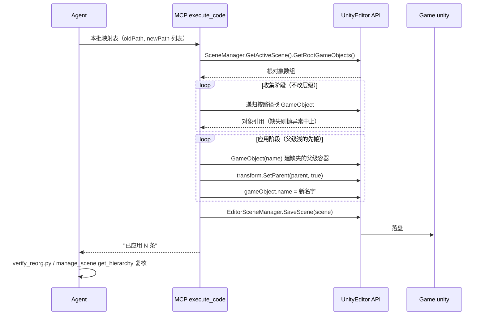

# Game 场景层级重构 实现计划

> **面向 AI 代理的工作者：** 必需子技能：使用 superpowers:subagent-driven-development（推荐）或 superpowers:executing-plans 逐任务实现此计划。步骤使用复选框（`- [ ]`）语法来跟踪进度。

**目标：** 把 `Assets/Scenes/Game.unity` 的 138 个节点按「空间 → 类别 → 名字」重排成 7 个根级主题层 + `关卡` 下四个房间，全程不动脚本、组件、几何与材质。

**架构：** 纯结构变换。四批 `execute_code` 调用，每批自带「旧路径 → 新路径」映射表；脚本先按旧路径把对象引用全部取到手，再统一换父级与改名（避免父级改名后子级路径失效），每批结束保存场景。校验由一个独立 Python 脚本对照 138 条期望全路径完成，重名/悬空引用/组件丢失都在这一步暴露。

**技术栈：** Unity 2022.3.62f3c1、Unity MCP（`execute_code` / `manage_scene` / `read_console` / `manage_editor`）、Python 3（仅用标准库解析场景 YAML）。

**设计依据：** `docs/superpowers/specs/2026-11-16-game-scene-hierarchy-design.md`

---

## 执行环境与偏差说明

1. **没有测试框架**：本项目无 CI、无 PlayMode 测试工程。本计划把「校验脚本对照 138 条期望路径」当作红灯/绿灯：重构前跑必然失败（当前是 123 个英文名节点），重构后跑必须通过。
2. **禁止 git 写操作**：项目 `AGENTS.md` 与用户全局约定只允许查询类 git 操作，因此**没有 `git commit` 步骤**。本计划的提交点 = 「保存场景 + 校验通过」，回滚点 = `Temp/reorg/Game.unity.before-reorg`。
3. **场景只经 MCP 修改**：不手写 YAML。所有层级改动都在 Unity 编辑器内通过 `execute_code` 执行。
4. **前置条件**：Unity 编辑器已打开 `Game.unity`，MCP 已连接（`get_server_info` 返回 ok），编辑器保持前台（`runInBackground: 0`，失焦会暂停 Play）。

## 文件结构

| 文件 | 责任 |
| --- | --- |
| `Temp/reorg/Game.unity.before-reorg`（创建） | 重构前场景备份，唯一回滚源 |
| `Temp/reorg/baseline.json`（创建） | 重构前的物体/Transform/MonoBehaviour 计数基线 |
| `Temp/reorg/verify_reorg.py`（创建） | 唯一的验收判定：138 条期望全路径 + 计数 + 悬空引用 |
| `Assets/Scenes/Game.unity`（修改，仅经 MCP） | 被重构的场景本体 |
| `AGENTS.md`（修改） | 同步失效的节点路径（第 27、30、31 行） |
| `docs/superpowers/specs/2026-11-16-game-scene-hierarchy-design.md`（修改） | 补「状态：已实施」与实测计数 |

## 分批依赖

```mermaid
graph TD
  T1[任务1 备份+基线] --> T2[任务2 校验脚本 红灯]
  T2 --> T3[任务3 批1 根级功能层 25 条]
  T3 --> T4[任务4 批2 房间容器 5 条]
  T4 --> T5[任务5 批3 组内分组+改名 76 条]
  T5 --> T6[任务6 批4 锚点15条+状态2条+删4容器]
  T6 --> T7[任务7 全量校验 绿灯]
  T7 --> T8[任务8 Play 冒烟]
  T8 --> T9[任务9 文档同步]

  T3 -.批1只动根级.,-> T3
  T4 -.批2后房间节点就位.,-> T5
  T5 -.批3后旧容器已空.,-> T6
```

## 数据流


## 调用链



---

### 任务 1：备份场景并抓计数基线

**文件：**
- 创建：`Temp/reorg/Game.unity.before-reorg`
- 创建：`Temp/reorg/baseline.json`
- 创建：`Temp/reorg/baseline.py`

- [ ] **步骤 1：建工作目录并备份场景**

```powershell
New-Item -ItemType Directory -Force "D:\Projects\UnityProjects\MakeYourChoice\Temp\reorg" | Out-Null
Copy-Item "D:\Projects\UnityProjects\MakeYourChoice\Assets\Scenes\Game.unity" "D:\Projects\UnityProjects\MakeYourChoice\Temp\reorg\Game.unity.before-reorg" -Force
Get-Item "D:\Projects\UnityProjects\MakeYourChoice\Temp\reorg\Game.unity.before-reorg" | Select-Object Length
```

预期：`Length` 与 343501 相近（编辑器若已另存过，以实际值为准，但必须非 0）。

- [ ] **步骤 2：写基线统计脚本**

`Temp/reorg/baseline.py`：

```python
"""统计场景中的 GameObject / Transform / MonoBehaviour 文档数，作为"组件没丢"的基线。"""
import json
import re
import sys

scene_path, out_path = sys.argv[1], sys.argv[2]
text = open(scene_path, encoding='utf-8').read()

docs = re.split(r'^--- !u!(\d+) &(\d+).*$', text, flags=re.M)
classes = [int(docs[i]) for i in range(1, len(docs), 3)]

data = {
    "gameobjects": classes.count(1),
    "transforms": classes.count(4) + classes.count(224),
    "monobehaviours": classes.count(114),
}
json.dump(data, open(out_path, 'w', encoding='utf-8'), ensure_ascii=False, indent=2)
print(json.dumps(data, ensure_ascii=False))
```

- [ ] **步骤 3：生成基线**

```powershell
python "D:\Projects\UnityProjects\MakeYourChoice\Temp\reorg\baseline.py" "D:\Projects\UnityProjects\MakeYourChoice\Assets\Scenes\Game.unity" "D:\Projects\UnityProjects\MakeYourChoice\Temp\reorg\baseline.json"
```

预期输出（JSON）：`{"gameobjects": 123, "transforms": 123, "monobehaviours": <后四位数字，非 0>}`。

若 `gameobjects` 不是 123，说明场景已被改动过——停下来核对，不要继续。

- [ ] **步骤 4：确认基线文件**

```powershell
Get-Content "D:\Projects\UnityProjects\MakeYourChoice\Temp\reorg\baseline.json"
```

预期：三个键齐全、`monobehaviours` > 0。

> 本计划无 git commit 步骤（项目约定禁止 git 写操作）。本任务的完成标志是备份文件与 `baseline.json` 存在。

---

### 任务 2：写校验脚本并确认红灯

**文件：**
- 创建：`Temp/reorg/verify_reorg.py`

- [ ] **步骤 1：写校验脚本（含 138 条期望路径）**

`Temp/reorg/verify_reorg.py`：

```python
"""校验 Game.unity 是否已重构成目标层级：全路径集合、计数、悬空引用。"""
import json
import re
import sys

EXPECTED = """
游戏入口
玩家
玩家/眼睛
玩家/眼睛/玩家相机
玩家/眼睛/玩家相机/cm
玩家/输入
相机
相机/主相机
相机/显示相机
界面
界面/准心提示
界面/准心提示/准心
界面/准心提示/交互键
界面/低分辨率画面
界面/低分辨率画面/遮罩
界面/低分辨率画面/画面
界面/事件系统
对话
对话/对话系统
对话/对话画面
对话/对话画面/对话框
对话/对话画面/对话框/正文
对话/对话画面/对话框/说话人
对话/对话画面/对话框/说话人/说话人名字
对话/飘字相机
对话/飘字画面
对话/飘字画面/飘字图
对话/飘字实例
背景音乐
关卡
关卡/电梯
关卡/电梯/建筑
关卡/电梯/建筑/地板
关卡/电梯/建筑/天花板
关卡/电梯/建筑/南墙
关卡/电梯/建筑/东墙
关卡/电梯/建筑/西墙
关卡/电梯/电梯门
关卡/电梯/电梯门/左门扇
关卡/电梯/电梯门/左门扇/门板
关卡/电梯/电梯门/左门扇/字_你
关卡/电梯/电梯门/右门扇
关卡/电梯/电梯门/右门扇/门板
关卡/电梯/电梯门/右门扇/字_好
关卡/电梯/招牌
关卡/电梯/招牌/红字_别开
关卡/电梯/招牌/退路箭头
关卡/电梯/触发
关卡/电梯/触发/开场
关卡/电梯/触发/看红字
关卡/电梯/触发/电梯倒计时
关卡/电梯/黄箱子
关卡/电梯/楼层牌
关卡/电梯/楼层牌/面板框架
关卡/电梯/楼层牌/面板屏幕
关卡/电梯/楼层牌/楼号
关卡/电梯/楼层牌/下一楼号
关卡/电梯/楼层牌/箭头1
关卡/电梯/楼层牌/箭头2
关卡/电梯/剧情锚点
关卡/电梯/剧情锚点/开场_台词点
关卡/电梯/剧情锚点/看红字_台词点
关卡/电梯/剧情锚点/倒计时_台词点
关卡/大厅
关卡/大厅/建筑
关卡/大厅/建筑/地板
关卡/大厅/建筑/天花板
关卡/大厅/建筑/东墙
关卡/大厅/建筑/西墙
关卡/大厅/建筑/南墙_左
关卡/大厅/建筑/南墙_右
关卡/大厅/建筑/南墙_门楣
关卡/大厅/建筑/北墙_左
关卡/大厅/建筑/北墙_中
关卡/大厅/建筑/北墙_右
关卡/大厅/建筑/北墙_门楣_左
关卡/大厅/建筑/北墙_门楣_右
关卡/大厅/建筑/中间墙
关卡/大厅/门
关卡/大厅/门/红门
关卡/大厅/门/红门/铰链
关卡/大厅/门/红门/门板
关卡/大厅/门/蓝门
关卡/大厅/门/蓝门/铰链
关卡/大厅/门/蓝门/门板
关卡/大厅/门/安全门
关卡/大厅/门/安全门/门板
关卡/大厅/招牌
关卡/大厅/招牌/禁止入内
关卡/大厅/招牌/地面箭头
关卡/大厅/招牌/左箭头
关卡/大厅/招牌/右箭头
关卡/大厅/招牌/红字_前方未开放
关卡/大厅/招牌/红字_前方未开放/文字
关卡/大厅/触发
关卡/大厅/触发/门前听风
关卡/大厅/触发/缝隙西侧
关卡/大厅/触发/缝隙东侧
关卡/大厅/剧情锚点
关卡/大厅/剧情锚点/电梯门_台词点
关卡/大厅/剧情锚点/听风_台词点
关卡/大厅/剧情锚点/缝隙东_台词点
关卡/大厅/剧情锚点/缝隙西_台词点
关卡/大厅/剧情锚点/左箭头_台词点
关卡/大厅/剧情锚点/右箭头_台词点
关卡/大厅/剧情锚点/安全门_台词点
关卡/储藏室
关卡/储藏室/建筑
关卡/储藏室/建筑/地板
关卡/储藏室/建筑/天花板
关卡/储藏室/建筑/北墙
关卡/储藏室/建筑/西墙
关卡/储藏室/建筑/隔墙
关卡/储藏室/道具
关卡/储藏室/道具/柜子B
关卡/储藏室/道具/空柜子
关卡/储藏室/进入储藏室
关卡/储藏室/剧情锚点
关卡/储藏室/剧情锚点/进储藏室_台词点
关卡/储藏室/剧情锚点/柜子B_台词点
关卡/打印室
关卡/打印室/建筑
关卡/打印室/建筑/地板
关卡/打印室/建筑/天花板
关卡/打印室/建筑/北墙
关卡/打印室/建筑/东墙
关卡/打印室/道具
关卡/打印室/道具/复印机
关卡/打印室/道具/复印机/紫光
关卡/打印室/道具/柜子A
关卡/打印室/进入打印室
关卡/打印室/剧情锚点
关卡/打印室/剧情锚点/进打印室_台词点
关卡/打印室/剧情锚点/柜子A_台词点
关卡/打印室/剧情锚点/复印机_台词点
关卡/剧情状态
关卡/剧情状态/电梯大厅
关卡/剧情状态/储藏室打印室
""".split()

DELETED = [
    "Level/Level1/Triggers",
    "Level/Level2/Geometry",
    "Level/Level2/Props",
    "Level/Level2/Triggers",
    "Level",
    "Level/Level1",
    "Level/Level2",
]

scene_path, baseline_path = sys.argv[1], sys.argv[2]
text = open(scene_path, encoding='utf-8').read()
baseline = json.load(open(baseline_path, encoding='utf-8'))

docs = re.split(r'^--- !u!(\d+) &(\d+).*$', text, flags=re.M)
objs = {}
for i in range(1, len(docs), 3):
    objs[docs[i + 1]] = (int(docs[i]), docs[i + 2])

def decode_name(raw):
    # Unity 把非 ASCII 的 m_Name 序列化成 "\u4E2D\u6587" 形式，这里还原成明文
    raw = raw.strip()
    if len(raw) >= 2 and raw.startswith('"') and raw.endswith('"'):
        try:
            return json.loads(raw)
        except ValueError:
            return raw
    return raw


go_name, go_comps, tr_of_go, tr_father = {}, {}, {}, {}
for fid, (cls, body) in objs.items():
    if cls == 1:
        m = re.search(r'^  m_Name: (.*)$', body, re.M)
        go_name[fid] = decode_name(m.group(1)) if m else ''
        go_comps[fid] = re.findall(r'component: \{fileID: (\d+)\}', body)
    elif cls in (4, 224):
        m = re.search(r'm_GameObject: \{fileID: (\d+)\}', body)
        f = re.search(r'm_Father: \{fileID: (-?\d+)\}', body)
        if m:
            tr_of_go[m.group(1)] = fid
            tr_father[fid] = f.group(1) if f else '0'

tr_to_go = {t: g for g, t in tr_of_go.items()}
children, roots = {}, []
for go, tr in tr_of_go.items():
    father = tr_father.get(tr, '0')
    parent = tr_to_go.get(father) if father not in ('0', '-1') else None
    if parent is None:
        roots.append(go)
    else:
        children.setdefault(parent, []).append(go)

actual = set()


def walk(go, prefix):
    path = f"{prefix}/{go_name.get(go, '?')}" if prefix else go_name.get(go, '?')
    actual.add(path)
    for ch in children.get(go, []):
        walk(ch, path)


for r in roots:
    walk(r, '')

exp = set(EXPECTED)
missing = sorted(exp - actual)
extra = sorted(actual - exp)

print(f"物体数: {len(actual)}  期望: {len(exp)}")
if missing:
    print(f"缺少 {len(missing)} 条:")
    for p in missing[:20]:
        print("  - " + p)
if extra:
    print(f"多出 {len(extra)} 条:")
    for p in extra[:20]:
        print("  + " + p)

leftover = [p for p in DELETED if p in actual]
if leftover:
    print("旧路径仍在: " + ", ".join(leftover))

counts = {
    "gameobjects": sum(1 for c, _ in objs.values() if c == 1),
    "transforms": sum(1 for c, _ in objs.values() if c in (4, 224)),
    "monobehaviours": sum(1 for c, _ in objs.values() if c == 114),
}
for key in ("gameobjects", "transforms", "monobehaviours"):
    if key == "monobehaviours" and counts[key] != baseline[key]:
        print(f"组件数变了: {key} {baseline[key]} -> {counts[key]}")

anchors = set(objs)
dangling = []
for m in re.finditer(r'\{fileID: (-?\d+)(?:, guid: [0-9a-f]+)?\}', text):
    if ', guid:' in m.group(0):
        continue
    ref = m.group(1)
    if ref != '0' and ref not in anchors:
        dangling.append(ref)
if dangling:
    print(f"悬空引用 {len(dangling)} 个: {dangling[:10]}")

ok = (not missing and not extra and not leftover
      and counts["monobehaviours"] == baseline["monobehaviours"]
      and not dangling)
print("RESULT:", "PASS" if ok else "FAIL")
sys.exit(0 if ok else 1)
```

- [ ] **步骤 2：跑一次，确认红灯**

```powershell
python "D:\Projects\UnityProjects\MakeYourChoice\Temp\reorg\verify_reorg.py" "D:\Projects\UnityProjects\MakeYourChoice\Assets\Scenes\Game.unity" "D:\Projects\UnityProjects\MakeYourChoice\Temp\reorg\baseline.json"
```

预期：`FAIL`，打印「缺少 138 条」与「多出 123 条」（当前是 `Level/Level1/...` 这类旧路径）。`exit code: 1`。

这一步是红灯：证明校验脚本真的在检查目标层级，而不是恒真。

---

### 任务 3：批 1 —— 根级功能层（25 条）

**文件：**
- 修改：`Assets/Scenes/Game.unity`（经 MCP `execute_code`）

- [ ] **步骤 1：执行批 1**

用 MCP `execute_code`（`channel: "editor"`）执行：

```csharp
var map = new (string oldPath, string newPath)[] {
    ("GameBootstrap", "游戏入口"),
    ("Player", "玩家"),
    ("Player/Eye", "玩家/眼睛"),
    ("Player/Eye/PlayerVCam", "玩家/眼睛/玩家相机"),
    ("Input", "玩家/输入"),
    ("Main Camera", "相机/主相机"),
    ("DisplayCamera", "相机/显示相机"),
    ("HUD", "界面/准心提示"),
    ("HUD/Crosshair", "界面/准心提示/准心"),
    ("HUD/InteractKeyIcon", "界面/准心提示/交互键"),
    ("LowResCanvas", "界面/低分辨率画面"),
    ("LowResCanvas/Background", "界面/低分辨率画面/遮罩"),
    ("LowResCanvas/LowResImage", "界面/低分辨率画面/画面"),
    ("EventSystem", "界面/事件系统"),
    ("DialogueSystem", "对话/对话系统"),
    ("DialogueCanvas", "对话/对话画面"),
    ("DialogueCanvas/DialogueBox", "对话/对话画面/对话框"),
    ("DialogueCanvas/DialogueBox/BodyText", "对话/对话画面/对话框/正文"),
    ("DialogueCanvas/DialogueBox/SpeakerRoot", "对话/对话画面/对话框/说话人"),
    ("DialogueCanvas/DialogueBox/SpeakerRoot/SpeakerText", "对话/对话画面/对话框/说话人/说话人名字"),
    ("Dialogue3DCamera", "对话/飘字相机"),
    ("Dialogue3DCanvas", "对话/飘字画面"),
    ("Dialogue3DCanvas/Dialogue3DImage", "对话/飘字画面/飘字图"),
    ("WorldLines", "对话/飘字实例"),
    ("Bgm", "背景音乐"),
};
```

本批共 25 条。`Player/Eye/PlayerVCam/cm` 不改名也不用搬（跟着 `玩家相机` 走），`关卡` 归任务 4，`ElevatorFloorDisplay` 那 7 条要等 `关卡/电梯` 出现后才有落点，归任务 5。

用下面这段宿主代码执行（后续每个批次都用同一段，只换 `map` 数组）：

```csharp
var registry = new System.Collections.Generic.Dictionary<string, GameObject>();

GameObject Descend(GameObject cur, string[] parts, int i) {
    if (i >= parts.Length) return cur;
    foreach (Transform ch in cur.transform)
        if (ch.name == parts[i]) {
            var r = Descend(ch.gameObject, parts, i + 1);
            if (r != null) return r;
        }
    return null;
}

GameObject FindPath(string path) {
    var parts = path.Split('/');
    foreach (var root in UnityEngine.SceneManagement.SceneManager.GetActiveScene().GetRootGameObjects())
        if (root.name == parts[0]) return Descend(root, parts, 1);
    return null;
}

int Depth(string p) {
    var n = 0;
    foreach (var c in p) if (c == '/') n++;
    return n;
}

// 1) 收集阶段：先按旧路径把对象全部取到手，此步不改层级
var todo = new System.Collections.Generic.List<(GameObject go, string newPath)>();
var moving = new System.Collections.Generic.HashSet<GameObject>();   // 本批会改名/搬家的物体
var seen = new System.Collections.Generic.HashSet<GameObject>();
foreach (var e in map) {
    var go = FindPath(e.oldPath);
    if (go == null) throw new System.Exception("找不到旧物体: " + e.oldPath);
    if (registry.ContainsKey(e.newPath)) throw new System.Exception("映射表新路径重复: " + e.newPath);
    if (!seen.Add(go)) throw new System.Exception("同一物体被映射两次: " + e.oldPath);
    registry[e.newPath] = go;
    moving.Add(go);
    todo.Add((go, e.newPath));
}

// 2) 父级按需创建：先查 registry——本批所有新路径在收集阶段已登记，
//    所以"本批会改名但还没轮到"的父级能直接拿到引用，不会重复建同名节点
GameObject Ensure(string path) {
    if (string.IsNullOrEmpty(path)) return null;   // 根级目标没有父级，返回 null 而不是 Substring(0,-1)
    if (registry.TryGetValue(path, out var known)) return known;
    var found = FindPath(path);
    // 跳过本批即将搬走的同名物体，否则子物体会被挂到它身上一起跑掉
    if (found != null && !moving.Contains(found)) { registry[path] = found; return found; }
    var i = path.LastIndexOf('/');
    var parent = Ensure(i < 0 ? "" : path.Substring(0, i));
    var made = new GameObject(i < 0 ? path : path.Substring(i + 1));
    made.transform.SetParent(parent == null ? null : parent.transform, false);
    registry[path] = made;
    return made;
}

// 3) 应用阶段：父级浅的先搬（深度升序只为让顺序可预测；防重名靠上面的 registry 预填）
todo.Sort((a, b) => Depth(a.newPath).CompareTo(Depth(b.newPath)));
var applied = 0;
foreach (var t in todo) {
    var i = t.newPath.LastIndexOf('/');
    var parentPath = i < 0 ? "" : t.newPath.Substring(0, i);
    var newName = i < 0 ? t.newPath : t.newPath.Substring(i + 1);
    var parent = Ensure(parentPath);
    var parentTr = parent == null ? null : parent.transform;   // 根级：挂到场景根
    if (t.go.transform.parent != parentTr)
        t.go.transform.SetParent(parentTr, true);
    t.go.name = newName;
    applied++;
}
UnityEditor.SceneManagement.EditorSceneManager.SaveScene(
    UnityEngine.SceneManagement.SceneManager.GetActiveScene());
return "已应用 " + applied + " 条";
```

预期返回：`"已应用 25 条"`。

- [ ] **步骤 2：核对批 1 结果**

用 MCP `manage_scene`（`action: "get_hierarchy"`, `max_depth: 1`）取根级列表。

预期根对象 7 个：`游戏入口`、`玩家`、`相机`、`界面`、`对话`、`背景音乐`、`Level`。

- [ ] **步骤 3：确认没断引用**

```powershell
python "D:\Projects\UnityProjects\MakeYourChoice\Temp\reorg\verify_reorg.py" "D:\Projects\UnityProjects\MakeYourChoice\Assets\Scenes\Game.unity" "D:\Projects\UnityProjects\MakeYourChoice\Temp\reorg\baseline.json"
```

预期：仍 `FAIL`（层级未完成），但**不得**出现「悬空引用」或「组件数变了」。若出现，立刻用备份回滚（见任务 6 步骤 4）。

---

### 任务 4：批 2 —— 房间容器（5 条）

**文件：**
- 修改：`Assets/Scenes/Game.unity`（经 MCP `execute_code`）

- [ ] **步骤 1：执行批 2**

`map` 换成：

```csharp
var map = new (string oldPath, string newPath)[] {
    ("Level", "关卡"),
    ("Level/Level1/Elevator", "关卡/电梯"),
    ("Level/Level1/Room", "关卡/大厅"),
    ("Level/Level2/Geometry/Storage", "关卡/储藏室"),
    ("Level/Level2/Geometry/Print", "关卡/打印室"),
};
```

宿主代码与任务 3 步骤 1 完全相同（`registry`/`Descend`/`FindPath`/`Depth`/`Ensure` 那段）。

预期返回：`"已应用 5 条"`。

- [ ] **步骤 2：核对**

用 MCP `manage_scene`（`action: "get_hierarchy"`, `target: "关卡"`, `max_depth: 1`）。

预期 `关卡` 下：`电梯`、`大厅`、`储藏室`、`打印室`、`Level1`、`Level2`（后两个在批 4 处理）。

- [ ] **步骤 3：跑校验**

```powershell
python "D:\Projects\UnityProjects\MakeYourChoice\Temp\reorg\verify_reorg.py" "D:\Projects\UnityProjects\MakeYourChoice\Assets\Scenes\Game.unity" "D:\Projects\UnityProjects\MakeYourChoice\Temp\reorg\baseline.json"
```

预期：`FAIL`，无悬空引用、无组件数变化。

---

### 任务 5：批 3 —— 组内分组与改名（71 条）

**文件：**
- 修改：`Assets/Scenes/Game.unity`（经 MCP `execute_code`）

- [ ] **步骤 1：执行批 3**

`map` 换成下面整张表（旧的 `Level1/Triggers` 与 `Level2/*` 路径在本批仍然有效，因为它们的父容器要到批 4 才改名/搬家）：

```csharp
var map = new (string oldPath, string newPath)[] {
    // 电梯 / 建筑
    ("关卡/电梯/Floor", "关卡/电梯/建筑/地板"),
    ("关卡/电梯/Ceiling", "关卡/电梯/建筑/天花板"),
    ("关卡/电梯/Wall_South", "关卡/电梯/建筑/南墙"),
    ("关卡/电梯/Wall_East", "关卡/电梯/建筑/东墙"),
    ("关卡/电梯/Wall_West", "关卡/电梯/建筑/西墙"),
    // 电梯 / 电梯门
    ("关卡/电梯/Door_Elevator", "关卡/电梯/电梯门"),
    ("关卡/电梯/Door_Elevator/Leaf_Left", "关卡/电梯/电梯门/左门扇"),
    ("关卡/电梯/Door_Elevator/Leaf_Left/Slab_Left", "关卡/电梯/电梯门/左门扇/门板"),
    ("关卡/电梯/Door_Elevator/Leaf_Left/Sign_Hello_Left", "关卡/电梯/电梯门/左门扇/字_你"),
    ("关卡/电梯/Door_Elevator/Leaf_Right", "关卡/电梯/电梯门/右门扇"),
    ("关卡/电梯/Door_Elevator/Leaf_Right/Slab_Right", "关卡/电梯/电梯门/右门扇/门板"),
    ("关卡/电梯/Door_Elevator/Leaf_Right/Sign_Hello_Right", "关卡/电梯/电梯门/右门扇/字_好"),
    // 电梯 / 招牌、触发、黄箱子
    ("关卡/电梯/Sign_DontOpen", "关卡/电梯/招牌/红字_别开"),
    ("关卡/电梯/Sign_Arrow_Back", "关卡/电梯/招牌/退路箭头"),
    ("关卡/Level1/Triggers/Trigger_A_Start", "关卡/电梯/触发/开场"),
    ("关卡/Level1/Triggers/Trigger_RedText", "关卡/电梯/触发/看红字"),
    ("关卡/Level1/Triggers/Trigger_ElevatorCountdown", "关卡/电梯/触发/电梯倒计时"),
    ("关卡/电梯/Box_Yellow", "关卡/电梯/黄箱子"),
    // 电梯 / 楼层牌
    ("ElevatorFloorDisplay", "关卡/电梯/楼层牌"),
    ("ElevatorFloorDisplay/Panel_Frame", "关卡/电梯/楼层牌/面板框架"),
    ("ElevatorFloorDisplay/Panel_Screen", "关卡/电梯/楼层牌/面板屏幕"),
    ("ElevatorFloorDisplay/TMP_Floor", "关卡/电梯/楼层牌/楼号"),
    ("ElevatorFloorDisplay/TMP_Floor_Next", "关卡/电梯/楼层牌/下一楼号"),
    ("ElevatorFloorDisplay/TMP_Arrow_1", "关卡/电梯/楼层牌/箭头1"),
    ("ElevatorFloorDisplay/TMP_Arrow_2", "关卡/电梯/楼层牌/箭头2"),
    // 大厅 / 建筑
    ("关卡/大厅/Floor", "关卡/大厅/建筑/地板"),
    ("关卡/大厅/Ceiling", "关卡/大厅/建筑/天花板"),
    ("关卡/大厅/Wall_East", "关卡/大厅/建筑/东墙"),
    ("关卡/大厅/Wall_West", "关卡/大厅/建筑/西墙"),
    ("关卡/大厅/Wall_South_Left", "关卡/大厅/建筑/南墙_左"),
    ("关卡/大厅/Wall_South_Right", "关卡/大厅/建筑/南墙_右"),
    ("关卡/大厅/Wall_South_Lintel", "关卡/大厅/建筑/南墙_门楣"),
    ("关卡/大厅/Wall_North_Left", "关卡/大厅/建筑/北墙_左"),
    ("关卡/大厅/Wall_North_Mid", "关卡/大厅/建筑/北墙_中"),
    ("关卡/大厅/Wall_North_Right", "关卡/大厅/建筑/北墙_右"),
    ("关卡/大厅/Wall_North_Lintel_Left", "关卡/大厅/建筑/北墙_门楣_左"),
    ("关卡/大厅/Wall_North_Lintel_Right", "关卡/大厅/建筑/北墙_门楣_右"),
    ("关卡/大厅/Wall_Mid", "关卡/大厅/建筑/中间墙"),
    // 大厅 / 门
    ("关卡/大厅/Door_North_Red", "关卡/大厅/门/红门"),
    ("关卡/大厅/Door_North_Red/Hinge", "关卡/大厅/门/红门/铰链"),
    ("关卡/大厅/Door_North_Red/Hinge/Slab", "关卡/大厅/门/红门/门板"),
    ("关卡/大厅/Door_North_Blue", "关卡/大厅/门/蓝门"),
    ("关卡/大厅/Door_North_Blue/Hinge", "关卡/大厅/门/蓝门/铰链"),
    ("关卡/大厅/Door_North_Blue/Hinge/Slab", "关卡/大厅/门/蓝门/门板"),
    ("关卡/大厅/Door_Mid_Safe", "关卡/大厅/门/安全门"),
    ("关卡/大厅/Door_Mid_Safe/Slab", "关卡/大厅/门/安全门/门板"),
    // 大厅 / 招牌
    ("关卡/大厅/Sign_NoEntry", "关卡/大厅/招牌/禁止入内"),
    ("关卡/大厅/Sign_FloorArrow", "关卡/大厅/招牌/地面箭头"),
    ("关卡/大厅/Sign_Arrow_Left", "关卡/大厅/招牌/左箭头"),
    ("关卡/大厅/Sign_Arrow_Right", "关卡/大厅/招牌/右箭头"),
    ("关卡/大厅/Canvas", "关卡/大厅/招牌/红字_前方未开放"),
    ("关卡/大厅/Canvas/TMP", "关卡/大厅/招牌/红字_前方未开放/文字"),
    // 大厅 / 触发
    ("关卡/Level1/Triggers/Trigger_DoorListen", "关卡/大厅/触发/门前听风"),
    ("关卡/Level1/Triggers/Trigger_B_West", "关卡/大厅/触发/缝隙西侧"),
    ("关卡/Level1/Triggers/Trigger_B_East", "关卡/大厅/触发/缝隙东侧"),
    // 储藏室
    ("关卡/储藏室/Floor", "关卡/储藏室/建筑/地板"),
    ("关卡/储藏室/Ceiling", "关卡/储藏室/建筑/天花板"),
    ("关卡/储藏室/Wall_North", "关卡/储藏室/建筑/北墙"),
    ("关卡/储藏室/Wall_West", "关卡/储藏室/建筑/西墙"),
    ("关卡/Level2/Geometry/Wall_Divider", "关卡/储藏室/建筑/隔墙"),
    ("关卡/Level2/Props/Prop_CabinetB", "关卡/储藏室/道具/柜子B"),
    ("关卡/Level2/Props/Prop_Cabinet", "关卡/储藏室/道具/空柜子"),
    ("关卡/Level2/Triggers/Trigger_Storage", "关卡/储藏室/进入储藏室"),
    // 打印室
    ("关卡/打印室/Floor", "关卡/打印室/建筑/地板"),
    ("关卡/打印室/Ceiling", "关卡/打印室/建筑/天花板"),
    ("关卡/打印室/Wall_North", "关卡/打印室/建筑/北墙"),
    ("关卡/打印室/Wall_East", "关卡/打印室/建筑/东墙"),
    ("关卡/Level2/Props/Prop_Copier", "关卡/打印室/道具/复印机"),
    ("关卡/Level2/Props/Prop_Copier/Glow_Print", "关卡/打印室/道具/复印机/紫光"),
    ("关卡/Level2/Props/Prop_CabinetA", "关卡/打印室/道具/柜子A"),
    ("关卡/Level2/Triggers/Trigger_PrintRoom", "关卡/打印室/进入打印室"),
};
```

宿主代码与任务 3 步骤 1 相同。

预期返回：`"已应用 71 条"`。

- [ ] **步骤 2：核对四个房间的一层**

用 MCP `manage_scene`（`action: "get_hierarchy"`, `target: "关卡"`, `max_depth: 2`）。

预期：`电梯` 下为 `建筑`/`电梯门`/`招牌`/`触发`/`黄箱子`/`楼层牌`；`大厅` 下为 `建筑`/`门`/`招牌`/`触发`；`储藏室` 下为 `建筑`/`道具`/`进入储藏室`；`打印室` 下为 `建筑`/`道具`/`进入打印室`。

- [ ] **步骤 3：跑校验**

```powershell
python "D:\Projects\UnityProjects\MakeYourChoice\Temp\reorg\verify_reorg.py" "D:\Projects\UnityProjects\MakeYourChoice\Assets\Scenes\Game.unity" "D:\Projects\UnityProjects\MakeYourChoice\Temp\reorg\baseline.json"
```

预期：仍 `FAIL`（缺 15 个锚点与 `剧情状态`），但「多出」清单里不应再出现 `关卡/电梯/Floor` 这类旧名（`电梯门`/`楼层牌` 除外——它们本身是实体名）。无悬空引用、无组件数变化。

---

### 任务 6：批 4 —— 剧情锚点 15 条 + 剧情状态 + 删除 4 个空容器

**文件：**
- 修改：`Assets/Scenes/Game.unity`（经 MCP `execute_code`）

- [ ] **步骤 1：执行批 4**

```csharp
var map = new (string oldPath, string newPath)[] {
    // 电梯三锚点
    ("关卡/电梯/触发/开场/StoryAnchor", "关卡/电梯/剧情锚点/开场_台词点"),
    ("关卡/电梯/触发/看红字/StoryAnchor", "关卡/电梯/剧情锚点/看红字_台词点"),
    ("关卡/电梯/触发/电梯倒计时/StoryAnchor", "关卡/电梯/剧情锚点/倒计时_台词点"),
    // 大厅七锚点
    ("关卡/电梯/电梯门/StoryAnchor", "关卡/大厅/剧情锚点/电梯门_台词点"),
    ("关卡/大厅/触发/门前听风/StoryAnchor", "关卡/大厅/剧情锚点/听风_台词点"),
    ("关卡/大厅/触发/缝隙西侧/StoryAnchor", "关卡/大厅/剧情锚点/缝隙西_台词点"),
    ("关卡/大厅/触发/缝隙东侧/StoryAnchor", "关卡/大厅/剧情锚点/缝隙东_台词点"),
    ("关卡/大厅/招牌/左箭头/StoryAnchor", "关卡/大厅/剧情锚点/左箭头_台词点"),
    ("关卡/大厅/招牌/右箭头/StoryAnchor", "关卡/大厅/剧情锚点/右箭头_台词点"),
    ("关卡/大厅/StoryAnchor_SafeDoor", "关卡/大厅/剧情锚点/安全门_台词点"),
    // 储藏室两锚点
    ("关卡/储藏室/进入储藏室/StoryAnchor", "关卡/储藏室/剧情锚点/进储藏室_台词点"),
    ("关卡/Level2/Props/StoryAnchor_CabinetB", "关卡/储藏室/剧情锚点/柜子B_台词点"),
    // 打印室三锚点
    ("关卡/打印室/进入打印室/StoryAnchor", "关卡/打印室/剧情锚点/进打印室_台词点"),
    ("关卡/Level2/Props/StoryAnchor_CabinetA", "关卡/打印室/剧情锚点/柜子A_台词点"),
    ("关卡/Level2/Props/StoryAnchor_Copier", "关卡/打印室/剧情锚点/复印机_台词点"),
    // 剧情状态（组件宿主，不能换物体，只能改名+搬家）
    ("关卡/Level1", "关卡/剧情状态/电梯大厅"),
    ("关卡/Level2", "关卡/剧情状态/储藏室打印室"),
    // 复印机所在的办公桌：根级 FBX prefab 实例（PrefabInstance，不拆本体）
    ("metal_office_desk_1k", "关卡/打印室/道具/办公桌"),
};

var toDelete = new[] {
    "关卡/Level1/Triggers",
    "关卡/Level2/Geometry",
    "关卡/Level2/Props",
    "关卡/Level2/Triggers",
};
```

宿主代码与任务 3 相同，另在**收集阶段之前**加：先把 4 个待删容器取到手（因为搬家后旧路径失效）：

```csharp
var doomed = new System.Collections.Generic.List<GameObject>();
foreach (var p in toDelete) {
    var go = FindPath(p);
    if (go == null) throw new System.Exception("找不到待删容器: " + p);
    doomed.Add(go);
}
```

并在**应用阶段之后**、`SaveScene` 之前加：

```csharp
foreach (var go in doomed) {
    if (go == null) continue;
    if (go.transform.childCount > 0)
        throw new System.Exception("容器非空，拒绝删除: " + go.name);
    UnityEngine.Object.DestroyImmediate(go);
}
applied += doomed.Count;
```

预期返回：`"已应用 18 条"`（15 个剧情锚点 + 2 个剧情状态宿主 + 1 张办公桌）。删除 4 个空容器不计入返回值，删完另跑校验确认物体数降到 138。

- [ ] **步骤 2：核对 `关卡` 一层树**

用 MCP `manage_scene`（`action: "get_hierarchy"`, `target: "关卡"`, `max_depth: 1`）。

预期 5 个子节点：`电梯`、`大厅`、`储藏室`、`打印室`、`剧情状态`。不得再有 `Level1`/`Level2`。

- [ ] **步骤 3：全量校验（绿灯）**

```powershell
python "D:\Projects\UnityProjects\MakeYourChoice\Temp\reorg\verify_reorg.py" "D:\Projects\UnityProjects\MakeYourChoice\Assets\Scenes\Game.unity" "D:\Projects\UnityProjects\MakeYourChoice\Temp\reorg\baseline.json"
```

预期：

```
物体数: 138  期望: 138
RESULT: PASS
```

`exit code: 0`。

- [ ] **步骤 4：失败时的回滚（仅在需要时执行）**

在 Unity 里 `File > New Scene`（不保存当前场景）→ 用备份覆盖 → 重新打开 `Game.unity`：

```powershell
Copy-Item "D:\Projects\UnityProjects\MakeYourChoice\Temp\reorg\Game.unity.before-reorg" "D:\Projects\UnityProjects\MakeYourChoice\Assets\Scenes\Game.unity" -Force
```

然后重新打开场景，确认 123 个物体、旧层级回来，再从出错的那一批重跑。

---

### 任务 7：抽查与「骨架可见」验收

**文件：** 无改动（只读核对）

- [ ] **步骤 1：抽 5 个物体打印全路径**

用 MCP `manage_scene`（`action: "get_hierarchy"`, `target: "关卡", max_depth: -1`）导出后，确认下面 5 条存在且唯一：

| 抽查物体 | 期望全路径 |
| --- | --- |
| 柜子A | `关卡/打印室/道具/柜子A` |
| 安全门 | `关卡/大厅/门/安全门` |
| 红字_别开 | `关卡/电梯/招牌/红字_别开` |
| 左箭头_台词点 | `关卡/大厅/剧情锚点/左箭头_台词点` |
| 楼层牌 | `关卡/电梯/楼层牌` |

- [ ] **步骤 2：确认无英文残留**

```powershell
@'
import re
text = open(r"D:\Projects\UnityProjects\MakeYourChoice\Assets\Scenes\Game.unity", encoding="utf-8").read()
names = re.findall(r"^  m_Name: (.*)$", text, re.M)
bad = [n for n in names if re.search(r"[A-Za-z]", n)]
print(len(names), "objects; ascii-named:", bad)
'@ | Out-File -Encoding utf8 "D:\Projects\UnityProjects\MakeYourChoice\Temp\reorg\names_check.py"
python "D:\Projects\UnityProjects\MakeYourChoice\Temp\reorg\names_check.py"
```

预期：`138 objects; ascii-named: ['cm']` —— 只允许 `cm`（Cinemachine 管线节点，按规格保持原名）。

- [ ] **步骤 3：骨架可见性人工确认**

在 Hierarchy 折叠 `关卡` 下四个房间，只用折叠行确认：四个房间名 + `剧情状态` 五行读得出「一个电梯、一个大厅、两个后间」。

---

### 任务 8：Play 冒烟

**文件：** 无改动

- [ ] **步骤 1：进入 Play 并确认开始菜单**

用 MCP `manage_editor`（`action: "play"`），保持 Unity 前台，然后 `manage_camera`（`action: "screenshot"`）或 `runtime_screenshot` 确认出现开始面板（半透明压暗 + 「开始游戏」按钮）。

- [ ] **步骤 2：走完关卡一主流程**

依次确认（人工操作或 `input_simulate`，每步之间用 `pwsh Start-Sleep -Seconds 5`，不要用 `Thread.Sleep`）：

1. 点「开始游戏」→ 电梯到站演出（楼号滚动、箭头下移后淡出）；
2. 开场剧情播放、播完玩家可走动；
3. 走向电梯门 → 出现交互提示 → 按键开门（门扇左右滑开）；
4. 大厅里「别开」红字剧情触发；
5. 门南侧停留 3 s → 风声剧情，播完电梯门解锁；
6. 回到电梯内 → 倒计时结局触发。

- [ ] **步骤 3：检查 Console**

用 MCP `read_console`（`types: ["error"]`, `count: 50`）。

预期：0 条 error。若出现 `NullReferenceException` 且指向脚本，说明某个序列化引用仍然指着已删对象——用 `manage_scene` 找到那处引用并核对，**不要**在脚本里加空值兜底。

- [ ] **步骤 4：退出 Play**

用 MCP `manage_editor`（`action: "stop"`）。

---

### 任务 9：文档同步

**文件：**
- 修改：`AGENTS.md:27`
- 修改：`AGENTS.md:30`
- 修改：`AGENTS.md:31`
- 修改：`docs/superpowers/specs/2026-11-16-game-scene-hierarchy-design.md`

- [ ] **步骤 1：改 `AGENTS.md:27` 的两处路径**

| 旧文本 | 新文本 |
| --- | --- |
| 中间墙仍是整块 `Room/Wall_Mid`（12.8×3×0.3，材质 `Wall_Mid`，实心无洞） | 中间墙仍是整块 `关卡/大厅/建筑/中间墙`（12.8×3×0.3，材质 `Wall_Mid`，实心无洞） |
| 关卡二两间房之间的隔墙 `Level2/Geometry/Wall_Divider` 用 `Wall_Divider` | 关卡二两间房之间的隔墙 `关卡/储藏室/建筑/隔墙` 用 `Wall_Divider` |

- [ ] **步骤 2：改 `AGENTS.md:30`**

| 旧文本 | 新文本 |
| --- | --- |
| 触发区在 `Level/Level1/Triggers` | 触发区在 `关卡/电梯/触发`（开场/看红字/电梯倒计时）与 `关卡/大厅/触发`（门前听风/缝隙西侧/缝隙东侧） |
| 大厅被一整块 `Room/Wall_Mid`（12.8×3×0.3，z=1.5，实心无洞）隔开 | 大厅被一整块 `关卡/大厅/建筑/中间墙`（12.8×3×0.3，z=1.5，实心无洞）隔开 |

同段里 `Door_Mid_Safe` 首次出现处改为 `关卡/大厅/门/安全门`（`Door_Mid_Safe`），`Trigger_B_West`/`Trigger_B_East` 首次出现处改为 `关卡/大厅/触发/缝隙西侧`（`Trigger_B_West`）/`关卡/大厅/触发/缝隙东侧`（`Trigger_B_East`）。改名后名字与脚本类名不再一一对应，所以每处都保留「中文名（原物体名）」写法。

- [ ] **步骤 3：改 `AGENTS.md:31`**

| 旧文本 | 新文本 |
| --- | --- |
| 场景节点 `Level/Level2`（`Geometry` / `Props` / `Triggers`） | 场景节点 `关卡/储藏室` 与 `关卡/打印室`（各含 `建筑` / `道具` / `进入储藏室`\|`进入打印室`）；关卡二的状态宿主在 `关卡/剧情状态/储藏室打印室` |
| 中间 `Geometry/Wall_Divider` 隔开 | 中间 `关卡/储藏室/建筑/隔墙` 隔开 |
| 两扇北门是 `AutoDoor(mode=Hinge, autoClose=false)` | 两扇北门（`关卡/大厅/门/红门`、`关卡/大厅/门/蓝门`）是 `AutoDoor(mode=Hinge, autoClose=false)` |

- [ ] **步骤 4：补 spec 的落地状态**

在 spec 头部 `- 状态：…` 下加一行：

```markdown
- 落地：2026-11-17 已按本设计重构完成（批 1–4 全部执行）。实测 **138 个序列化 GameObject / 110 个 MonoBehaviour**（123 物体 − 4 个搬空的容器 + 19 个分组节点），`Temp/reorg/verify_reorg.py` 输出 `物体数: 138  期望: 138` / `RESULT: PASS`；Play 冒烟走通「开始菜单 → 到站演出 → 电梯门开 → 玩家可走动」，Console 无 error（仅有既有的单 EventSystem 提示）。
```

并把 `## 2. 验收判据` 第 1 条确认已于 2026-11-16 改为「同一父级下无重名、全路径唯一」的口径（若尚未改，此处一并改）。

- [ ] **步骤 5：最终核对**

```powershell
Select-String -Path "D:\Projects\UnityProjects\MakeYourChoice\AGENTS.md" -Pattern 'Level/Level1|Level/Level2|Level2/Geometry|Level2/Props|Level1/Triggers|Room/Wall_Mid'
```

预期：无输出（旧路径已全部换掉）。

> 本计划无 git commit 步骤。交付 = `Game.unity` 已保存 + `RESULT: PASS` + Play 冒烟通过 + 两份文档同步。

---

## 自检记录

- **规格覆盖度**：规格 §4 命名规则 → 任务 3–6 的映射表；§5 目标层级 → 任务 2 的 138 条期望路径；§6 执行方案（备份/映射表/分批/保存/批间核对）→ 任务 1、3–6；§7 风险与回滚 → 任务 6 步骤 4；§8 验收 → 任务 2（零重名/引用）、任务 6 步骤 3（计数）、任务 7（抽查/无英文/骨架）、任务 8（Play）、任务 9（文档）。无遗漏。
- **占位符扫描**：无「待定/TODO/类似任务 N」；每个批次的映射表都是完整展开的 26/5/76/21 条。
- **一致性**：`verify_reorg.py` 的 138 条期望路径 = 批 1 的 25 条 + 批 2 的 5 条 + 批 3 的 71 条 + 批 4 的 18 条（15 锚点 + 2 状态宿主 + 1 办公桌） = 118 条实体映射，加上未改名也未搬动的 `cm` 共 119 个物体（= 重构前 123 − 删除的 4 个空容器），再加 19 个由 `Ensure` 按需新建的分组节点（根级 `相机`/`界面`/`对话` 3、`剧情状态` 1、`电梯` 4、`大厅` 5、`储藏室` 3、`打印室` 3），合 138。批 3 的 71 条里含 `ElevatorFloorDisplay` 那 7 条，与任务 3 的分工一致。
- **规格校正**：规格 §2 判据①原写「全场景不重名」，与 §4 规则 2「重名靠嵌套消歧」和 §5.2 的 `地板`×4 冲突，已改为「同一父级下无重名、全路径唯一」。
