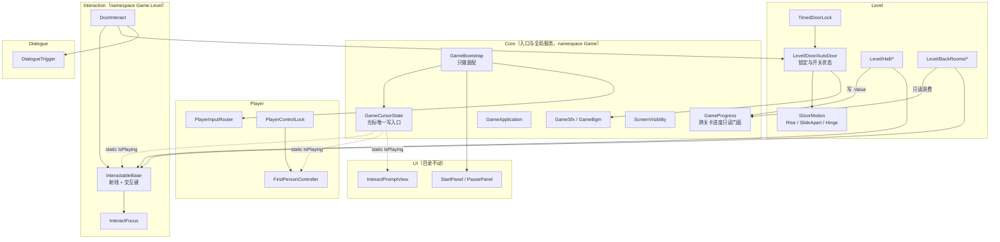
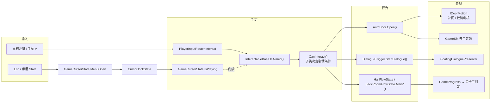
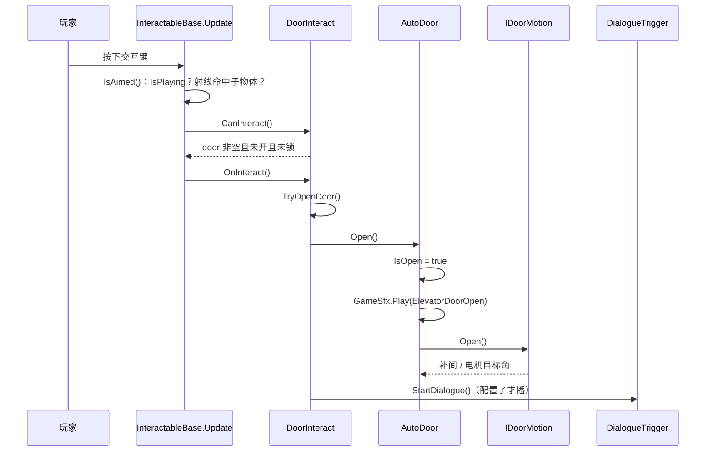

# Assets/Scripts 代码结构重构 实现计划

> **面向 AI 代理的工作者：** 必需子技能：使用 superpowers:subagent-driven-development（推荐）或 superpowers:executing-plans 逐任务实现此计划。步骤使用复选框（`- [ ]`）语法来跟踪进度。

**目标：** 在不改变任何玩法行为与场景配置数值的前提下，消除交互判定/光标判定/开门音效的重复，按职责拆分 `AutoDoor`、`BackRoomFlowState`、`GameBootstrap`，并把目录按 `Core / Player / Interaction / Level` 分层。

**架构：** 纯代码重构。移动文件靠 `.meta` 的 GUID 保引用（不改 namespace），类改名靠改写已有文件（GUID 不动），门的多策略用纯 C# 的 `IDoorMotion` 组合实现（14 个序列化字段全部留在 `AutoDoor`，零场景迁移），光标写入收口到 `GameCursorState`，跨关卡进度收口到只读门面 `GameProgress`。

**技术栈：** Unity 2022.3.62f3c1 / C# 9（`Assembly-CSharp`，无 asmdef）/ QFramework UIKit / DOTween Pro / Odin Inspector / Unity MCP

- 规格来源：`docs/superpowers/specs/2026-11-17-code-refactor-design.md`（下称「规格」）
- 日期：2026-11-17
- 状态：任务 1–9 已完成（任务 9 可选项目也已做），任务 10 验收通过；执行中修正三处：`PlayerControlLock` 的解锁条件（见任务 7 步骤 4 的执行时修正）、`AutoDoor.Open(bool playSound)`（见任务 3）、`SafeDoorHintInteract.cs` 实施后确认全项目零引用已在验收后删除（`Assets/Scripts` 最终 57 个 `.cs`）
- 交付方式：按用户全局 git 约定（只允许查询类 git 操作），本次执行全程不 commit，改动留给用户自行提交

## 0. 执行前必读的五条硬约束

1. **禁止任何 git 写操作。** 用户全局约定只允许查询类 git（`status` / `log` / `diff` / `show`）。因此本计划**一律不用 `git mv`**，改用 `Move-Item` 同时移动 `.cs` 与 `.cs.meta`（效果等价：GUID 不变、引用不丢），也**不执行 `git add` / `git commit`**。每个任务结束的「检查点」是把改动清单交给用户，由用户自行提交。
2. **不手改 `.meta`。** 移动/改名时把 `.meta` 一起搬，绝不编辑其内容。
3. **`Assets/Scripts/UI/` 结构不动。** `PausePanel.cs`、`PausePanel.Designer.cs`、`StartPanel.cs`、`StartPanel.Designer.cs` 一个字不改（QFramework UIKit + CodeGenKit 自动生成）。`UI/InteractPromptView.cs` 只改一行判断条件。
4. **不改任何玩法数值、剧情节点名、门的开合角度与方向、触发区范围。**
5. **不写协程。** 任务 1–7 新建/改写的文件里不许出现 `StartCoroutine` / `IEnumerator` / `yield return` / `WaitForSeconds`；已有的 9 个协程在任务 8 一次性换成 UniTask。定时等待一律 `UniTask.Delay(TimeSpan, DelayType.DeltaTime)`（暂停菜单要能冻住计时），入口一律 `async UniTaskVoid` + `.Forget()` 并 `catch (OperationCanceledException)`。

### 0.1 验证方式（每个任务的「验证」步骤都走这套）

本项目没有测试工程、没有 CI、没有无头构建脚本（项目 `AGENTS.md` 明确），所以**不做 TDD 单测**；每个任务的验证 = 编译零报错 + Console 零 error + 针对性 Play 抽查。

**有 Unity MCP 时：**

```text
mcp__unityMCP__refresh_unity(mode="force", scope="assets", compile="request", wait_for_ready=true)
mcp__unityMCP__read_console(action="get", types=["error"], count=20)
```

**没有 MCP 时：** 切到 Unity 窗口，等右下角编译转圈结束（约 5–20 s），打开 Console 筛 `Error`。

两点提醒（项目 `AGENTS.md`）：

- `runInBackground: 0`，**Play 检查时 Unity 必须是前台窗口**，否则 `Time.time` 不推进、协程不动，会误判成卡死；
- 项目开了 Enter Play Mode Options 但只关了 Domain Reload，静态字段跨 Play 残留，`GameBootstrap.ResetUIKitState()` 已兜住 UIKit；手动重复 Play 时若面板异常，先退出 Play 再进一次。

## 1. 架构图（重构后的目录与依赖）



## 2. 数据流图（交互键到门/剧情）



## 3. 调用链图

### 3.1 对准门按交互键



### 3.2 任务依赖


任务 1–8 必须按序（任务 7 用到任务 5 提供的 `GameCursorState.IsPlaying`；任务 8 用到任务 4 的 `TimedDoorLock` 已建成）；任务 9 可跳过；任务 10 收尾。

---

## 任务 1：目录骨架、纯移动、`GameCursorState` 读取端

**文件：**
- 创建：`Assets/Scripts/Core/GameCursorState.cs`
- 移动：见步骤 2 的表 A（`.cs` 与 `.cs.meta` 成对移动，**不改文件内容**）
- 移动 + 改名：见步骤 2 的表 B（文件名必须与新类名一致，同时替换全项目的类名 token）
- 核对：`docs/superpowers/specs/2026-11-17-code-refactor-design.md`（确认已无 `git mv` 措辞，见步骤 6；编写计划阶段已改完）

本任务只做结构搬运与改名，**不碰任何逻辑**；完成后项目必须照常可 Play，行为零变化。

- [ ] **步骤 1：建目录**

```powershell
$dirs = @(
  'Assets/Scripts/Core',
  'Assets/Scripts/Player',
  'Assets/Scripts/Interaction',
  'Assets/Scripts/Level/Door',
  'Assets/Scripts/Level/Elevator',
  'Assets/Scripts/Level/Trigger',
  'Assets/Scripts/Level/Visual',
  'Assets/Scripts/Level/Hall',
  'Assets/Scripts/Level/BackRooms'
)
$dirs | ForEach-Object { New-Item -ItemType Directory -Path $_ -Force | Out-Null }
```

- [ ] **步骤 2：移动文件（`.cs` 与 `.cs.meta` 一起）**

| 原路径 | 新路径 |
| --- | --- |
| `Game/GameBootstrap.cs` | `Core/GameBootstrap.cs` |
| `Game/GameApplication.cs` | `Core/GameApplication.cs` |
| `Game/GameSfx.cs` | `Core/GameSfx.cs` |
| `Game/GameBgm.cs` | `Core/GameBgm.cs` |
| `Game/ScreenVisibility.cs` | `Core/ScreenVisibility.cs` |
| `Game/InteractFocus.cs` | `Interaction/InteractFocus.cs` |
| `Game/PlayerInputRouter.cs` | `Player/PlayerInputRouter.cs` |
| `Level/FirstPersonController.cs` | `Player/FirstPersonController.cs` |
| `Level/Level1/PlayerControlLock.cs` | `Player/PlayerControlLock.cs` |
| `Level/AutoDoor.cs` | `Level/Door/AutoDoor.cs` |
| `Level/ElevatorFloorDisplay.cs` | `Level/Elevator/ElevatorFloorDisplay.cs` |
| `Level/ElevatorRideMotion.cs` | `Level/Elevator/ElevatorRideMotion.cs` |
| `Level/TriggerVolume.cs` | `Level/Trigger/TriggerVolume.cs` |
| `Level/DialogueZoneTrigger.cs` | `Level/Trigger/DialogueZoneTrigger.cs` |
| `Level/LowResDisplay.cs` | `Level/Visual/LowResDisplay.cs` |
| `Level/YBillboard.cs` | `Level/Visual/YBillboard.cs` |
| `Level/OverlayTextVisibility.cs` | `Level/Visual/OverlayTextVisibility.cs` |

```powershell
$root = 'Assets/Scripts'
$moves = @(
  @('Game/GameBootstrap.cs',                    'Core/GameBootstrap.cs'),
  @('Game/GameApplication.cs',                  'Core/GameApplication.cs'),
  @('Game/GameSfx.cs',                          'Core/GameSfx.cs'),
  @('Game/GameBgm.cs',                          'Core/GameBgm.cs'),
  @('Game/ScreenVisibility.cs',                 'Core/ScreenVisibility.cs'),
  @('Game/InteractFocus.cs',                    'Interaction/InteractFocus.cs'),
  @('Game/PlayerInputRouter.cs',                'Player/PlayerInputRouter.cs'),
  @('Level/FirstPersonController.cs',           'Player/FirstPersonController.cs'),
  @('Level/Level1/PlayerControlLock.cs',        'Player/PlayerControlLock.cs'),
  @('Level/AutoDoor.cs',                        'Level/Door/AutoDoor.cs'),
  @('Level/ElevatorFloorDisplay.cs',            'Level/Elevator/ElevatorFloorDisplay.cs'),
  @('Level/ElevatorRideMotion.cs',              'Level/Elevator/ElevatorRideMotion.cs'),
  @('Level/TriggerVolume.cs',                   'Level/Trigger/TriggerVolume.cs'),
  @('Level/DialogueZoneTrigger.cs',             'Level/Trigger/DialogueZoneTrigger.cs'),
  @('Level/LowResDisplay.cs',                   'Level/Visual/LowResDisplay.cs'),
  @('Level/YBillboard.cs',                      'Level/Visual/YBillboard.cs'),
  @('Level/OverlayTextVisibility.cs',           'Level/Visual/OverlayTextVisibility.cs')
)

foreach ($pair in $moves) {
  $from = Join-Path $root $pair[0]
  $to   = Join-Path $root $pair[1]
  if (-not (Test-Path $from))       { throw "源文件不存在：$from" }
  if (-not (Test-Path "$from.meta")) { throw "源文件缺 .meta：$from.meta" }
  Move-Item -Path $from       -Destination $to
  Move-Item -Path "$from.meta" -Destination "$to.meta"
}

# 核对：每个 .cs 都有同名 .meta
Get-ChildItem -Path $root -Recurse -Filter *.cs -File | ForEach-Object {
  if (-not (Test-Path "$($_.FullName).meta")) { Write-Host "缺 .meta: $($_.FullName)" }
}
```

预期：脚本无输出（没有「缺 .meta」行）、无异常。**任何一行 `throw` 触发就停下排查，不要继续。**

**表 B：移动 + 按职责改名（目标文件名必须与新类名完全一致）**

| 原路径 | 新路径 |
| --- | --- |
| `Level/Level2/Level2InteractBase.cs` | `Interaction/InteractableBase.cs` |
| `Level/Level2/Level2DoorInteract.cs` | `Interaction/DoorInteract.cs` |
| `Level/Level1/Level1State.cs` | `Level/Hall/HallFlowState.cs` |
| `Level/Level1/Level1DoorInteract.cs` | `Level/Hall/ElevatorDoorInteract.cs` |
| `Level/Level1/Level1SafeDoorInteract.cs` | `Level/Hall/SafeDoorHintInteract.cs`（实施后确认零引用，任务 10 已删除） |
| `Level/Level1/Level1DoorListenTrigger.cs` | `Level/Hall/DoorListenTrigger.cs` |
| `Level/Level1/Level1RedTextTrigger.cs` | `Level/Hall/RedTextSightTrigger.cs` |
| `Level/Level1/Level1RoomEntryTrigger.cs` | `Level/Hall/HallEntryTrigger.cs` |
| `Level/Level1/Level1ElevatorCountdown.cs` | `Level/Hall/ElevatorCountdown.cs` |
| `Level/Level2/Level2State.cs` | `Level/BackRooms/BackRoomFlowState.cs` |
| `Level/Level2/Level2SafeDoorInteract.cs` | `Level/BackRooms/SafeDoorInteract.cs` |
| `Level/Level2/Level2Copier.cs` | `Level/BackRooms/CopierInteract.cs` |
| `Level/Level2/Level2StorageCabinet.cs` | `Level/BackRooms/StorageCabinetInteract.cs` |
| `Level/Level2/Level2GlowCabinet.cs` | `Level/BackRooms/GlowCabinetInteract.cs` |
| `Level/Level2/Level2BlueArrow.cs` | `Level/BackRooms/BlueArrowInteract.cs` |
| `Level/Level2/Level2RoomTrigger.cs` | `Level/BackRooms/RoomEntryTrigger.cs` |
| `Level/Level2/Level2Blink.cs` | `Level/BackRooms/BreathGlow.cs` |

```powershell
$root = 'Assets/Scripts'

# B-1. 移动 + 改文件名（.cs 与 .cs.meta 成对）
$renames = @(
  @('Level/Level2/Level2InteractBase.cs',      'Interaction/InteractableBase.cs'),
  @('Level/Level2/Level2DoorInteract.cs',      'Interaction/DoorInteract.cs'),
  @('Level/Level1/Level1State.cs',             'Level/Hall/HallFlowState.cs'),
  @('Level/Level1/Level1DoorInteract.cs',      'Level/Hall/ElevatorDoorInteract.cs'),
  @('Level/Level1/Level1SafeDoorInteract.cs',  'Level/Hall/SafeDoorHintInteract.cs'),
  @('Level/Level1/Level1DoorListenTrigger.cs', 'Level/Hall/DoorListenTrigger.cs'),
  @('Level/Level1/Level1RedTextTrigger.cs',    'Level/Hall/RedTextSightTrigger.cs'),
  @('Level/Level1/Level1RoomEntryTrigger.cs',  'Level/Hall/HallEntryTrigger.cs'),
  @('Level/Level1/Level1ElevatorCountdown.cs', 'Level/Hall/ElevatorCountdown.cs'),
  @('Level/Level2/Level2State.cs',             'Level/BackRooms/BackRoomFlowState.cs'),
  @('Level/Level2/Level2SafeDoorInteract.cs',  'Level/BackRooms/SafeDoorInteract.cs'),
  @('Level/Level2/Level2Copier.cs',            'Level/BackRooms/CopierInteract.cs'),
  @('Level/Level2/Level2StorageCabinet.cs',    'Level/BackRooms/StorageCabinetInteract.cs'),
  @('Level/Level2/Level2GlowCabinet.cs',       'Level/BackRooms/GlowCabinetInteract.cs'),
  @('Level/Level2/Level2BlueArrow.cs',         'Level/BackRooms/BlueArrowInteract.cs'),
  @('Level/Level2/Level2RoomTrigger.cs',       'Level/BackRooms/RoomEntryTrigger.cs'),
  @('Level/Level2/Level2Blink.cs',             'Level/BackRooms/BreathGlow.cs')
)

foreach ($pair in $renames) {
  $from = Join-Path $root $pair[0]
  $to   = Join-Path $root $pair[1]
  if (-not (Test-Path $from))        { throw "源文件不存在：$from" }
  if (-not (Test-Path "$from.meta")) { throw "源文件缺 .meta：$from.meta" }
  Move-Item -Path $from       -Destination $to
  Move-Item -Path "$from.meta" -Destination "$to.meta"
}

# B-2. 全项目替换类名 token（含所有引用处、错误提示文案）
# 长名在前，避免短名先吃掉长名的前缀
$classMap = [ordered]@{
  'Level2SafeDoorInteract'  = 'SafeDoorInteract'
  'Level2StorageCabinet'    = 'StorageCabinetInteract'
  'Level2GlowCabinet'       = 'GlowCabinetInteract'
  'Level2InteractBase'      = 'InteractableBase'
  'Level2DoorInteract'      = 'DoorInteract'
  'Level2RoomTrigger'       = 'RoomEntryTrigger'
  'Level2BlueArrow'         = 'BlueArrowInteract'
  'Level2Copier'            = 'CopierInteract'
  'Level2State'             = 'BackRoomFlowState'
  'Level2Blink'             = 'BreathGlow'
  'Level1SafeDoorInteract'  = 'SafeDoorHintInteract'
  'Level1DoorListenTrigger' = 'DoorListenTrigger'
  'Level1RoomEntryTrigger'  = 'HallEntryTrigger'
  'Level1ElevatorCountdown' = 'ElevatorCountdown'
  'Level1RedTextTrigger'    = 'RedTextSightTrigger'
  'Level1DoorInteract'      = 'ElevatorDoorInteract'
  'Level1State'             = 'HallFlowState'
}

Get-ChildItem -Path $root -Recurse -Filter *.cs -File | ForEach-Object {
  $text = Get-Content -Raw -LiteralPath $_.FullName
  $before = $text
  foreach ($k in $classMap.Keys) { $text = $text.Replace($k, $classMap[$k]) }
  if ($text -ne $before) {
    Set-Content -LiteralPath $_.FullName -Value $text -NoNewline -Encoding utf8
  }
}

# B-3. 删掉已经搬空的旧目录与它的 .meta
foreach ($d in @('Level/Level1', 'Level/Level2')) {
  $p = Join-Path $root $d
  if (Test-Path $p)       { Remove-Item -LiteralPath $p -Recurse -Force }
  if (Test-Path "$p.meta") { Remove-Item -LiteralPath "$p.meta" -Force }
}

# B-4. 核对：旧类名零残留 + 每个 .cs 都有同名 .meta
$left = Get-ChildItem -Path $root -Recurse -Filter *.cs -File |
  Select-String -Pattern 'Level1[A-Z]|Level2[A-Z]'
if ($left) { $left | ForEach-Object { Write-Host "残留旧名: $($_.Path):$($_.LineNumber): $($_.Line.Trim())" } }
else { Write-Host '旧类名零残留' }

Get-ChildItem -Path $root -Recurse -Filter *.cs -File | ForEach-Object {
  if (-not (Test-Path "$($_.FullName).meta")) { Write-Host "缺 .meta: $($_.FullName)" }
}
```

预期：先打印「旧类名零残留」，且没有任何「缺 .meta」行。**两个预期任一不满足就停下排查。**

> 说明：脚本用 `Set-Content -Encoding utf8` 重写文件，原本带 BOM 的文件会变成无 BOM。Unity 对两种都认，不影响编译；不要为此改用 `Add-Content` 之类的方法。

- [ ] **步骤 3：创建 `Assets/Scripts/Core/GameCursorState.cs`（本任务只落地读取端）**

此刻还不接管光标写入，否则会和 `GameBootstrap.UpdateCursorState()` 抢着写、把开始菜单的光标锁死。写入端在任务 5 一起接。

```csharp
using UnityEngine;

namespace Game
{
    /// <summary>
    /// 光标的唯一写入口与「玩家现在能不能操作」的唯一事实来源。
    /// 光标锁定同时被各触发区当作「游玩中」信号，所以这里只读地暴露 <see cref="IsPlaying"/>。
    /// </summary>
    public sealed class GameCursorState : MonoBehaviour
    {
        /// <summary>玩家现在是否处于可操作状态（光标已锁定）。</summary>
        public static bool IsPlaying => Cursor.lockState == CursorLockMode.Locked;

        /// <summary>菜单是否打开（由 GameBootstrap 每帧告知）。</summary>
        public bool MenuOpen { get; set; }

        /// <summary>到站演出是否还在播：期间不显示光标，但也不能操作。</summary>
        public bool Settling { get; set; }
    }
}
```

- [ ] **步骤 4：验证编译**

按 §0.1 跑 `refresh_unity` + `read_console`。预期 Console 无 error。

- [ ] **步骤 5：Play 抽查（零行为变化）**

进 Play：开始菜单正常出现、光标可见可用鼠标点按钮 → 点「开始游戏」→ 到站演出 → 演出结束后进入第一人称、鼠标锁定。退出 Play。

- [ ] **步骤 6：核对规格里已无 `git mv`**

```powershell
Select-String -Path 'docs/superpowers/specs/2026-11-17-code-refactor-design.md' -Pattern 'git mv'
```

预期：**零命中**。这三处（`不做的事` 最后一条、移动对照表的 `方式` 列、风险表）在编写计划阶段已经改成「移动（`.cs` 与 `.cs.meta` 成对搬）」，此处只做确认。

- [ ] **步骤 7：检查点（交给用户提交）**

向用户汇报：移动并改名 34 个文件（17 个纯移动 + 17 个改名）+ 新增 1 个文件，列出 `git status --short` 输出，请用户自行提交。**不要执行 commit。**

---

## 任务 2：交互层收口（`InteractableBase` + `DoorInteract`）

**文件：**
- 整体改写：`Assets/Scripts/Interaction/InteractableBase.cs`、`Assets/Scripts/Interaction/DoorInteract.cs`（任务 1 已就位，本任务只改内容）
- 整体改写：`Level/Hall/ElevatorDoorInteract.cs`、`Level/Hall/SafeDoorHintInteract.cs`、`Level/BackRooms/SafeDoorInteract.cs`、`Level/BackRooms/BlueArrowInteract.cs`
- 父类名一行替换：`Level/BackRooms/CopierInteract.cs`、`Level/BackRooms/StorageCabinetInteract.cs`、`Level/BackRooms/GlowCabinetInteract.cs`

本任务**不再动任何文件位置**（移动与改名已在任务 1 完成），只改内容。全部改完再统一 refresh，避免中间态报「类名与文件名不符」。

- [ ] **步骤 1：整体改写 `Assets/Scripts/Interaction/InteractableBase.cs`**

把该文件全文替换为：

```csharp
using Sirenix.OdinInspector;
using UnityEngine;

namespace Game.Level
{
    /// <summary>
    /// 可交互物的公共部分：玩家视线正对物体时登记准心提示，按交互键触发 <see cref="OnInteract"/>。
    /// 光标未锁定（菜单 / 到站演出中）时一律不响应交互，也不显示提示。
    /// </summary>
    public abstract class InteractableBase : MonoBehaviour
    {
        [SerializeField, Required, LabelText("视线起点（玩家眼睛）")]
        protected Transform eye;

        [SerializeField, LabelText("交互距离")]
        protected float maxDistance = 3f;

        void Update()
        {
            if (!IsAimed())
            {
                InteractFocus.Clear(this);
                return;
            }

            InteractFocus.Set(this);

            var input = PlayerInputRouter.Instance;
            if (input != null && input.Interact.WasPressedThisFrame())
            {
                OnInteract();
            }
        }

        void OnDisable() => InteractFocus.Clear(this);

        /// <summary>当前是否允许交互（剧情状态是否满足、有没有对话正在播）。</summary>
        protected abstract bool CanInteract();

        /// <summary>玩家按交互键时调用；此时已确认视线对准且 <see cref="CanInteract"/> 为真。</summary>
        protected abstract void OnInteract();

        /// <summary>光标锁定、视线对准自己的子物体且没有被遮挡。</summary>
        bool IsAimed()
        {
            if (eye == null || !GameCursorState.IsPlaying || !CanInteract())
            {
                return false;
            }

            // 视线从眼睛沿着朝向打一条射线，射线起点在玩家胶囊体内部，不会打到自己。
            if (!Physics.Raycast(eye.position, eye.forward, out var hit, maxDistance, ~0,
                    QueryTriggerInteraction.Ignore))
            {
                return false;
            }

            return hit.collider.transform.IsChildOf(transform);
        }
    }
}
```

字段名 `eye`、`maxDistance` 与序列化顺序不变 → 所有已填的眼睛引用与距离值不丢。

- [ ] **步骤 2：整体改写 `Assets/Scripts/Interaction/DoorInteract.cs`**

全文替换为：

```csharp
using Game.Dialogue;
using Sirenix.OdinInspector;
using UnityEngine;

namespace Game.Level
{
    /// <summary>
    /// 对准门板按交互键开门；可配置一段开门剧情（关卡一的电梯门用这个）。
    /// </summary>
    public class DoorInteract : InteractableBase
    {
        [SerializeField, Required, LabelText("门")]
        protected AutoDoor door;

        [SerializeField, LabelText("开门剧情")]
        protected DialogueTrigger openDialogue;

        /// <summary>开门剧情正在播放。</summary>
        protected bool DialogueRunning => openDialogue != null && openDialogue.IsRunning;

        protected override bool CanInteract()
        {
            return door != null && !door.IsOpen && !door.Locked && !DialogueRunning;
        }

        protected override void OnInteract()
        {
            if (!TryOpenDoor())
            {
                return;
            }

            if (openDialogue != null)
            {
                openDialogue.StartDialogue();
            }
        }

        /// <summary>把门打开，返回是否真的打开了；关卡一的电梯门要先过剧情闸门，所以留成虚方法。</summary>
        protected virtual bool TryOpenDoor()
        {
            door.Open();
            return true;
        }
    }
}
```

- [ ] **步骤 3：`ElevatorDoorInteract.cs` 全文替换**

原来的 `eye`、`maxDistance`、`Update()`、`OnDisable()`、`IsAimingAtDoor()` 全部由基类接管，本类只剩剧情闸门。

```csharp
using Sirenix.OdinInspector;
using UnityEngine;

namespace Game.Level
{
    /// <summary>
    /// 电梯门的交互：玩家视线正对门时按交互键（鼠标左键 / 手柄 A）开门并播放开门后的剧情。
    /// 看过红字但还没听完风声剧情时门保持锁定，既不显示交互提示也开不了门。
    /// 对话播放期间与菜单打开时都不接受交互。
    /// </summary>
    public sealed class ElevatorDoorInteract : DoorInteract
    {
        [SerializeField, Required, LabelText("关卡状态")]
        HallFlowState state;

        protected override bool CanInteract()
        {
            return base.CanInteract() && state != null && !state.DoorOpened && state.CanOpenDoor;
        }

        /// <summary>先过剧情闸门再开门；闸门没过就不开门、也不播开门剧情。</summary>
        protected override bool TryOpenDoor()
        {
            return state != null && state.OpenElevatorDoor();
        }
    }
}
```

- [ ] **步骤 4：`SafeDoorHintInteract.cs` 全文替换**

```csharp
using Game.Dialogue;
using Sirenix.OdinInspector;
using UnityEngine;

namespace Game.Level
{
    /// <summary>
    /// 关卡一中间的安全门：电梯门打开后，玩家视线正对门时按交互键（鼠标左键 / 手柄 A），
    /// 播放一次“现在打不开，先去找门禁卡”的剧情。门本身不会打开。
    /// 电梯门还没开、剧情正在播、光标未锁定时不接受交互，也不显示交互提示。
    /// </summary>
    public sealed class SafeDoorHintInteract : InteractableBase
    {
        [SerializeField, Required, LabelText("关卡状态")]
        HallFlowState state;

        [SerializeField, Required, LabelText("打不开剧情")]
        DialogueTrigger dialogue;

        bool _fired;

        protected override bool CanInteract()
        {
            return state != null && dialogue != null && !_fired && state.DoorOpened && !dialogue.IsRunning;
        }

        protected override void OnInteract()
        {
            _fired = true;
            InteractFocus.Clear(this);
            dialogue.StartDialogue();
        }
    }
}
```

- [ ] **步骤 5：`SafeDoorInteract.cs` 改 2 处**

本任务只改这两处；`HallFlowState` → `GameProgress` 的三处替换要等 `GameProgress` 在任务 6 建好之后再做（见任务 6 步骤 4、5），现在动会编译不过。

```text
① 第 13 行
旧：    public sealed class SafeDoorInteract : InteractableBase
新：    public sealed class SafeDoorInteract : InteractableBase

② 第 72 行（整行删除；开门音效已移进 AutoDoor.Open，任务 3 接管）
旧：                GameSfx.Play(GameSfx.ElevatorDoorOpen);
```

删掉 ② 之后 `OnInteract()` 的真卡分支剩四行：`state.MarkSafeDoorOpened(); door.Locked = false; door.Open(); exitOpened.Invoke();`。

本任务结束时该文件仍保留 `HallFlowState level1State;` 字段与 `!level1State.DoorOpened` 判断——这是**有意为之**，任务 6 会一次性换掉。

- [ ] **步骤 6：`BlueArrowInteract.cs` 只改父类名**

```text
第 11 行
旧：    public sealed class BlueArrowInteract : InteractableBase
新：    public sealed class BlueArrowInteract : InteractableBase
```

它的 `HallFlowState level1State` 字段与 `level1State.EnteredRoom` 判断留到任务 6 再换。

- [ ] **步骤 7：三个柜子/复印机只改父类名**

对下面三个文件各做同一处替换（`InteractableBase` → `InteractableBase`）：

- `Assets/Scripts/Level/BackRooms/CopierInteract.cs`
- `Assets/Scripts/Level/BackRooms/StorageCabinetInteract.cs`
- `Assets/Scripts/Level/BackRooms/GlowCabinetInteract.cs`

```powershell
$files = @(
  'Assets/Scripts/Level/BackRooms/CopierInteract.cs',
  'Assets/Scripts/Level/BackRooms/StorageCabinetInteract.cs',
  'Assets/Scripts/Level/BackRooms/GlowCabinetInteract.cs'
)
foreach ($f in $files) {
  $text = Get-Content -Path $f -Raw -Encoding UTF8
  if ($text -notmatch 'InteractableBase') { throw "未找到父类名：$f" }
  $text = $text -replace 'InteractableBase', 'InteractableBase'
  Set-Content -Path $f -Value $text -Encoding UTF8 -NoNewline
}
```

- [ ] **步骤 8：校验全项目已无旧类名**

```powershell
Select-String -Path 'Assets/Scripts/**/*.cs' -Pattern 'InteractableBase|DoorInteract' -SimpleMatch
```

`Select-String -SimpleMatch` 只接受一个模式，改用：

```powershell
Get-ChildItem -Path 'Assets/Scripts' -Recurse -Filter *.cs |
  Select-String -Pattern 'InteractableBase','DoorInteract'
```

预期：**零命中**（注释里也不许留）。

- [ ] **步骤 9：验证编译**

按 §0.1 跑 `refresh_unity` + `read_console`。预期零 error。若报「`GameCursorState` 找不到」，说明任务 1 的 `Core/GameCursorState.cs` 没建。

- [ ] **步骤 10：Unity 里补 `ElevatorDoorInteract` 的 `门` 引用**

基类 `CanInteract()` 要判 `door.IsOpen` / `door.Locked`，所以电梯门的交互组件必须拿到门本体。

1. 打开 `Assets/Scenes/Game.unity`；
2. 选中挂 `ElevatorDoorInteract` 的物体（电梯门交互，`关卡/电梯` 下）；
3. Inspector 里新增的 `门` 字段拖入电梯门的 `AutoDoor`（与 `HallFlowState` 上的 `电梯门` 是同一个组件）；
4. Ctrl+S 保存场景。

- [ ] **步骤 11：Play 抽查**

1. 开始菜单 → 到站 → 走到电梯门前：出现交互提示（准心右侧键位图标）；
2. 按交互键：门开、**开门音效只响一次**、开门剧情播放；
3. 中间墙的安全门：交互后播「打不开」，且**只能播一次**；
4. 关卡二两扇北门：对准门板按交互才开（靠近不自动开），开合角度与方向与改前一致；
5. 把光标解锁（打开暂停面板）时，门的交互提示消失、按键无反应。

- [ ] **步骤 12：检查点（交给用户提交）**

汇报「2 个基类整体改写 + 4 个子类改写 + 3 个子类只改父类名 + 场景 1 处引用」，附 `git status --short`，由用户提交。

---

## 任务 3：门策略分离（`IDoorMotion` + 3 实现）

**文件：**
- 创建：`Assets/Scripts/Level/Door/IDoorMotion.cs`
- 创建：`Assets/Scripts/Level/Door/RiseDoorMotion.cs`
- 创建：`Assets/Scripts/Level/Door/SlideApartDoorMotion.cs`
- 创建：`Assets/Scripts/Level/Door/HingeDoorMotion.cs`
- 改写：`Assets/Scripts/Level/Door/AutoDoor.cs`（233 行 → 约 95 行）
- 删音效调用：`Assets/Scripts/Level/Hall/ElevatorDoorInteract.cs`（任务 2 后已无此行，确认即可）、`Assets/Scripts/Interaction/DoorInteract.cs`（同上）

14 个序列化字段**全部留在 `AutoDoor` 上**，`Awake` 里按 `mode` 现场 new 一个 motion → 场景与 `Assets/Prefabs/Level/AutoDoor.prefab` 零改动。

- [ ] **步骤 1：创建 `IDoorMotion.cs`**

```csharp
namespace Game.Level
{
    /// <summary>门的一种开合方式：自己管自己的门扇位移或物理，AutoDoor 只负责开关状态与触发。</summary>
    public interface IDoorMotion
    {
        /// <summary>按场景配置记录关闭位、设置铰链限位；配置不全时打印错误并返回 false。</summary>
        bool TryConfigure();

        void Open();

        void Close();

        /// <summary>FixedUpdate 驱动（目前只有铰链门需要）。</summary>
        void FixedTick();

        /// <summary>释放补间等运行时句柄。</summary>
        void Dispose();
    }
}
```

- [ ] **步骤 2：创建 `RiseDoorMotion.cs`（接管原 `Awake` 98-109、`Open` 183-188、`Close` 210-216）**

```csharp
using DG.Tweening;
using UnityEngine;

namespace Game.Level
{
    /// <summary>整扇门向上抬起的开合方式（电梯门、安全门都是这个）。</summary>
    public sealed class RiseDoorMotion : IDoorMotion
    {
        readonly AutoDoor _owner;
        readonly Transform _doorPanel;
        readonly float _openHeight;
        readonly float _duration;
        readonly bool _autoClose;
        readonly float _closeDelay;

        Vector3 _closedPosition;
        Tween _tween;

        public RiseDoorMotion(AutoDoor owner, Transform doorPanel, float openHeight,
            float duration, bool autoClose, float closeDelay)
        {
            _owner = owner;
            _doorPanel = doorPanel;
            _openHeight = openHeight;
            _duration = duration;
            _autoClose = autoClose;
            _closeDelay = closeDelay;
        }

        public bool TryConfigure()
        {
            if (_doorPanel == null)
            {
                Debug.LogError("AutoDoor 未指定门扇", _owner);
                return false;
            }

            _closedPosition = _doorPanel.localPosition;
            return true;
        }

        public void Open()
        {
            _tween?.Kill();
            _tween = _doorPanel.DOLocalMoveY(_closedPosition.y + _openHeight, _duration)
                .SetEase(Ease.OutQuad);
        }

        public void Close()
        {
            _tween?.Kill();
            _tween = _doorPanel.DOLocalMoveY(_closedPosition.y, _duration)
                .SetDelay(_autoClose ? _closeDelay : 0f)
                .SetEase(Ease.InQuad);
        }

        public void FixedTick()
        {
        }

        public void Dispose() => _tween?.Kill();
    }
}
```

- [ ] **步骤 3：创建 `SlideApartDoorMotion.cs`（接管原 `Awake` 111-119、`Open` 190-193、`Close` 218-224）**

```csharp
using DG.Tweening;
using UnityEngine;

namespace Game.Level
{
    /// <summary>两扇门向两侧滑开的开合方式（关卡二的电梯门）。</summary>
    public sealed class SlideApartDoorMotion : IDoorMotion
    {
        readonly AutoDoor _owner;
        readonly Transform _leftLeaf;
        readonly Transform _rightLeaf;
        readonly float _slideDistance;
        readonly float _duration;
        readonly bool _autoClose;
        readonly float _closeDelay;

        Vector3 _closedLeftPosition;
        Vector3 _closedRightPosition;
        Tween _leftTween;
        Tween _rightTween;

        public SlideApartDoorMotion(AutoDoor owner, Transform leftLeaf, Transform rightLeaf,
            float slideDistance, float duration, bool autoClose, float closeDelay)
        {
            _owner = owner;
            _leftLeaf = leftLeaf;
            _rightLeaf = rightLeaf;
            _slideDistance = slideDistance;
            _duration = duration;
            _autoClose = autoClose;
            _closeDelay = closeDelay;
        }

        public bool TryConfigure()
        {
            if (_leftLeaf == null || _rightLeaf == null)
            {
                Debug.LogError("AutoDoor 未指定左右门扇", _owner);
                return false;
            }

            _closedLeftPosition = _leftLeaf.localPosition;
            _closedRightPosition = _rightLeaf.localPosition;
            return true;
        }

        public void Open()
        {
            KillTweens();
            _leftTween = _leftLeaf.DOLocalMoveX(_closedLeftPosition.x - _slideDistance, _duration)
                .SetEase(Ease.OutQuad);
            _rightTween = _rightLeaf.DOLocalMoveX(_closedRightPosition.x + _slideDistance, _duration)
                .SetEase(Ease.OutQuad);
        }

        public void Close()
        {
            KillTweens();
            var delay = _autoClose ? _closeDelay : 0f;
            _leftTween = _leftLeaf.DOLocalMoveX(_closedLeftPosition.x, _duration)
                .SetDelay(delay)
                .SetEase(Ease.InQuad);
            _rightTween = _rightLeaf.DOLocalMoveX(_closedRightPosition.x, _duration)
                .SetDelay(delay)
                .SetEase(Ease.InQuad);
        }

        public void FixedTick()
        {
        }

        public void Dispose() => KillTweens();

        void KillTweens()
        {
            _leftTween?.Kill();
            _rightTween?.Kill();
        }
    }
}
```

- [ ] **步骤 4：创建 `HingeDoorMotion.cs`（接管原 `Awake` 61-96、`FixedUpdate` 122-142、`Open` 175-181、`Close` 202-208）**

```csharp
using UnityEngine;

namespace Game.Level
{
    /// <summary>
    /// 绕竖直铰链旋转的开合方式（关卡二两扇北门）：门扇挂在一个带 Rigidbody + HingeJoint 的枢轴上，
    /// 电机按剩余角度限速转到开门角 / 关门角。
    /// </summary>
    public sealed class HingeDoorMotion : IDoorMotion
    {
        readonly AutoDoor _owner;
        readonly HingeJoint _hinge;
        readonly float _openAngleOffset;
        readonly float _speed;
        readonly float _gain;
        readonly float _motorForce;
        readonly bool _autoClose;
        readonly float _closeDelay;

        Rigidbody _body;
        float _closedAngle;
        float _openAngle;
        float _targetAngle;
        float _closeAt;
        bool _pendingClose;

        public HingeDoorMotion(AutoDoor owner, HingeJoint hinge, float openAngleOffset,
            float speed, float gain, float motorForce, bool autoClose, float closeDelay)
        {
            _owner = owner;
            _hinge = hinge;
            _openAngleOffset = openAngleOffset;
            _speed = speed;
            _gain = gain;
            _motorForce = motorForce;
            _autoClose = autoClose;
            _closeDelay = closeDelay;
        }

        public bool TryConfigure()
        {
            if (_hinge == null)
            {
                Debug.LogError("AutoDoor 未指定铰链关节", _owner);
                return false;
            }

            _body = _hinge.GetComponent<Rigidbody>();
            if (_body == null)
            {
                Debug.LogError("AutoDoor 的铰链关节缺少刚体", _owner);
                return false;
            }

            _closedAngle = _hinge.angle;
            _openAngle = _closedAngle + _openAngleOffset;

            var limits = _hinge.limits;
            limits.min = Mathf.Min(_closedAngle, _openAngle);
            limits.max = Mathf.Max(_closedAngle, _openAngle);
            _hinge.limits = limits;
            _hinge.useLimits = true;
            _hinge.useMotor = true;

            var motor = _hinge.motor;
            motor.force = _motorForce;
            motor.targetVelocity = 0f;
            motor.freeSpin = false;
            _hinge.motor = motor;

            _targetAngle = _closedAngle;
            return true;
        }

        public void Open()
        {
            _pendingClose = false;
            _targetAngle = _openAngle;
            _body.WakeUp();
        }

        public void Close()
        {
            _pendingClose = true;
            _closeAt = Time.time + (_autoClose ? _closeDelay : 0f);
            _body.WakeUp();
        }

        public void FixedTick()
        {
            if (_pendingClose && Time.time >= _closeAt)
            {
                _pendingClose = false;
                _targetAngle = _closedAngle;
            }

            // 按剩余角度给电机限速：起步快、接近目标时逐渐减速，停在开门角 / 关门角上。
            float diff = _targetAngle - _hinge.angle;
            var motor = _hinge.motor;
            motor.targetVelocity = Mathf.Abs(diff) < 0.5f
                ? 0f
                : Mathf.Clamp(diff * _gain, -_speed, _speed);
            _hinge.motor = motor;
        }

        public void Dispose()
        {
        }
    }
}
```

- [ ] **步骤 5：`AutoDoor.cs` 全文替换（233 行 → 约 95 行）**

```csharp
using Sirenix.OdinInspector;
using UnityEngine;

namespace Game.Level
{
    /// <summary>门的打开方式。</summary>
    public enum AutoDoorMode
    {
        [LabelText("整体向上")] Rise,
        [LabelText("两扇向两侧滑开")] SlideApart,
        [LabelText("绕铰链旋转")] Hinge,
    }

    /// <summary>
    /// 玩家靠近时打开的门；触发区挂在根节点，门扇作为子物体按 <see cref="mode"/> 开合。
    /// 开合动作本身交给 <see cref="IDoorMotion"/>，这里只负责锁定、开关状态、玩家触发与开门音效。
    /// </summary>
    public sealed class AutoDoor : MonoBehaviour
    {
        [LabelText("开门方式"), SerializeField] AutoDoorMode mode = AutoDoorMode.Rise;

        [LabelText("门扇（整体向上时使用）"), SerializeField] Transform doorPanel;
        [LabelText("升起高度"), SerializeField] float openHeight = 2.5f;
        [LabelText("单侧滑动距离（两扇向两侧时使用）"), SerializeField] float slideDistance = 1.5f;

        [LabelText("左门扇"), SerializeField] Transform leftLeaf;
        [LabelText("右门扇"), SerializeField] Transform rightLeaf;

        [LabelText("铰链关节（旋转门使用）"), SerializeField] HingeJoint hinge;
        [LabelText("开门角度（旋转门使用，负值反向转）"), SerializeField] float hingeOpenAngle = -95f;
        [LabelText("最大角速度（旋转门使用，度/秒）"), SerializeField] float hingeSpeed = 150f;
        [LabelText("角度跟随刚度（旋转门使用）"), SerializeField] float hingeGain = 4f;
        [LabelText("电机力矩上限（旋转门使用）"), SerializeField] float hingeMotorForce = 600f;

        [LabelText("开关门时长"), SerializeField] float duration = 0.6f;
        [LabelText("自动关门"), SerializeField] bool autoClose;
        [LabelText("关门延迟"), SerializeField] float closeDelay = 2f;

        IDoorMotion _motion;

        /// <summary>锁住时玩家靠近也不开门、调用 <see cref="Open"/> 也无效；由剧情脚本控制。</summary>
        public bool Locked { get; set; }

        /// <summary>门当前是否已经打开（升到顶 / 滑到两侧 / 转到开门角度）；用于交互提示与防重复开门。</summary>
        public bool IsOpen { get; private set; }

        void Awake()
        {
            _motion = mode switch
            {
                AutoDoorMode.Rise => new RiseDoorMotion(
                    this, doorPanel, openHeight, duration, autoClose, closeDelay),
                AutoDoorMode.SlideApart => new SlideApartDoorMotion(
                    this, leftLeaf, rightLeaf, slideDistance, duration, autoClose, closeDelay),
                _ => new HingeDoorMotion(
                    this, hinge, hingeOpenAngle, hingeSpeed, hingeGain, hingeMotorForce, autoClose, closeDelay),
            };

            if (!_motion.TryConfigure())
            {
                enabled = false;
            }
        }

        void FixedUpdate() => _motion?.FixedTick();

        void OnDestroy() => _motion?.Dispose();

        void OnTriggerEnter(Collider other)
        {
            if (Locked || !other.CompareTag("Player"))
            {
                return;
            }

            Open(playSound: false);
        }

        void OnTriggerExit(Collider other)
        {
            if (!other.CompareTag("Player") || !autoClose)
            {
                return;
            }

            Close();
        }

        /// <summary>打开门；锁住、已经打开或配置有误时不响应。</summary>
        /// <param name="playSound">是否播开门音效：玩家交互开门要响，触发式自动开与定时锁自动重开不响。</param>
        public void Open(bool playSound = true)
        {
            if (Locked || IsOpen || _motion == null)
            {
                return;
            }

            IsOpen = true;
            if (playSound)
            {
                GameSfx.Play(GameSfx.ElevatorDoorOpen);
            }

            _motion.Open();
        }

        /// <summary>把门放回关闭位置。</summary>
        public void Close()
        {
            if (!IsOpen || _motion == null)
            {
                return;
            }

            IsOpen = false;
            _motion.Close();
        }
    }
}
```

三处刻意的行为变更（都在规格里写明）：

1. `Open()` 加 `IsOpen` 短路：对已开的门再调一次不再重跑补间，顺带修掉「同一扇门被多个碰撞体触发、开门声播两次」；
2. `Close()` 加 `!IsOpen` 短路：与「对已关闭的门再补一次间」视觉等价；
3. 开门音效移进门自身（判据 2 要求只剩一处），`Locked` 短路保证锁着的门不响；**非交互路径传 `playSound: false`**（`OnTriggerEnter` 的自动开、`TimedDoorLock` 的 60 s 后重开），保证「只有玩家交互开门才响」这一听感与改前完全一致。

- [ ] **步骤 6：确认三个交互类里已无开门音效**

```powershell
Get-ChildItem -Path 'Assets/Scripts' -Recurse -Filter *.cs |
  Select-String -Pattern 'GameSfx\.Play\(GameSfx\.ElevatorDoorOpen\)'
```

预期：**只有 1 处**，且位于 `Assets/Scripts/Level/Door/AutoDoor.cs`。若还有 `SafeDoorInteract.cs` 或 `Interaction/DoorInteract.cs` 命中，说明任务 2 步骤 5 的 ⑤ 没删干净，现在删。

- [ ] **步骤 7：验证编译**

按 §0.1 跑 `refresh_unity` + `read_console`。预期零 error。

若报「`AutoDoor` 里 `_motion` 可能为 null」之类的可空警告可忽略；若报 `switch` 表达式语法错误，说明项目 C# 版本不足 C# 8——`AutoDoorMode` 的 `switch` 在 Unity 2022 默认 C# 9 下可用。

- [ ] **步骤 8：Play 抽查三种门**

1. 电梯门（`Rise`，关卡一）：靠近自动开（若为触发式）、对准按交互开、升起高度与改前一致；
2. 关卡二两扇北门（`Hinge`，`autoClose=false`）：对准按交互，绕铰链向房间内转 -95°，方向与角度与改前完全一致，门开过程中不卡顿；
3. 安全门（`Rise`，`openHeight=3`）：升到顶整扇藏进天花板后面；关卡一的中间墙安全门交互只播剧情不升；
4. 关卡二电梯门（`SlideApart`，若场景里用这个 mode）：两扇向两侧滑开、中缝重叠与改前一致；
5. 靠近触发开门时音效只响一次；连续快速穿过触发区不重复响。

- [ ] **步骤 9：检查点（交给用户提交）**

汇报「新增 4 个文件 + 改写 1 个文件」，附 `git status --short`，由用户提交。

---

## 任务 4：红门定时锁（`TimedDoorLock`）

**文件：**
- 创建：`Assets/Scripts/Level/Door/TimedDoorLock.cs`
- 修改：`Assets/Scripts/Level/BackRooms/BackRoomFlowState.cs`（137 → 约 105 行）
- 修改：`Assets/Scripts/Level/BackRooms/RoomEntryTrigger.cs`
- Unity：红门物体加组件 + `RoomEntryTrigger` 拖引用

- [ ] **步骤 1：创建 `TimedDoorLock.cs`**

```csharp
using System;
using System.Threading;
using Cysharp.Threading.Tasks;
using Sirenix.OdinInspector;
using UnityEngine;

namespace Game.Level
{
    /// <summary>把门关上并锁住一段时间，时间一到自动解锁并重新打开。</summary>
    public sealed class TimedDoorLock : MonoBehaviour
    {
        [SerializeField, Required, LabelText("门")]
        AutoDoor door;

        [SerializeField, LabelText("锁定时长（秒）")]
        float lockSeconds = 60f;

        CancellationTokenSource _countdown;

        /// <summary>关门并锁定；重复调用会重新计时。</summary>
        public void LockForAWhile()
        {
            if (door == null)
            {
                Debug.LogError($"{name} 没有指定门，锁定不会生效。", this);
                return;
            }

            CancelCountdown();
            _countdown = CancellationTokenSource.CreateLinkedTokenSource(destroyCancellationToken);

            door.Locked = true;
            door.Close();
            UnlockAfterDelay(_countdown.Token).Forget();
        }

        /// <summary>等满 <see cref="lockSeconds"/> 秒再解锁；被打断（重新计时或物体销毁）时直接退出。</summary>
        async UniTaskVoid UnlockAfterDelay(CancellationToken cancellationToken)
        {
            try
            {
                await UniTask.Delay(TimeSpan.FromSeconds(lockSeconds), DelayType.DeltaTime, cancellationToken: cancellationToken);
            }
            catch (OperationCanceledException)
            {
                return;
            }

            CancelCountdown();
            door.Locked = false;
            door.Open(playSound: false);
        }

        void CancelCountdown()
        {
            if (_countdown == null)
            {
                return;
            }

            _countdown.Cancel();
            _countdown.Dispose();
            _countdown = null;
        }

        void OnDestroy()
        {
            CancelCountdown();
        }
    }
}
```

锁定时长用 `DelayType.DeltaTime`：暂停面板把 `timeScale` 设为 0 时，60 s 计时必须跟着冻住，和原来 `WaitForSeconds` 的语义一致。

- [ ] **步骤 2：`BackRoomFlowState.cs` 精简**

(a) 删掉 `using System.Collections;`（第 1 行）与它后面的空行，文件开头变成：

```csharp
using Sirenix.OdinInspector;
using UnityEngine;
```

(b) 类注释删掉「并负责…」那半句，并删两个字段与协程句柄。第 7-20 行替换为：

```csharp
    /// <summary>
    /// 关卡二（打印室 / 储藏室）的剧情状态：记录每个触发点是否已经播过。
    /// 触发编号对应 docs/后室游戏交互节点_1-2.xlsx 的「节点2」工作表（8、10–16）。
    /// </summary>
    public sealed class BackRoomFlowState : MonoBehaviour
    {
```

（即删掉 `[SerializeField, Required, LabelText("红色门")] AutoDoor redDoor;`、`[SerializeField, LabelText("红色门锁定时间（秒）")] float redDoorLockSeconds = 60f;`、`Coroutine _unlockRoutine;` 三个成员及其空行。）

(c) `EnterStorage()` 改为返回是否首次，并不再碰门。第 58-68 行替换为：

```csharp
        /// <summary>记录玩家走进了储藏室；返回是否首次进入（首次时调用方要把红色门锁上）。</summary>
        /// <returns>本次是否是第一次进入储藏室。</returns>
        public bool EnterStorage()
        {
            if (EnteredStorage)
            {
                return false;
            }

            EnteredStorage = true;
            return true;
        }
```

(d) 删掉文件末尾的 `LockRedDoor()` 与 `UnlockRedDoorAfterDelay()` 两个方法（原第 108-135 行），以及它们前面的 `/// <summary>关门并把红色门锁上…</summary>` 注释。删完后 `MarkSafeDoorOpened()` 的右花括号紧接类结束。

- [ ] **步骤 3：`RoomEntryTrigger.cs` 加字段与改分支**

(a) 在 `Room room = Room.PrintRoom;` 之后新增字段：

```csharp
        [SerializeField, Required, LabelText("红色门定时锁")]
        TimedDoorLock redDoorLock;
```

(b) 第 57-64 行替换为：

```csharp
            if (room == Room.PrintRoom)
            {
                state.MarkEnteredPrintRoom();
            }
            else if (state.EnterStorage() && redDoorLock != null)
            {
                redDoorLock.LockForAWhile();
            }
```

(c) 类注释第 9 行的「进入储藏室时还会让红色门关上并锁一分钟」保留不动（行为没变，只是执行者换成了 `TimedDoorLock`）。

- [ ] **步骤 4：验证编译**

按 §0.1 跑 `refresh_unity` + `read_console`。预期零 error。

- [ ] **步骤 5：Unity 里挂 `TimedDoorLock`**

1. `Assets/Scenes/Game.unity` → 选中红色门物体（`关卡/大厅/门` 下那扇红色的 `AutoDoor`）；
2. Add Component → `Timed Door Lock`（若菜单里显示中文则找 `红色门定时锁` 相关项）；
3. `门` 拖拖它自己身上的 `AutoDoor`；`锁定时长（秒）` 填 `60`；
4. 选中储藏室那台 `RoomEntryTrigger`，把刚加的 `TimedDoorLock` 拖进 `红色门定时锁`；
5. 选中 `BackRoomFlowState`，确认 Inspector 里原来那两项 `红色门`、`红色门锁定时间（秒）` 已消失（代码删了字段，Unity 会自动丢弃孤儿数据）；
6. Ctrl+S 保存场景。

- [ ] **步骤 6：Play 抽查**

1. 走进储藏室：红色门立刻关上并锁住；对红门按交互**无提示、无反应**；
2. 等 60 s（或临时把 `锁定时长` 改成 5 s 验证后改回 60）：红门自动解锁并打开；
3. 第二次走回储藏室入口：红门**不再**重新锁（`EnterStorage()` 返回 false）；
4. Console 无「没有指定门」错误。

- [ ] **步骤 7：检查点（交给用户提交）**

汇报「新增 1 个文件 + 改写 2 个文件 + 场景 2 处配置」，附 `git status --short`，由用户提交。

---

## 任务 5：光标收口（`GameCursorState` 接线 + 8 处替换）

**文件：**
- 改写：`Assets/Scripts/Core/GameCursorState.cs`（补 `LateUpdate` 写入端）
- 修改：`Assets/Scripts/Core/GameBootstrap.cs`（删 `UpdateCursorState`，改 6 处）
- 一行替换：`Level/Trigger/DialogueZoneTrigger.cs`、`Level/Trigger/TriggerVolume.cs`、`Player/FirstPersonController.cs`、`Player/PlayerControlLock.cs`、`Level/Hall/ElevatorCountdown.cs`、`Level/Hall/HallEntryTrigger.cs`、`Level/BackRooms/RoomEntryTrigger.cs`、`UI/InteractPromptView.cs`

- [ ] **步骤 1：`Core/GameCursorState.cs` 全文替换为最终版**

```csharp
using UnityEngine;

namespace Game
{
    /// <summary>
    /// 光标的唯一写入口：菜单打开与到站演出期间解锁光标，其余时间锁定并隐藏，进入第一人称。
    /// 光标锁定同时被各触发区当作「游玩中」信号，所以这里只读地暴露 <see cref="IsPlaying"/>。
    /// </summary>
    [DefaultExecutionOrder(100)]
    public sealed class GameCursorState : MonoBehaviour
    {
        /// <summary>玩家现在是否处于可操作状态（光标已锁定）。</summary>
        public static bool IsPlaying => Cursor.lockState == CursorLockMode.Locked;

        /// <summary>菜单是否打开（由 GameBootstrap 每帧告知）。</summary>
        public bool MenuOpen { get; set; }

        /// <summary>到站演出是否还在播：期间不显示光标，但也不能操作。</summary>
        public bool Settling { get; set; }

        // 放在 LateUpdate：保证本帧内所有读取方都先拿到上一帧已生效的状态，写入时机唯一且确定。
        void LateUpdate()
        {
            bool unlock = MenuOpen || Settling;

            if (unlock)
            {
                if (Cursor.lockState != CursorLockMode.None)
                {
                    Cursor.lockState = CursorLockMode.None;
                }

                // 菜单里要用光标点按钮；演出期间没有可点的东西，藏起来免得鼠标在画面里乱跑。
                if (Cursor.visible != MenuOpen)
                {
                    Cursor.visible = MenuOpen;
                }
            }
            else if (Cursor.lockState != CursorLockMode.Locked)
            {
                Cursor.lockState = CursorLockMode.Locked;
                Cursor.visible = false;
            }
        }
    }
}
```

`IsPlaying` 读 `Cursor.lockState` 而不是另存布尔量：光标锁定就是项目里「能不能操作」的唯一事实，读它保证新写入端与 11 个旧读取点是同一语义。

- [ ] **步骤 2：`Core/GameBootstrap.cs` 改 6 处**

**文件用 Tab 缩进，替换时保持原缩进。**

(a) 类声明加 `RequireComponent`：

```text
旧：	public class GameBootstrap : MonoBehaviour
新：	[RequireComponent(typeof(GameCursorState))]
	public class GameBootstrap : MonoBehaviour
```

(b) 字段换成光标引用：

```text
旧：		bool _starting;

		/// <summary>点击开始后的到站演出还没结束：保持光标解锁，等楼号动画与到站音效播完再交还控制权。</summary>
		bool _settling;
新：		bool _starting;

		GameCursorState _cursor;
```

(c) `Awake()` 里取引用（在 `void Awake()` 的 `{` 之后插入）：

```text
旧：		void Awake()
		{
新：		void Awake()
		{
			_cursor = GetComponent<GameCursorState>();

```

(d) `Update()` 末尾把 `UpdateCursorState();` 换成直接告知菜单状态：

```text
旧：			UpdateCursorState();
		}
新：			_cursor.MenuOpen = UIKit.GetPanel<StartPanel>() != null || UIKit.GetPanel<PausePanel>() != null;
		}
```

(e) 两处 `_settling` 赋值改为写组件：

```text
旧（OnStartRequested 内）：			_settling = true;
新：			_cursor.Settling = true;

旧（ReleaseControlAfterSfx 内）：			_settling = false;
新：			_cursor.Settling = false;
```

(f) 删掉整个 `UpdateCursorState()` 方法及其 doc 注释（原第 138-164 行）：

```text
		/// <summary>
		/// 菜单与开场演出期间解锁光标，演出结束后锁定光标进入第一人称。
		/// 光标锁定同时是各个剧情触发区的“游玩中”信号，开场剧情因此会等演出播完才触发。
		/// </summary>
		void UpdateCursorState()
		{
			var menuOpen = UIKit.GetPanel<StartPanel>() != null || UIKit.GetPanel<PausePanel>() != null;

			if (menuOpen || _settling)
			{
				if (Cursor.lockState != CursorLockMode.None)
				{
					Cursor.lockState = CursorLockMode.None;
				}

				// 菜单里要用光标点按钮；演出期间没有可点的东西，藏起来免得鼠标在画面里乱跑。
				if (Cursor.visible != menuOpen)
				{
					Cursor.visible = menuOpen;
				}
			}
			else if (Cursor.lockState != CursorLockMode.Locked)
			{
				Cursor.lockState = CursorLockMode.Locked;
				Cursor.visible = false;
			}
		}
```

整段删除（连同上方的 doc 注释与它后面的一个空行），保留其后的 `TogglePausePanel`。

- [ ] **步骤 3：8 处 `Cursor.lockState` 判断替换**

替换是**子串替换**，不要求整行一致：把每个文件该行里的 `Cursor.lockState != CursorLockMode.Locked` 换成 `!GameCursorState.IsPlaying`，把 `Cursor.lockState == CursorLockMode.Locked` 换成 `GameCursorState.IsPlaying`。条件其余部分（`requireCursorLocked &&`、`|| dialogue.IsRunning` 等）保持原样。

| 文件 | 行 | 该行的读取点 | 替换后 |
| --- | --- | --- | --- |
| `Assets/Scripts/Level/Trigger/DialogueZoneTrigger.cs` | 32 | `Cursor.lockState != CursorLockMode.Locked` | `!GameCursorState.IsPlaying` |
| `Assets/Scripts/Level/Trigger/TriggerVolume.cs` | 61 | 同上 | 同上 |
| `Assets/Scripts/Player/FirstPersonController.cs` | 30 | 同上 | 同上 |
| `Assets/Scripts/Player/PlayerControlLock.cs` | 54 | 同上 | 同上 |
| `Assets/Scripts/Level/Hall/ElevatorCountdown.cs` | 38 | 同上 | 同上 |
| `Assets/Scripts/Level/Hall/HallEntryTrigger.cs` | 37 | 同上 | 同上 |
| `Assets/Scripts/Level/BackRooms/RoomEntryTrigger.cs` | 47 | 同上 | 同上 |
| `Assets/Scripts/UI/InteractPromptView.cs` | 40 | `Cursor.lockState == CursorLockMode.Locked` | `GameCursorState.IsPlaying`（后续再改为 `GameCursorState.IsPlaying && !PlayerControlLock.IsLocked`，见步骤 3 末尾注记） |

> **2026-11-18 更新（剧情播放中允许交互）**：`InteractPromptView` 已整体重写，不再保留 `IsDialoguePlaying()`。该类现在只为“光标是否锁定 / 是否处于开场锁定”而显示准心与交互键提示，条件为 `GameCursorState.IsPlaying && !PlayerControlLock.IsLocked`，并删掉了 `presenter` 字段、`Awake`、`IsDialoguePlaying()`。执行本步骤时，`InteractPromptView.cs` 的目标形态即此后一个条件，而**不是**单纯的 `GameCursorState.IsPlaying`。

替换脚本（先跑核对，再跑替换）：

```powershell
$files = @(
  'Assets/Scripts/Level/Trigger/DialogueZoneTrigger.cs',
  'Assets/Scripts/Level/Trigger/TriggerVolume.cs',
  'Assets/Scripts/Player/FirstPersonController.cs',
  'Assets/Scripts/Player/PlayerControlLock.cs',
  'Assets/Scripts/Level/Hall/ElevatorCountdown.cs',
  'Assets/Scripts/Level/Hall/HallEntryTrigger.cs',
  'Assets/Scripts/Level/BackRooms/RoomEntryTrigger.cs',
  'Assets/Scripts/UI/InteractPromptView.cs'
)

# 核对：每个文件恰好有 1 处 Cursor.lockState 读取
foreach ($f in $files) {
  $hits = (Select-String -Path $f -Pattern 'Cursor\.lockState').Count
  Write-Host "$f  $hits"
  if ($hits -ne 1) { throw "读取点数不是 1，先人工确认：$f" }
}

# 替换
foreach ($f in $files) {
  $text = Get-Content -Path $f -Raw -Encoding UTF8
  $text = $text -replace 'Cursor\.lockState != CursorLockMode\.Locked',  '!GameCursorState.IsPlaying'
  $text = $text -replace 'Cursor\.lockState == CursorLockMode\.Locked',  'GameCursorState.IsPlaying'
  Set-Content -Path $f -Value $text -Encoding UTF8 -NoNewline
}
```

替换后核对：`Select-String -Path $files -Pattern 'Cursor.lockState'` 应零命中。

- [ ] **步骤 4：全局核对只剩写入端**

```powershell
Get-ChildItem -Path 'Assets/Scripts' -Recurse -Filter *.cs |
  Select-String -Pattern 'Cursor\.lockState'
```

预期：**只有 `Assets/Scripts/Core/GameCursorState.cs` 命中**（4 处：`IsPlaying` 的读取 + `LateUpdate` 里的读写）。`InteractPromptView` 若还命中说明步骤 3 漏了。

- [ ] **步骤 5：验证编译**

按 §0.1 跑 `refresh_unity` + `read_console`。

- [ ] **步骤 6：Unity 里保存场景以生成 `GameCursorState`**

`[RequireComponent]` 会在编译后自动给挂 `GameBootstrap` 的物体加上 `GameCursorState` 组件。打开 `Assets/Scenes/Game.unity` → Ctrl+S 保存 → 选中入口物体确认组件已出现。

若 Auto Add 没触发（某些 Unity 版本只在手动 Add Component 时补），手动 Add Component → `GameCursorState`。

- [ ] **步骤 7：Play 抽查**

1. 开始菜单：光标可见、可点按钮、十字键/摇杆能选按钮；
2. 点「开始游戏」后到站演出期间：**光标不可见**，鼠标移动不转视角，走动无效；
3. 演出结束：光标自动锁定、隐藏，可以走动转视角；
4. Esc 打开暂停面板：光标出现、鼠标可操作滑杆；再按 Esc 关闭：光标重新锁定；
5. 暂停期间（光标解锁）：门不再显示交互提示、按交互键无反应；开场剧情两次 Play 都只播一次；
6. 手柄 B 在暂停面板里能返回。

- [ ] **步骤 8：检查点（交给用户提交）**

汇报「2 个文件改写 + 8 个文件一行改动 + 场景保存」，附 `git status --short`，由用户提交。

---

## 任务 6：跨关卡进度（`GameProgress`，静态 BindableProperty）

进度靠 `GameProgress` 的两个静态 `BindableProperty<bool>` 传，不靠 Inspector 拖 `HallFlowState`，也不引入事件类型：置位方写 `.Value`，消费方读 `.Value`（需要时也能 `Register` 订阅），所以 `Core` 不依赖 `Level`。

**文件：**
- 创建：`Assets/Scripts/Core/GameProgress.cs`
- 修改：`Assets/Scripts/Core/GameBootstrap.cs`（`ResetUIKitState()` 末尾加一行 `GameProgress.Reset()`）
- 修改：`Assets/Scripts/Level/Hall/HallFlowState.cs`（2 处置位）
- 修改：`Assets/Scripts/Level/BackRooms/SafeDoorInteract.cs`（删字段 + 删 null 判断 + 1 处判断）
- 修改：`Assets/Scripts/Level/BackRooms/BlueArrowInteract.cs`（同上 3 处）
- Unity：**无需任何操作**（静态类不进场景、不用拖引用）

- [ ] **步骤 1：创建 `Core/GameProgress.cs`**

```csharp
using QFramework;

namespace Game
{
    /// <summary>
    /// 跨关卡剧情的只读进度。用 <see cref="BindableProperty{T}"/> 同时提供「读」与「变更通知」：
    /// 置位方直接写 <c>.Value</c>，消费方读 <c>.Value</c> 或 <c>Register</c> 订阅，
    /// 所以它既不持有 <see cref="Game.Level.HallFlowState"/>，也不需要额外的事件类型与中间缓存。
    /// </summary>
    public static class GameProgress
    {
        /// <summary>电梯门是否已经打开（关卡一触发 2）。</summary>
        public static readonly BindableProperty<bool> ElevatorDoorOpened = new BindableProperty<bool>(false);

        /// <summary>玩家是否已经第一次走进大厅（中间墙两侧的缝隙共用）。</summary>
        public static readonly BindableProperty<bool> EnteredLobby = new BindableProperty<bool>(false);

        /// <summary>把两个进度复位。关掉 Domain Reload 后静态值会跨 Play 残留，入口必须调用。</summary>
        public static void Reset()
        {
            ElevatorDoorOpened.SetValueWithoutEvent(false);
            EnteredLobby.SetValueWithoutEvent(false);
        }
    }
}
```

> `BindableProperty<T>` 在 `namespace QFramework`（`Assets/QFramework/Framework/Scripts/QFramework.cs:697`）；`bool` 的比较器由框架的 `ComparerAutoRegister` 在 `BeforeSceneLoad` 注册（`:754-780`），不要自己设 `Comparer`。

- [ ] **步骤 2：`GameBootstrap.ResetUIKitState()` 末尾复位进度**

在 `UIKit.Table.Clear();` 之后加一行（同一缩进）：

```csharp
        GameProgress.Reset();
```

理由：本工程关了 Domain Reload，静态字段跨 Play 残留；不复位的话第二次 Play 会带着上一局的「电梯门已开 / 已进大厅」进场，关卡二的安全门与蓝箭头一开局就能用。

- [ ] **步骤 3：`HallFlowState.cs` 两处置位**

不需要加 `using`：`HallFlowState` 在 `namespace Game.Level`，`GameProgress` 在父命名空间 `Game`，子命名空间自动可见父命名空间。

```text
① 第 53-57 行整段替换（原方法没有重复进入的保护，这里补上，保持“第一次位于 B”只播一次）
旧：        /// <summary>记录玩家已经到过触发点 B；两侧缝隙共用，保证“第一次位于 B”只播一次。</summary>
            public void MarkEnteredRoom()
            {
                EnteredRoom = true;
            }
新：        /// <summary>记录玩家已经到过触发点 B；两侧缝隙共用，保证“第一次位于 B”只播一次。</summary>
            public void MarkEnteredRoom()
            {
                if (EnteredRoom)
                {
                    return;
                }

                EnteredRoom = true;
                GameProgress.EnteredLobby.Value = true;
            }

② 第 74 行 `elevatorDoor.Open();` 上方插入一行（保持 12 空格缩进）
            GameProgress.ElevatorDoorOpened.Value = true;
```

- [ ] **步骤 4：`BlueArrowInteract.cs` 改 3 处**

```text
① 第 13-14 行整段删除（字段连它的特性一起删，上下多余空行清掉）
旧：        [SerializeField, Required, LabelText("关卡一状态（触发点 B）")]
            HallFlowState level1State;
新：        （这两行删除）

② 第 25 行
旧：            if (level1State == null || state == null || dialogue == null)
新：            if (state == null || dialogue == null)

③ 第 30 行
旧：            return level1State.EnteredRoom && !state.EnteredPrintRoom && !dialogue.IsRunning;
新：            return GameProgress.EnteredLobby.Value && !state.EnteredPrintRoom && !dialogue.IsRunning;
```

- [ ] **步骤 5：`SafeDoorInteract.cs` 改 3 处（任务 2 步骤 5 里推迟的那三步）**

```text
① 第 15-16 行整段删除
旧：        [SerializeField, Required, LabelText("关卡一状态（电梯门开没开）")]
            HallFlowState level1State;
新：        （这两行删除）

② 第 54 行
旧：            if (level1State == null || state == null || door == null || dialogue == null)
新：            if (state == null || door == null || dialogue == null)

③ 第 59 行
旧：            if (!level1State.DoorOpened || state.SafeDoorOpened)
新：            if (!GameProgress.ElevatorDoorOpened.Value || state.SafeDoorOpened)
```

- [ ] **步骤 6：核对关卡二不再出现 `HallFlowState`**

```powershell
Get-ChildItem -Path 'Assets/Scripts/Level/BackRooms' -Filter *.cs |
  Select-String -Pattern 'HallFlowState'
```

预期：**零命中**。

- [ ] **步骤 7：验证编译**

按 §0.1 跑 `refresh_unity` + `read_console`，预期无 error（`GameProgress` 是 `public static`，两个消费方删掉字段后不应该再有「未赋值引用」告警）。

- [ ] **步骤 8：Play 抽查**

1. 电梯门没开时，安全门不响应交互（无提示）；
2. 开过电梯门后，对着安全门交互：播「打不开」；
3. 拿到真卡后交互：安全门升起 + 播开门音效 + `exitOpened` 被调用；
4. 没进大厅时蓝箭头不响应；进大厅后响应一次并播追问剧情；
5. Console 无报错。上面第 2、4 条能响应，就说明 `HallFlowState` 确实把进度写进了静态字段；
6. 连续 Play 两次，第二局一开场直接对安全门按交互键 → 仍答「没开电梯门」（说明 `GameProgress.Reset()` 生效，没带着上一局的 `true` 进场）。

> 本任务**没有任何 Unity 侧操作**：`GameProgress` 是静态类，没有组件可挂；两个消费方的字段已随代码删除，场景里不需要加东西、也不需要拖引用。

- [ ] **步骤 9：检查点（交给用户提交）**

汇报「新增 1 个文件 + 4 个文件改动 + 场景无改动」，附 `git status --short`，由用户提交。

---

## 任务 7：剧情结束通知（`DialogueEndedEvent`）

把「等这段剧情播完」的两处每帧轮询换成订阅：`DoorListenTrigger`（播完解锁电梯门）与 `PlayerControlLock`（开场剧情播完才交还控制权）。

**`RoomEntryTrigger` 明确不改**：它那句 `dialogue.IsRunning` 是「播放中不许再触发」的互斥锁，不是「等播完」；若改成订阅，玩家在别的剧情播放中走进房间会被判为已进入却播不出剧情，反而丢内容。所以第 3 处「可优化」的消费者实际只有两处。

关键约束：`DialogueTrigger` 现在有 8 段前置校验，任一不通过就 `return`，对话根本没启动。旧代码靠每帧轮询 `IsRunning == false` 兜住了这种情形；改成事件后必须让**失败路径也发事件**（`Completed=false`），否则玩家会永久卡在「门打不开 / 不能动」。

**文件：**
- 创建：`Assets/Scripts/Dialogue/DialogueEndedEvent.cs`
- 修改：`Assets/Scripts/Dialogue/DialogueTrigger.cs`
- 修改：`Assets/Scripts/Level/Hall/DoorListenTrigger.cs`
- 修改：`Assets/Scripts/Player/PlayerControlLock.cs`

- [ ] **步骤 1：创建 `Dialogue/DialogueEndedEvent.cs`**

```csharp
namespace Game.Dialogue
{
    /// <summary>一段对话结束（正常播完，或被前置校验拦下）；订阅者据此解锁后续流程。</summary>
    public readonly struct DialogueEndedEvent
    {
        public DialogueEndedEvent(DialogueTrigger trigger, bool completed)
        {
            Trigger = trigger;
            Completed = completed;
        }

        /// <summary>结束的这段对话所在的对象，订阅者用来判断是不是自己那段。</summary>
        public DialogueTrigger Trigger { get; }

        /// <summary>true 表示完整播到结束；false 表示校验未通过或中途抛异常。</summary>
        public bool Completed { get; }
    }
}
```

- [ ] **步骤 2：`DialogueTrigger.cs` 拆成「包装 + 正文」**

顶部 using 增加两行（放在 `using System;` 下方）：

```text
using System.Threading.Tasks;
using QFramework;
```

然后把第 24-86 行的 `async void StartDialogue(string node)` 整体替换为：

```csharp
        /// <summary>播放指定的 Yarn 剧情节点；结束时（含被校验拦下）发 <see cref="DialogueEndedEvent"/>。</summary>
        public async void StartDialogue(string node)
        {
            var completed = false;
            try
            {
                completed = await RunDialogueAsync(node);
            }
            finally
            {
                TypeEventSystem.Global.Send(new DialogueEndedEvent(this, completed));
            }
        }

        /// <summary>播放指定节点：完整播完返回 true，被校验拦下或抛异常返回 false。</summary>
        async Task<bool> RunDialogueAsync(string node)
        {
            if (runner == null)
            {
                Debug.LogError("DialogueTrigger 未指定 DialogueRunner", this);
                return false;
            }

            if (presenter == null)
            {
                Debug.LogError("DialogueTrigger 未指定 FloatingDialoguePresenter", this);
                return false;
            }

            if (textAnchor == null)
            {
                Debug.LogError("DialogueTrigger 未指定文字锚点", this);
                return false;
            }

            if (string.IsNullOrWhiteSpace(node))
            {
                Debug.LogError("DialogueTrigger 的剧情节点为空", this);
                return false;
            }

            if (runner.IsDialogueRunning)
            {
                Debug.LogWarning("DialogueTrigger 忽略重复触发：对话已在运行", this);
                return false;
            }

            if (presenter.IsBusy)
            {
                Debug.LogWarning("DialogueTrigger 忽略重复触发：Presenter 正忙", this);
                return false;
            }

            if (runner.YarnProject == null)
            {
                Debug.LogError("DialogueTrigger 的 DialogueRunner 没有 Yarn Project", this);
                return false;
            }

            if (runner.YarnProject.Program == null)
            {
                Debug.LogError("DialogueTrigger 的 Yarn Project 没有有效 Program", this);
                return false;
            }

            if (!presenter.BeginStory(textAnchor))
            {
                return false;
            }

            try
            {
                await runner.StartDialogue(node);
                return true;
            }
            catch (Exception e)
            {
                Debug.LogException(e, this);
                presenter.CancelStory();
                return false;
            }
        }
```

`IsRunning`（第 17 行）保持不动——`CanInteract()` 那类每帧判定仍需要「此刻是否在播」。

- [ ] **步骤 3：`DoorListenTrigger.cs` 换成订阅**

顶部 using 已有 `using QFramework;`，无需新增。新增订阅入口与回调：

```csharp
        void OnEnable()
        {
            TypeEventSystem.Global.Register<DialogueEndedEvent>(OnDialogueEnded)
                .UnRegisterWhenDisabled(this);
        }

        /// <summary>听门剧情结束（含没能播起来）：解锁电梯门并停掉风声。</summary>
        void OnDialogueEnded(DialogueEndedEvent e)
        {
            if (e.Trigger != dialogue || state == null || !state.ListenStarted || state.ListenFinished)
            {
                return;
            }

            state.MarkListenFinished();
            StopWind();
        }
```

再把 `Update()` 里第 40-50 行那段轮询删掉，只留提前返回：

```text
旧：            if (state.ListenStarted)
                {
                    // 风声剧情播完（或没能播起来）之后才解锁电梯门，同时停掉循环的风声。
                    if (!state.ListenFinished && !dialogue.IsRunning)
                    {
                        state.MarkListenFinished();
                        StopWind();
                    }

                    return;
                }
新：            if (state.ListenStarted)
                {
                    return;
                }
```

第 52 行的 `dialogue.IsRunning` 保留：它是「正在播别的剧情时不要开始听门」的互斥判断，不是「等播完」。

- [ ] **步骤 4：`PlayerControlLock.cs` 换成订阅**

顶部 using 增加 `using QFramework;`，把第 17 行的 `Cursor.lockState != CursorLockMode.Locked` 换成 `!GameCursorState.IsPlaying`（任务 5 已提供），并替换 `Update` 的主体：

```csharp
        bool _locked;
        float _elapsed;

        void OnEnable()
        {
            TypeEventSystem.Global.Register<DialogueEndedEvent>(OnDialogueEnded)
                .UnRegisterWhenDisabled(this);
        }

        /// <summary>有台词播完：若此刻已经没有任何剧情在播，就交还控制权。</summary>
        void OnDialogueEnded(DialogueEndedEvent e)
        {
            if (!_locked || gate == null || gate.IsRunning)
            {
                return;
            }

            Release();
        }

        void Update()
        {
            if (controller == null || gate == null)
            {
                return;
            }

            if (!_locked)
            {
                if (!gate.IsRunning)
                {
                    if (!GameCursorState.IsPlaying)
                    {
                        _elapsed = 0f;
                    }

                    return;
                }

                _locked = true;
                _elapsed = 0f;
                controller.enabled = false;
                return;
            }

            if (gate.IsRunning)
            {
                _elapsed = 0f;
                return;
            }

            // 兜底：台词已经不在播，但结束事件没到（例如剧情从未真正启动），超时后照样交还。
            _elapsed += Time.deltaTime;
            if (_elapsed < waitTimeout)
            {
                return;
            }

            Release();
        }

        /// <summary>交还控制权并关掉自己；之后的剧情结束事件不再关心。</summary>
        void Release()
        {
            _locked = false;
            _elapsed = 0f;
            controller.enabled = true;
            enabled = false;
        }
```

> **执行时修正（2026-11-17，任务 10 验收发现）**：事件里最初写的是 `if (e.Trigger != gate || !_locked) return;`，只认自己那段剧情的结束事件。但 `DialogueTrigger.IsRunning` 是 `runner.IsDialogueRunning || presenter.IsBusy`，而全场景共用一个 `FloatingDialoguePresenter`——别人的剧情在播时 `gate.IsRunning` 也是 true，于是 `_locked` 会被别人的剧情点亮；等那段剧情结束，事件的 `Trigger` 不是 `gate`，解锁被挡掉，而 `_locked` 为真又让 `Update` 直接 return，`waitTimeout` 兜底永远执行不到，玩家被永久锁在原地（实测第二局开场即复现）。因此改成「结束事件到来时，只要已经没有剧情在播就交还」，并把 `_elapsed` 兜底挪到 `_locked` 分支内，保证任何路径都能解锁。

`Awake()` 与 `waitTimeout` 的兜底语义不变：事件没来（例如组件比剧情晚启用）时，最多等 `waitTimeout` 秒仍然交还控制权。

- [ ] **步骤 5：验证编译**

按 §0.1 跑 `refresh_unity` + `read_console`。预期零 error。若报 `DialogueEndedEvent 未定义`，说明步骤 1 的文件没建或命名空间写错（必须是 `Game.Dialogue`）。

- [ ] **步骤 6：Play 抽查**

1. 进大厅看完红字 → 走到电梯门前站满 3 s：风声起、剧情播放；播完电梯门解锁且风声立刻停（不是等下一次交互）；
2. 开场独白期间不能走动/回头；播完立刻能走；
3. 连续 Play 两次，第 2 次进游戏仍然只有一次风声、门只解锁一次（验证静态事件订阅没有跨 Play 残留）。

- [ ] **步骤 7：检查点（交给用户提交）**

汇报「新增 1 个文件 + 3 个文件改动」，附 `git status --short`，由用户提交。

---

## 任务 8：协程 → UniTask

**文件：**
- 创建：`Assets/Scripts/Core/TweenAwaiter.cs`
- 修改：`Assets/Scripts/Core/GameBgm.cs`（101 行，2 个协程）
- 修改：`Assets/Scripts/Core/GameBootstrap.cs`（2 个协程 + 2 处 `StartCoroutine`）
- 修改：`Assets/Scripts/Level/Elevator/ElevatorFloorDisplay.cs`（374 行，4 个协程 + 2 个 `Coroutine` 字段）

本任务只换等待方式，**不改任何时机、时长、音效节点**。转换规则见规格 §10.4：`WaitForSeconds` → `UniTask.Delay(..., DelayType.DeltaTime)`、`yield return null` → `await UniTask.NextFrame(ct)`、`StartCoroutine(F())` → `F(destroyCancellationToken).Forget()`、`StopCoroutine` → 取消 `CancellationTokenSource`。

- [ ] **步骤 1：创建 `Core/TweenAwaiter.cs`**

```csharp
using System.Threading;
using Cysharp.Threading.Tasks;
using DG.Tweening;

namespace Game
{
    /// <summary>
    /// 把 DOTween 补间/序列变成可 await 的等待。补间被 Kill 或 token 取消时立即返回，
    /// 不抛取消异常——调用方按「已经停下」继续收尾即可。
    /// </summary>
    public static class TweenAwaiter
    {
        /// <summary>等待补间播完；<paramref name="tween"/> 已结束或为空时立即返回。</summary>
        public static async UniTask WaitForCompletionAsync(this Tween tween, CancellationToken cancellationToken = default)
        {
            if (tween == null || !tween.IsActive())
            {
                return;
            }

            var done = new UniTaskCompletionSource();
            tween.OnComplete(() => done.TrySetResult());
            tween.OnKill(() => done.TrySetResult());

            using (cancellationToken.Register(() =>
                   {
                       if (tween.IsActive())
                       {
                           tween.Kill();
                       }
                   }))
            {
                await done.Task;
            }
        }
    }
}
```

`OnKill` 里的 `TrySetResult` 不能省：`ElevatorFloorDisplay` 会在到站流程中途 `Kill` 掉旧的滚动序列，只有 `OnComplete` 的话那次等待永远不返回。

- [ ] **步骤 2：`Core/GameBgm.cs` 整体替换**

```csharp
using System;
using System.Threading;
using Cysharp.Threading.Tasks;
using QFramework;
using Sirenix.OdinInspector;
using UnityEngine;

namespace Game
{
	/// <summary>
	/// 背景音乐：循环播放同一首曲子，并在每一轮的首尾做渐入渐出，掩盖循环接缝。
	/// 音量跟随暂停面板里的背景音乐音量（AudioKit.Settings.MusicVolume）。
	/// </summary>
	[RequireComponent(typeof(AudioSource))]
	public class GameBgm : MonoBehaviour
	{
		[LabelText("背景音乐"), Required, SerializeField] AudioClip clip;
		[LabelText("淡入时长（秒）"), MinValue(0), SerializeField] float fadeIn = 2f;
		[LabelText("淡出时长（秒）"), MinValue(0), SerializeField] float fadeOut = 2f;
		[LabelText("基础音量"), Range(0f, 1f), SerializeField] float volume = 1f;

		/// <summary>渐入渐出系数：0 为静音、1 为满音量；实际输出还要乘上全局音乐音量。初值为 0，让第一轮从淡入开始。</summary>
		float _fade;

		AudioSource _source;

		void Awake()
		{
			_source = GetComponent<AudioSource>();
		}

		void Start()
		{
			if (clip == null)
			{
				Debug.LogError("GameBgm 没有指定背景音乐，背景音乐不会播放", this);
				enabled = false;
				return;
			}

			_source.playOnAwake = false;
			_source.loop = false; // 接缝由淡出再淡入处理，不能用 AudioSource 自带的循环
			_source.spatialBlend = 0f;

			PlayLoop(destroyCancellationToken).Forget();
		}

		void Update()
		{
			var musicOn = AudioKit.Settings.IsMusicOn.Value ? 1f : 0f;
			_source.volume = _fade * volume * AudioKit.Settings.MusicVolume.Value * musicOn;
		}

		/// <summary>
		/// 播放一轮：开头淡入，接近结尾淡出，然后立刻重播进入下一轮，接缝处音量降到 0 再升起。
		/// </summary>
		async UniTaskVoid PlayLoop(CancellationToken cancellationToken)
		{
			try
			{
				var length = clip.length;
				// 淡入淡出各不超过曲子长度的四成，避免短曲子时两段互相覆盖。
				var fadeInSeconds = Mathf.Min(fadeIn, length * 0.4f);
				var fadeOutSeconds = Mathf.Min(fadeOut, length * 0.4f);

				while (true)
				{
					_source.clip = clip;
					_source.Play();

					await FadeTo(1f, fadeInSeconds, cancellationToken);

					while (_source.isPlaying && _source.time < length - fadeOutSeconds)
					{
						await UniTask.NextFrame(cancellationToken);
					}

					await FadeTo(0f, fadeOutSeconds, cancellationToken);

					_source.Stop();
				}
			}
			catch (OperationCanceledException)
			{
				// 退出 Play 或物体销毁：音乐随对象一起消失，不需要收尾。
			}
		}

		/// <summary>把渐入渐出系数从当前值线性过渡到目标值；用非缩放时间，暂停菜单打开时也能正常过渡。</summary>
		async UniTask FadeTo(float target, float duration, CancellationToken cancellationToken)
		{
			if (duration <= 0f)
			{
				_fade = target;
				return;
			}

			var start = _fade;
			var elapsed = 0f;
			while (elapsed < duration)
			{
				elapsed += Time.unscaledDeltaTime;
				_fade = Mathf.Lerp(start, target, elapsed / duration);
				await UniTask.NextFrame(cancellationToken);
			}

			_fade = target;
		}
	}
}
```

注意这个文件用 **Tab** 缩进，别顺手格式化成一格一格的空格。`FadeTo` 仍走 `Time.unscaledDeltaTime`（暂停菜单打开时音乐仍要正常淡入淡出），只有等待方式从 `yield return null` 换成 `await UniTask.NextFrame`。

- [ ] **步骤 3：`Core/GameBootstrap.cs` 三处改动**

(a) 第 1 行 `using System.Collections;` 替换为：

```csharp
using System;
using System.Threading;
using Cysharp.Threading.Tasks;
```

(b) `OnStartRequested()` 里第 99 行：

```csharp
			StartCoroutine(PlayArrivalSfx(floorDisplay.ArrivalPresentationSeconds - arrivalSfxLead));
```

改为：

```csharp
			PlayArrivalSfx(floorDisplay.ArrivalPresentationSeconds - arrivalSfxLead, destroyCancellationToken).Forget();
```

(c) `PlayArrivalSfx` 与 `ReleaseControlAfterSfx` 两个方法整体替换（原 103-136 行）：

```csharp
		/// <summary>到站音效提前于电梯停稳播放，让声音的渐入与到站动作对齐。</summary>
		async UniTaskVoid PlayArrivalSfx(float delaySeconds, CancellationToken cancellationToken)
		{
			try
			{
				if (delaySeconds > 0f)
				{
					await UniTask.Delay(TimeSpan.FromSeconds(delaySeconds), DelayType.DeltaTime, cancellationToken: cancellationToken);
				}
			}
			catch (OperationCanceledException)
			{
				return;
			}

			GameSfx.Play(GameSfx.ElevatorArrive);
		}

		/// <summary>电梯停稳：镜头下沉回弹，等音效播完再结束演出。</summary>
		void OnArrived()
		{
			_starting = false;
			rideMotion.Arrive();
			ReleaseControlAfterSfx(destroyCancellationToken).Forget();
		}

		/// <summary>
		/// 到站音效播完后才锁定光标：开场剧情点只在光标锁定时开播，这样台词不会盖住楼号动画与到站声音。
		/// </summary>
		async UniTaskVoid ReleaseControlAfterSfx(CancellationToken cancellationToken)
		{
			// 音效在到站前 arrivalSfxLead 秒开始，所以到站后还要等它剩下的部分。
			var sfxStart = Mathf.Max(0f, floorDisplay.ArrivalPresentationSeconds - arrivalSfxLead);
			var remaining = sfxStart + GameSfx.ClipLength(GameSfx.ElevatorArrive) - floorDisplay.ArrivalPresentationSeconds;
			if (remaining > 0f)
			{
				try
				{
					await UniTask.Delay(TimeSpan.FromSeconds(remaining), DelayType.DeltaTime, cancellationToken: cancellationToken);
				}
				catch (OperationCanceledException)
				{
					return;
				}
			}

			_cursor.Settling = false;
		}
```

`_cursor.Settling` 被取消时保持 true 不要紧：本任务里只有物体销毁会触发取消（退出 Play），此时场景卸载、光标状态随组件一起消失，行为与原来的 `StopCoroutine` 一致。

(c-2) `OnArrived` 的改动已包含在上面的代码块里（原来第 115-120 行整个方法都在替换范围内）。文件同样是 **Tab** 缩进。

- [ ] **步骤 4：`Level/Elevator/ElevatorFloorDisplay.cs` 四处改动**

(a) 文件头 `using System.Collections;` 改为 `using System.Threading;`，并加一行 `using Cysharp.Threading.Tasks;`（放在 `using DG.Tweening;` 之前，保持字母序）。第 39-40 行两个协程句柄改为：

```csharp
        CancellationTokenSource _idleCts;
        CancellationTokenSource _arrivalCts;
```

(b) `BeginIdleDescent()` 第 117 行：

```csharp
            _idleRoutine = StartCoroutine(IdleRoutine());
```

改为：

```csharp
            _idleCts = CancellationTokenSource.CreateLinkedTokenSource(destroyCancellationToken);
            IdleRoutine(_idleCts.Token).Forget();
```

`ArriveAt()` 第 130 行：

```csharp
            _arrivalRoutine = StartCoroutine(ArrivalRoutine(targetFloor, onArrived));
```

改为：

```csharp
            _arrivalCts = CancellationTokenSource.CreateLinkedTokenSource(destroyCancellationToken);
            ArrivalRoutine(targetFloor, onArrived, _arrivalCts.Token).Forget();
```

(c) 四个协程方法整体替换（原 134-258 行）：

```csharp
        async UniTask IdleRoutine(CancellationToken cancellationToken)
        {
            try
            {
                while (true)
                {
                    await UniTask.Delay(TimeSpan.FromSeconds(idleStepSeconds), DelayType.DeltaTime, cancellationToken: cancellationToken);
                    var next = _floor - 1;
                    if (next < idleBottomFloor)
                    {
                        next = idleTopFloor;
                    }

                    await RollTo(next, 0.12f, null, cancellationToken);
                }
            }
            catch (OperationCanceledException)
            {
                // 切到到站流程或物体销毁：待机滚动到此为止。
            }
        }

        async UniTask ArrivalRoutine(int targetFloor, Action onArrived, CancellationToken cancellationToken)
        {
            try
            {
                var start = _floor;
                var steps = Mathf.Max(0, start - targetFloor);
                var rollSeconds = 0.18f;
                var travelSeconds = Mathf.Max(0.2f, arrivalSeconds - rollSeconds);

                if (steps > 0)
                {
                    var totalWeight = 0f;
                    for (var i = 0; i < steps; i++)
                    {
                        totalWeight += StepWeight(i, steps);
                    }

                    for (var i = 1; i <= steps; i++)
                    {
                        var gap = travelSeconds * StepWeight(i - 1, steps) / totalWeight;
                        if (gap > 0.001f)
                        {
                            await UniTask.Delay(TimeSpan.FromSeconds(gap), DelayType.DeltaTime, cancellationToken: cancellationToken);
                        }

                        if (i < steps)
                        {
                            SetFloor(start - i);
                            PunchDigit();
                        }
                        else
                        {
                            await RollTo(targetFloor, rollSeconds, arrivalFloorLabel, cancellationToken);
                        }
                    }
                }
                else
                {
                    SetFloor(targetFloor, arrivalFloorLabel);
                }

                _arrowsRunning = false;
                _arrived = true;
                await SettleFloorToArrived(cancellationToken);
                FlashDigit(string.IsNullOrEmpty(arrivalFloorLabel) ? DigitColor : arrivalFloorColor);
                await UniTask.Delay(TimeSpan.FromSeconds(arrivalHoldSeconds), DelayType.DeltaTime, cancellationToken: cancellationToken);
            }
            catch (OperationCanceledException)
            {
                // 被 StopArrival 打断：不回调，与原来 StopCoroutine 的行为一致。
                return;
            }

            IsArriving = false;
            _arrivalCts?.Dispose();
            _arrivalCts = null;
            onArrived?.Invoke();
        }

        /// <summary>到站后箭头收起，楼号滑到面板竖直中央，避免竖版面板下半截空着。</summary>
        async UniTask SettleFloorToArrived(CancellationToken cancellationToken)
        {
            var target = new Vector3(_floorHome.x, arrivedFloorY, _floorHome.z);
            if ((floorText.rectTransform.localPosition - target).sqrMagnitude < 0.000001f)
            {
                return;
            }

            _rollSequence?.Kill();
            _rollSequence = DOTween.Sequence();
            _rollSequence.Join(DOTween.To(
                () => floorText.rectTransform.localPosition,
                value => floorText.rectTransform.localPosition = value,
                target, SettleSeconds).SetEase(Ease.OutQuad));
            await _rollSequence.WaitForCompletionAsync(cancellationToken);
        }

        /// <summary>越接近目标层，单层停留越久，读起来像电梯减速。</summary>
        static float StepWeight(int index, int steps)
        {
            var p = steps <= 1 ? 1f : index / (float)(steps - 1);
            return Mathf.Lerp(0.35f, 1.75f, p * p);
        }

        async UniTask RollTo(int targetFloor, float duration, string displayLabel, CancellationToken cancellationToken)
        {
            var label = string.IsNullOrEmpty(displayLabel) ? Format(targetFloor) : displayLabel;
            _floor = targetFloor;
            nextFloorText.text = label;
            nextFloorText.alpha = 0f;

            var nextFrom = _nextHome + new Vector3(0f, RollTravel, 0f);
            nextFloorText.rectTransform.localPosition = nextFrom;
            floorText.rectTransform.localPosition = _floorHome;
            floorText.alpha = 1f;

            _rollSequence?.Kill();
            _rollSequence = DOTween.Sequence();
            _rollSequence.Join(DOTween.To(
                () => floorText.alpha, value => floorText.alpha = value, 0f, duration));
            _rollSequence.Join(DOTween.To(
                () => floorText.rectTransform.localPosition,
                value => floorText.rectTransform.localPosition = value,
                _floorHome - new Vector3(0f, RollTravel, 0f), duration));
            _rollSequence.Join(DOTween.To(
                () => nextFloorText.alpha, value => nextFloorText.alpha = value, 1f, duration));
            _rollSequence.Join(DOTween.To(
                () => nextFloorText.rectTransform.localPosition,
                value => nextFloorText.rectTransform.localPosition = value,
                _nextHome, duration));

            await _rollSequence.WaitForCompletionAsync(cancellationToken);

            floorText.text = label;
            floorText.alpha = 1f;
            floorText.rectTransform.localPosition = _floorHome;
            nextFloorText.alpha = 0f;
            nextFloorText.rectTransform.localPosition = _nextHome;
        }
```

（上面 `callbaok` 是笔误，落代码时写 `callback`。）

（d）`OnDestroy()` 第 100 行 `StopAllCoroutines();` 改为：

```csharp
            StopIdle();
            StopArrival();
```

`StopIdle` / `StopArrival`（原 348-364 行）替换为：

```csharp
        void StopIdle() => CancelAndDispose(ref _idleCts);

        void StopArrival() => CancelAndDispose(ref _arrivalCts);

        static void CancelAndDispose(ref CancellationTokenSource cts)
        {
            if (cts == null)
            {
                return;
            }

            cts.Cancel();
            cts.Dispose();
            cts = null;
        }
```

这个文件用 **4 空格** 缩进（不是 Tab），别和上面两个文件搞混。

- [ ] **步骤 5：确认没有协程残留**

```powershell
Get-ChildItem -Path Assets/Scripts -Recurse -Filter *.cs |
  Select-String -Pattern 'StartCoroutine|IEnumerator|yield return|WaitForSeconds' |
  Select-Object Path, LineNumber, Line
```

预期：**没有任何输出**。若还有命中，说明漏改了某个文件。

- [ ] **步骤 6：验证编译**

用 Unity MCP `refresh_unity` + `read_console`（或手动切到 Unity 等编译），确认 Console 零 error。重点看两类错：`UniTask` 找不到（`using Cysharp.Threading.Tasks;` 漏了）、`DelayType` 名字拼错。

- [ ] **步骤 7：Play 抽查（暂停冻结是关键）**

1. 进 Play，等开始菜单出现：BGM 有淡入，楼号在递减滚动；
2. 点开始 → 到站演出照常（楼号减速、停稳、闪色、音效时机不变）；
3. 按 Esc 打开暂停面板，**盯住红门 60 s 计时与楼号滚动**：都应该冻住（暂停时楼号本来不滚，重点是红门）；
4. 进储藏室触发红门关闭，等 60 s 自动重开（不能在暂停时倒完）；
5. 反复进出 Play 两次，Console 没有 `OperationCanceledException`。

- [ ] **步骤 8：检查点（交给用户提交）**

汇报「新增 1 个文件 + 3 个文件改动」，附 `git status --short`，由用户提交。

---

## 任务 9（可选）：两处小重复

不影响任何验收判据，时间紧可整任务跳过。

**文件：**
- 创建：`Assets/Scripts/Dialogue/TmpReveal.cs`
- 创建：`Assets/Scripts/Core/GameLayers.cs`
- 修改：`Assets/Scripts/Dialogue/DialogueBoxView.cs`、`Assets/Scripts/Dialogue/FloatingLine.cs`
- 修改：`Assets/Scripts/Dialogue/WorldLineView.cs`、`Assets/Scripts/Level/Hall/RedTextSightTrigger.cs`

- [ ] **步骤 1：创建 `Dialogue/TmpReveal.cs`**

```csharp
using TMPro;
using UnityEngine;

namespace Game.Dialogue
{
    /// <summary>TMP 逐字显示：把已显示字数夹到文本实际字符范围内。</summary>
    public static class TmpReveal
    {
        /// <summary>只显示前 <paramref name="count"/> 个字符。</summary>
        public static void SetVisibleCount(TMP_Text text, int count)
        {
            if (text == null)
            {
                return;
            }

            text.maxVisibleCharacters = Mathf.Clamp(count, 0, text.textInfo.characterCount);
        }
    }
}
```

- [ ] **步骤 2：`DialogueBoxView.cs:54-57` 与 `FloatingLine.cs:125-128` 改为调用它**

两处原本都是这三行（字段名都叫 `text`）：

```csharp
        void SetVisibleCount(int count)
        {
            text.maxVisibleCharacters = Mathf.Clamp(count, 0, text.textInfo.characterCount);
        }
```

各替换为一行：

```csharp
        void SetVisibleCount(int count) => TmpReveal.SetVisibleCount(text, count);
```

- [ ] **步骤 3：创建 `Core/GameLayers.cs`**

```csharp
using UnityEngine;

namespace Game
{
    /// <summary>项目里按名字取层掩码的地方集中在这里，避免各脚本各写一份。</summary>
    public static class GameLayers
    {
        /// <summary>除玩家层以外的所有层：射线/视线检测默认打这些。</summary>
        public static int EverythingButPlayer => ~LayerMask.GetMask("Player");
    }
}
```

- [ ] **步骤 4：两处替换**

```text
Assets/Scripts/Dialogue/WorldLineView.cs:38
旧：            int mask = ~LayerMask.GetMask("Player");
新：            int mask = GameLayers.EverythingButPlayer;

Assets/Scripts/Level/Hall/RedTextSightTrigger.cs:61
旧：            ~LayerMask.GetMask("Player")（出现在 ScreenVisibility.IsOnScreen 的参数里）
新：            GameLayers.EverythingButPlayer
```

- [ ] **步骤 5：验证编译 + Play 抽查**

按 §0.1 跑 `refresh_unity` + `read_console`。Play 里确认：3D 飘字逐字显示正常、红字能在可视距离内出现。

- [ ] **步骤 6：检查点**

汇报改动，附 `git status --short`，由用户提交。

---

## 任务 10：完整 Play 验收与文档同步

- [ ] **步骤 1：跑完整验收清单**

Unity 前台 → 打开 `Assets/Scenes/Game.unity` → Play，逐条确认（Console 必须零 error、零 `Missing (Mono Script)`）：

1. 开始菜单 → 到站演出期间光标不可见且不可操作 → 演出结束后自动锁定并进入第一人称；
2. 电梯门对准出现交互提示、按键开门、开门音效**只响一次**、开门剧情播放；
3. 看过红字后门锁住（无提示、按了没反应）→ 贴门 3 s 听风声 → 播完解锁可开；
4. 大厅缝隙进入播一次；电梯里待满 5 分钟触发超时结局；
5. 两扇北门对准才开、开合角度与旋转方向与改前一致；红门在进储藏室后关闭、60 s 后自动解锁并打开；
6. 临时卡试安全门 → 柜子解锁；真卡 → 安全门升起并抛出 `exitOpened`；
7. 暂停面板音量滑杆、Esc 开关、手柄 B 返回、手柄导航焦点全部正常；
8. 暂停菜单打开时，BGM 淡入淡出、电梯楼层待机滚动、红门 60 s 计时、到站演出全部冻结，关闭后继续。

- [ ] **步骤 2：核对五条验收判据**

| 判据 | 核对方法 | 预期 |
| --- | --- | --- |
| 零丢失 | Play 里逐扇门/逐个触发区走一遍，Console 筛 `Missing` | 零命中 |
| 零重复 | 三次 grep | `IsAimed` 只剩 `InteractableBase`；`Cursor.lockState` 只剩 `GameCursorState`；`GameSfx.ElevatorDoorOpen` 只剩 `AutoDoor`；`DialogueEndedEvent` 只由 `Dialogue/DialogueTrigger` 发、订阅方只有 `DoorListenTrigger` 与 `PlayerControlLock` |
| 零行为变化 | 步骤 1 的 8 条 | 全部与改前一致 |
| 结构可读 | `Get-ChildItem Assets/Scripts -Recurse -Filter *.cs` | 每个文件都在 `Core/Player/Interaction/Level/Dialogue/UI` 之一 |
| 零协程 | `Select-String -Pattern 'StartCoroutine|IEnumerator|yield return|WaitForSeconds'` | 零命中 |

- [ ] **步骤 3：更新 `AGENTS.md` 的「已有能力」表**

在表格中按现有体例补三行（改到对应行的描述里，不要新开章节）：

1. 「UI 面板、层级、面板代码生成」那行末尾补：`脚本按职责分在 Assets/Scripts/{Core,Player,Interaction,Level,Dialogue,UI}，UI/ 下是 UIKit 生成的 PausePanel/StartPanel，不要挪目录`；
2. 「关卡几何、第一人称视角」行提到 `AutoDoor` 的地方补：`AutoDoor 只保留锁定/开关状态与开门音效，开合方式由 Level/Door/IDoorMotion 的三个实现（Rise/SlideApart/Hinge）承担，加第四种门只需新增一个实现并在 AutoDoor.Awake 的 switch 里补一行`；
3. 新增一行：`| 光标与「游玩中」判定 / 跨关卡进度 / 剧情结束通知 | Assets/Scripts/Core/GameCursorState.cs 是光标唯一写入口，其他脚本一律用 GameCursorState.IsPlaying 判断"能不能操作"，不要再写 Cursor.lockState；关卡二读关卡一进度走 Core/GameProgress.cs 的两个静态 BindableProperty（ElevatorDoorOpened / EnteredLobby，由 HallFlowState 在置位处写 .Value）；"等这段剧情播完"一律订阅 Dialogue/DialogueEndedEvent，不要再轮询 DialogueTrigger.IsRunning（播放中的互斥仍用 IsRunning） |`；
4. 新增一行：`| 异步与等待 | 一律 UniTask，不写协程（Assets/Scripts 下不得出现 StartCoroutine / IEnumerator / yield return / WaitForSeconds）。定时等待用 UniTask.Delay(TimeSpan, DelayType.DeltaTime)，暂停菜单要能冻住；入口写 async UniTaskVoid + .Forget()（不写 async void），方法体最外层 catch (OperationCanceledException)；可重启的流程用 CancellationTokenSource.CreateLinkedTokenSource(destroyCancellationToken)；等 DOTween 补间用 Core/TweenAwaiter.cs 的 WaitForCompletionAsync，不要用 UniTask 自带的 AsyncWaitForCompletion（本项目 DOTween 走 DLL，UniTask.DOTween 的 define 不成立） |`。

- [ ] **步骤 4：更新规格文档状态行**

`docs/superpowers/specs/2026-11-17-code-refactor-design.md` 第 6 行：

```text
旧：- 状态：待用户审查（激进档设计稿）
新：- 状态：已实现（2026-11-17），实现计划见 plans/2026-11-17-code-refactor.md
```

- [ ] **步骤 5：确认 mermaid 图与代码一致**

规格第 4–6 节的三张图描述的就是重构后的形态，实现完成后逐条比对：

- 架构图里 `Core/Player/Interaction/Level/Dialogue/UI` 六层与目录实际内容一致；
- 数据流图里「`GameCursorState.MenuOpen` → `Cursor.lockState` → `IsPlaying` 门禁」这条链在 `GameCursorState.LateUpdate` 里成立；
- 调用链图 6.1 里 `DI->>AD: Open()` → `AD->>AD: GameSfx.Play` → `AD->>M: Open()` 与 `AutoDoor.Open()` 实际顺序一致。

不一致就改图（改图不改代码）。

- [ ] **步骤 6：最终检查点**

向用户汇报：任务 1–8 全部完成（任务 9 可选）、五条判据核对结果、8 条 Play 验收结果、`git status --short` 全量清单，请用户自行提交。**不要执行 commit。**

---

## 附：本计划相对规格的两处执行顺序调整

1. **先移动（任务 1）后改名（任务 2）**，规格的 P1/P2 顺序相反。原因：`InteractableBase.cs` 无论如何都要改名成 `InteractableBase.cs`，先改类名再移目录会经历「文件名与类名不符」的中间态；先移动到位再一次性改名，只经历一次 Unity 重导入。P1/P2 的回退粒度不变（单文件 / 整目录）。
2. **`GameCursorState` 分两步落地**（任务 1 只给 `IsPlaying`，任务 5 才接 `LateUpdate` 写入端）。原因：若任务 1 就接管写入，`MenuOpen` 默认 false 会让 `LateUpdate` 每帧把光标锁死，任务 1–4 期间开始菜单直接不可用；分两步保证每个任务结束时项目都能正常 Play。
3. **协程转换放在任务 8**（规格 P6，在 P1–P5 之后）。原因：`GameBootstrap` 的 `_settling` 在任务 5 会被换成 `_cursor.Settling`，`ElevatorFloorDisplay` 的两处补间等待要等任务 1 把文件搬到 `Level/Elevator/` 才落位；先做完结构改动再统一换 async，避免同一段代码改两遍。
