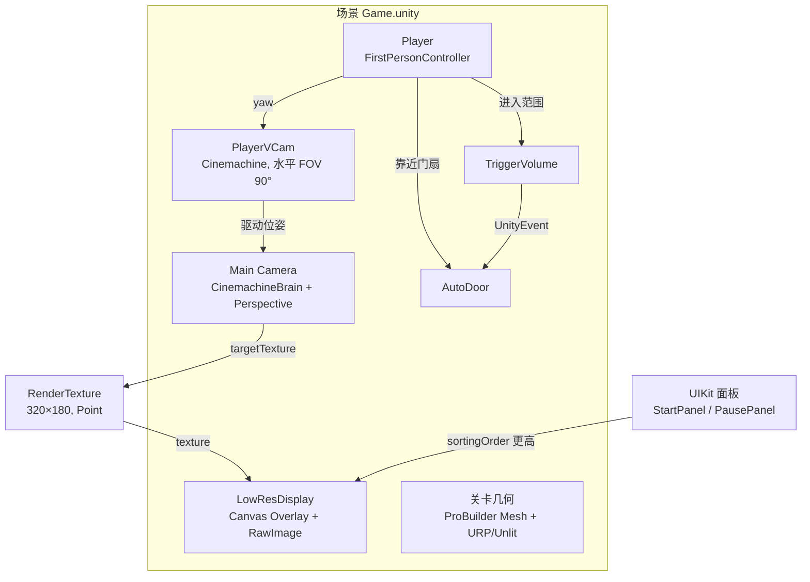
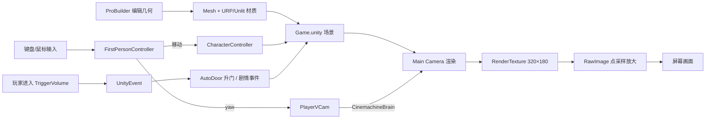
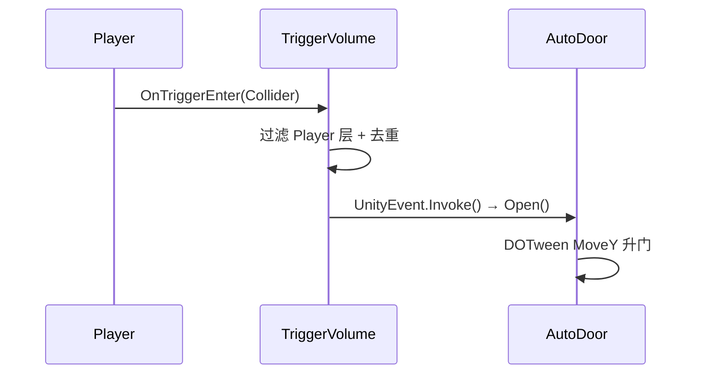

# Doom 式伪 3D 关卡编辑与第一人称渲染设计

- 日期：2026-11-14
- 项目：MakeYourChoice（48h Game Jam）
- 引擎：Unity 2022.3.62f3c1 / URP 14.0.12
- 状态：设计已获用户批准，本文档为实现依据

## 1. 背景与目标

现状是临时用 2D Tilemap 搭墙，编辑体验差：地板、天花板无法单独编辑，触发点没有合适的放置方式，也没有高低差与可开关的门。

目标是得到一套「Doom 式伪 3D」的关卡编辑与运行方案：

- 编辑时用 3D 几何直接搭房间，地板、天花板、墙都是可编辑的面；
- 运行时是第一人称视角，低分辨率大像素，接近 Doom 的观感；
- 支持高低差、门和剧情触发点；
- 48 小时内可完成，不自研编辑器。

## 2. 用户决定

| 决定 | 内容 |
| --- | --- |
| 分辨率 | 16:9，即 320×180 RenderTexture |
| 视角 | 只允许左右转（yaw），不允许上下看（pitch 固定 0） |
| 相机 | 用 Cinemachine（项目已装 2.10.7），不手写传统相机跟随 |
| 旧资产 | DoomDemo 相关脚本、场景、美术资源全部删除 |
| 范围 | 不做升降台、不做刷怪点；触发区保留，用于剧情触发或开门 |

## 3. 总体方案

放弃 CPU 光线投射（`DoomRaycaster`），改为「真实 3D 几何 + 低分辨率渲染 + 点采样放大」。Doom 的关卡语义（门、触发）用 Unity 组件表达，编辑器直接用 ProBuilder。

```
ProBuilder 搭几何 + URP/Unlit 材质
        ↓
PlayerVCam（Cinemachine 虚拟相机，水平 FOV 90°，只随 yaw 旋转）
        ↓ CinemachineBrain
Main Camera（Perspective，渲染到 RT）
        ↓ targetTexture
320×180 RenderTexture（Point 过滤）
        ↓
Canvas Overlay 全屏 RawImage（sortingOrder = -100）
        ↓ 上层
QFramework UIKit 面板（StartPanel / PausePanel）
```

## 4. 渲染管线

### 4.1 项目与 URP 设置

1. **Default Behavior Mode 改 3D**：`Edit > Project Settings > Editor > Default Behavior Mode` 从 `2D` 改为 `3D`（`ProjectSettings/EditorSettings.asset` 里 `m_DefaultBehaviorMode` 由 `1` 变 `0`）。之后新建的贴图、场景按 3D 模式处理；已导入的资产不受影响。
2. 新建 `Universal Renderer Data` 资产（`Assets/Settings/` 下，例如 `Universal3DRenderer.asset`）。
3. 打开 `Assets/Settings/UniversalRP.asset`，把 `Universal3DRenderer` 加入 `m_RendererDataList`，并移除 `Renderer2D`（本项目转 3D 后不再需要 2D Renderer）。
4. 确认 `UniversalRenderPipelineGlobalSettings.asset` 没有残留的 Renderer2D 引用（通过编辑器 UI 操作，Unity 会自动维护）。
5. 场景中删除 `Global Light 2D`：所有材质使用 Unlit，不依赖光照。

### 4.2 相机（Cinemachine）

- 使用项目已安装的 **Cinemachine 2.10.7**：`CinemachineVirtualCamera` 负责视角，`CinemachineBrain` 负责把虚拟相机应用到 `Main Camera`。
- `Main Camera` 保留，挂 `CinemachineBrain`，改为 Perspective，`nearClipPlane = 0.1`，`farClipPlane = 100`，`clearFlags = SolidColor`（黑色），并作为 RT 的渲染相机。
- 新建 `PlayerVCam`（`CinemachineVirtualCamera`），作为玩家 `Eye` 锚点的子物体：局部位置和旋转都为零，Body = None、Aim = None。这样相机位姿完全由玩家 yaw 决定，天然不会出现 pitch。
- 备选方案：vcam 不挂父子，`Follow` 指向 `Eye`，Body 用 Transposer（偏移 0、阻尼 0），Aim 用 Same As Follow Target。实现时优先子物体方案，参数更少、不会漂移。
- 水平视场固定 90°，与 Doom 一致。Cinemachine 的 Lens Field of View 对应 Unity 的垂直 FOV，16:9 下设为约 **58.7°**（`2 * atan(tan(45°) / (16/9))`）。
- 场景里只保留一个激活的 vcam，避免 Brain 在多个 vcam 之间混切。
- 相机渲染到 RenderTexture，不直接渲染到屏幕。
- 因为渲染世界的相机不输出到屏幕，场景里还需要一个「只为 Display 1 提供相机」的 `DisplayCamera`：`cullingMask = 0`、`depth = -100`、`clearFlags = SolidColor`（黑）、`targetTexture = null`、不挂 AudioListener。它不渲染任何物体，只负责让 Game 视图不再提示 `Display 1 No cameras rendering`；画面仍由 Overlay Canvas 的 `RawImage` 显示。

### 4.3 RenderTexture 与显示

- RenderTexture：**320×180**、`filterMode = Point`、`antiAliasing = 1`、`useMipMap = false`、深度 24。
- 显示层：独立 Canvas（Screen Space Overlay，`sortingOrder = -100`），内放全屏 `RawImage`。
- 用 `AspectRatioFitter`（Aspect Mode = Fit In Parent，Aspect Ratio = 16/9）保持比例，超出的屏幕区域显示黑色背景。
- UIKit 面板由 QFramework 运行时创建，层级天然高于 `sortingOrder = -100` 的显示 Canvas，不需要额外处理。
- 运行时由 `LowResDisplay` 组件把相机 `targetTexture` 与 `RawImage.texture` 都指向同一张 RT；RT 在运行时创建（尺寸固定，不属于「场景里摆好的对象」）。

### 4.4 材质与雾

- 全部使用 `URP/Unlit`（Opaque），贴图 `filterMode = Point`、关闭 mipmap。
- 基础材质资产：墙 ×2~3、地板 ×2~3、天花板 ×2~3，放 `Assets/Materials/Level/`。
- 距离雾用 Unity 内置线性雾：`RenderSettings.fog = true`、`fogMode = Linear`、黑色雾色、`fogStartDistance ≈ 4`、`fogEndDistance ≈ 18`。对应原 `DoomRaycaster.LightFor` 的距离衰减。
- 若 URP/Unlit 在该版本下雾效不生效，退路是给材质加一个基于顶点距离的简单渐变（Shader Graph 或手写 shader），但先验证内置雾。

## 5. 关卡编辑工作流

不写自研编辑器，ProBuilder 就是编辑器。

### 5.1 基本操作

- 房间：ProBuilder Cube → 缩放到房间尺寸 → Face 模式删除朝向玩家的那一面（或保留六面，内部可见）→ 应用材质。
- 走廊：选中墙面 → Extrude → 拉伸。
- 楼梯/高低差：复制平台 Cube，抬高摆放，或用 ProBuilder 的顶点编辑。
- 网格吸附：ProBuilder 工具栏 Grid Snapping 设为 1 单位，所有几何对齐整数坐标。
- 材质：ProBuilder 的 Material 面板直接刷面材质。

### 5.2 可放置的预制体

| 预制体 | 作用 | 关键配置 |
| --- | --- | --- |
| `AutoDoor` | 玩家靠近自动升起的门 | 门扇 Mesh + BoxCollider + Trigger + DOTween 位移 |
| `TriggerVolume` | 剧情触发区 | BoxCollider(IsTrigger) + `UnityEvent` + 触发模式 |
| `Player` | 第一人称玩家 | CharacterController + `FirstPersonController` |

### 5.3 编辑期辅助

- `TriggerVolume` 用 `OnDrawGizmos` 画范围框、类型颜色和朝向箭头，选中即可辨认。
- 门的触发范围用 Gizmo 画出，便于调整。

## 6. 运行时系统

组件统一放在 `Assets/Scripts/Level/`，编辑器专用代码放 `Assets/Scripts/Level/Editor/`。

| 组件 | 职责 | 关键点 |
| --- | --- | --- |
| `FirstPersonController` | 读取输入、移动、左右转 | CharacterController；新 Input System；鼠标锁定；pitch 固定 0；WASD + Shift 奔跑；鼠标 X 控制 yaw |
| `LowResDisplay` | 创建 RT、绑定相机与 RawImage | 只做绑定，不建 Canvas/RawImage（场景里摆好） |
| `AutoDoor` | 玩家靠近时升门 | 自身 Trigger 检测 Player 层；DOTween `MoveY`；可配自动关门与延迟 |
| `TriggerVolume` | 进入/离开时触发目标 | BoxCollider IsTrigger；Player 层过滤；一次性/可重复；向外暴露 `UnityEvent` |

约定：

- 触发判定统一用 Layer（例如 `Player` 层），不用名字字符串。
- 所有对外序列化字段加 Odin `[LabelText("中文")]`。
- 不引入事件总线或自定义框架；`TriggerVolume` 只暴露一个 `UnityEvent`，需要联动的组件或对象（门、剧情监听者等）把各自的方法拖进事件列表。

## 7. 图

### 7.1 架构图



### 7.2 数据流图



### 7.3 调用链图



每帧调用链：

```
Update:
  FirstPersonController.ReadInput()
  → 计算 yaw（Mouse.current.delta.x * sensitivity）
  → CharacterController.Move(水平位移)
  → transform.rotation = Quaternion.Euler(0, yaw, 0)

LateUpdate:
  CinemachineBrain 读取激活的 PlayerVCam，更新 Main Camera 位姿
  → Camera 按 targetTexture 渲染到 RT
  → RawImage 自动显示
```

## 8. 迁移步骤

1. **项目与 URP 转 3D**：`Default Behavior Mode` 改为 3D；新建 `Universal3DRenderer`，更新 `UniversalRP.asset` 的 renderer 列表，移除 Renderer2D；删除 `Global Light 2D`；`Main Camera` 改 Perspective，挂 `CinemachineBrain`。
2. **低分辨率管线**：加 RT、显示 Canvas + RawImage、`LowResDisplay`，Play 确认画面是 320×180 放大后的像素画面。
3. **材质与雾**：建 URP/Unlit 材质资产，开 `RenderSettings` 线性雾，确认雾在 Unlit 上生效。
4. **测试房间**：用 ProBuilder 搭一个带走廊、门洞的房间，验证几何与碰撞。
5. **玩家与相机**：`FirstPersonController` + CharacterController，鼠标锁定，只允许 yaw；创建 `PlayerVCam` 并挂到玩家 `Eye` 锚点，确认 Cinemachine 驱动画面。
6. **交互组件**：`AutoDoor`、`TriggerVolume`。
7. **清理**：删除 `Assets/Scripts/Demo`、`Assets/Scenes/DoomDemo.unity`、`Assets/Art/Doom`（均连 `.meta`）；确认 Console 无报错。
8. **验收**：在 `Game.unity` Play 一次，走通「开始面板 → 第一人称移动 → 靠近开门 → 进入触发区触发剧情事件」。

## 9. 验收标准

- `Game.unity` Play 后：StartPanel 正常显示，点击开始进入第一人称。
- 画面为 320×180 点采样放大，16:9，左右有黑边（若屏幕不是 16:9）。
- 鼠标左右转视角，上下移动鼠标不改变俯仰角；WASD 移动，Shift 奔跑。
- 撞墙被挡住，能走过门洞并进入门外走廊。
- 靠近门时门升起；进入触发区能触发配置好的剧情事件。
- Console 无报错、无 MissingReference。

## 10. 风险与取舍

| 风险 | 应对 |
| --- | --- |
| 移除 Renderer2D 后旧 2D 资产报错 | DoomDemo 资产已决定删除；全局搜索确认无其他 2D 依赖 |
| URP/Unlit 不响应内置雾 | 先用内置雾验证；不生效再换简单距离渐变 shader |
| 低分辨率下 UI 与画面层级错乱 | 显示 Canvas 固定 `sortingOrder = -100`，UIKit 在上层；Play 验证 |
| 16:9 RT 在非 16:9 屏幕变形 | `AspectRatioFitter` 保持比例，黑边填充 |
| Cinemachine 与玩家移动不同步/抖动 | vcam 作为 `Eye` 子物体、Body/Aim 全 None，Brain 默认 LateUpdate；只有一个激活 vcam |
| 关闭 Domain Reload 导致静态状态残留 | 新增静态字段必须配 `[RuntimeInitializeOnLoadMethod]` 重置 |
| ProBuilder 与 URP/Unlit 材质兼容 | ProBuilder 5.2.4 支持 URP；材质直接从 ProBuilder 面板刷，验证显示 |

## 11. 范围外

- 升降台、刷怪点（用户已明确去掉）。
- 敌人 AI 与战斗（本设计不含敌人逻辑）。
- 多关卡切换、存档、小地图、音效。
- 自研关卡编辑器或 Doom WAD 导入。
- 抖动/色板等更重的复古后处理（用户已排除 C 档特征）。
