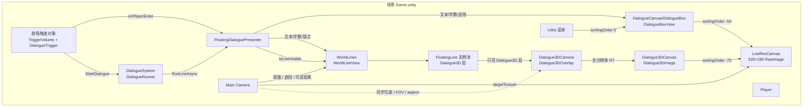
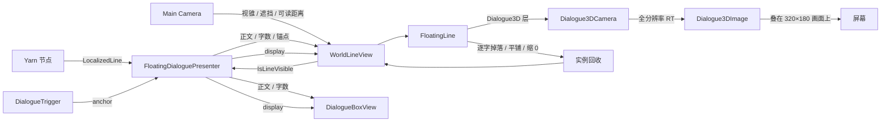
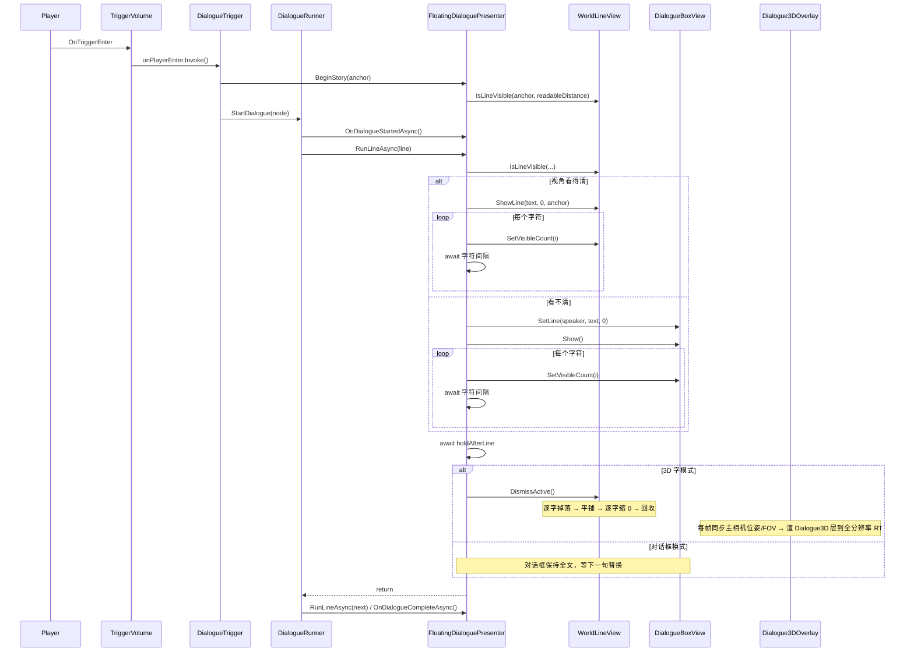

# 米塔式 3D 飘字对话设计

- 日期：2026-11-14
- 项目：MakeYourChoice（48h Game Jam）
- 引擎：Unity 2022.3.62f3c1 / URP 14.0.12
- 对话：Yarn Spinner 3.2.8
- 状态：设计已获用户批准，本文档为实现依据
- 交付方式：按用户全局 git 约定，本文档只写入工作区，不执行 commit

## 1. 背景与目标

项目已安装 Yarn Spinner 3.2.8，但 `Assets` 下还没有任何 `.yarn`、`.yarnproject`、对话代码或对话 UI。现有 `TriggerVolume` 只暴露 `onPlayerEnter` / `onPlayerExit` UnityEvent，不做距离判定。

目标是实现类似《米塔》的 3D 飘字对话：

- 剧情开始时，文字以 3D 形式浮在剧情点上方，带打字机效果；
- **显示方式只由玩家视角决定**：3D 字在画面里且看得清（在视锥内、视线未被遮挡、相机到字的距离不超过可读距离）就用 3D 字，否则改用底部对话框显示同一句、同一进度；
- 不按玩家与触发点的距离切换显示方式；
- 两种形态共用同一份打字进度，切换时不重播；
- 每句结束后，3D 字逐字像纸片一样掉落、带随机旋转地摔成平铺贴地，全部落地后逐字缩放到 `Vector3.zero`；
- 自动推进，不需要玩家按键；
- 48 小时内可完成，不自研对话框架。

世界画面由 `Main Camera` 渲染到 320×180 RenderTexture，再由全屏 `RawImage` 点采样放大；UI 使用全分辨率。3D 字**不走进**这条低分辨率路径：它单独放在 `Dialogue3D` 层，由 `Dialogue3DCamera` 渲到与屏幕同尺寸的全分辨率 RenderTexture，再由全屏 `RawImage` 叠在低分辨率画面之上，所以字和描边是清晰的；对话框属于 UI，同样是全分辨率。

## 2. 用户决定

| 决定 | 内容 |
| --- | --- |
| 每句生命周期 | 每句独立：切下一句时旧句逐字掉落，新句用另一个实例出现，允许短暂同屏 |
| 文字锚点 | 锚定剧情触发点上方约 1.8m，不跟随角色或玩家 |
| 3D 字分辨率 | 单独一层（`Dialogue3D`）走全分辨率叠加，不进 320×180 低分辨率画面；字与描边都不被像素化 |
| 消失方式 | 逐字掉落：每个字像纸片一样带随机旋转下落，落地后变成平铺贴地；全部落地后逐字缩放到 0；不做弹跳、不用 Rigidbody |
| 显示切换 | 只看玩家视角能不能看清 3D 字，不看与触发点的距离；两种形态共享同一份打字进度，不重播 |
| 可见性判定 | 相机视锥内（`viewport.z > 0` 且 x/y ∈ [0,1]）+ 视线 `Linecast` 未被遮挡 + 相机到字的距离 ≤ 可读距离（默认 6m） |
| 防抖 | 可见性变化后等待 0.15s 仍维持新状态才切换，避免屏幕边缘、柱子边缘抖动 |
| 推进方式 | 自动推进，无玩家输入；打字完停留 1.2s 进下一句 |
| 架构 | 单个 `DialoguePresenterBase` 持有行状态、打字进度和显示方式；3D 视图与对话框视图只负责渲染 |
| 3D 字内容 | 3D 字只显示正文；角色名只显示在对话框中 |
| 对话框保持 | 对话框模式下保持到下一句替换或对话结束，避免每句闪烁 |
| 对话框实现 | 独立全屏 Canvas + CanvasGroup，不走 UIKit 面板生命周期 |

## 3. 总体方案

采用“单个 Presenter + 两个纯视图”的结构：

- `DialogueRunner` 只挂一个自定义 `FloatingDialoguePresenter`，不挂 `LineAdvancer`，由 Presenter 自己控制打字和停留；
- `FloatingDialoguePresenter` 持有当前行、已显示字数、当前显示方式（3D 字/对话框）、当前阶段（显示/停留/收尾/空档）；
- `WorldLineView` 管理 3D 字实例池，`DialogueBoxView` 管理底部对话框；
- 两个视图都不持有对话状态，只接收 Presenter 下发的文本、字数、位置和显隐指令；
- 显示方式由 Presenter 每帧向 `WorldLineView` 询问 `IsLineVisible(anchor.position, readableDistance)`（视锥 + 遮挡 + 可读距离），并用 `displaySwitchDelay` 做时间防抖；
- 3D 字的逐字掉落、平铺与缩小由 `FloatingLine` 自己的状态机驱动，逐个改写 TMP 网格顶点，不依赖物理引擎；
- 3D 字只有在 `Dialogue3D` 层：主相机的 `cullingMask` 去掉该层（不进 320×180 画面），`Dialogue3DCamera` 只渲染该层，`Dialogue3DOverlay` 每帧同步主相机位姿与 FOV、把结果输出到全屏 `RawImage`。

```
TriggerVolume.onPlayerEnter
        ↓
DialogueTrigger.StartDialogue()
        ↓
FloatingDialoguePresenter.BeginStory(anchor)
        ↓
DialogueRunner.StartDialogue(node)
        ↓
FloatingDialoguePresenter.RunLineAsync(line)
        ├─ 视角看得清 → WorldLineView → FloatingLine（3D TMP，Dialogue3D 层）
        │                              ↓
        │                  Dialogue3DCamera 渲到全分辨率 RT
        │                              ↓
        │                  Dialogue3DCanvas/RawImage 叠在 320×180 画面上
        └─ 看不清 → DialogueBoxView（全屏 Canvas 底部对话框）
        ↓
打字完成 → 停留 1.2s → 旧 3D 字逐字掉落平铺、缩到 0 → 下一句
```

## 4. 可见性与显示方式

### 4.1 可见性判定

`WorldLineView.IsLineVisible(Vector3 worldPosition, float readableDistance)` 依次判断，任一不满足就算“看不清”：

1. 相机到字的世界距离 ≤ `readableDistance`（默认 6m，配置在 `FloatingDialoguePresenter` 上）；
2. `Camera.WorldToViewportPoint` 后 `viewport.z > 0` 且 `viewport.x/y` 都在 `[0,1]`（在画面内）；
3. 从相机位置到字的 `Physics.Linecast` 不被墙体遮挡。

- 第 1 条衡量“太远看不清”，第 2、3 条衡量“没出现在画面里”；
- 遮挡射线用 `~LayerMask.GetMask("Player")` 并 `QueryTriggerInteraction.Ignore`，避免玩家自己的胶囊体和 Trigger 挡住判定；
- 这是“相机到字”的距离，不是“玩家到触发点”的距离；相机不可用时返回 false，直接走对话框。

### 4.2 防抖规则

| 当前显示 | 可见性 | 结果 |
| --- | --- | --- |
| 3D 字 | 保持可见 | 保持 3D 字 |
| 3D 字 | 变为不可见 | 等 `displaySwitchDelay`（0.15s）仍不可见才切对话框 |
| 对话框 | 保持不可见 | 保持对话框 |
| 对话框 | 变为可见 | 等 `displaySwitchDelay` 仍可见才切回 3D 字 |

- 0.15s 防抖替代滞回带，避免文字贴到屏幕边缘或被柱子擦边时来回闪；
- 对话开始时立即按当前可见性决定显示方式，不等延迟；
- 对话过程中玩家离开触发区不中断对话，只由可见性决定显示方式。

### 4.3 显示方式切换时的阶段处理

| 当前阶段 | 切到 3D 字 | 切到对话框 |
| --- | --- | --- |
| 正在显示 / 停留 | 隐藏对话框；用当前 `revealed` 字数显示 3D 字 | 隐藏所有 3D 字；对话框显示当前进度 |
| 正在收尾（逐字掉落） | 保留收尾动画，不生成新字；隐藏对话框 | 立即回收还在掉落的 3D 字；对话框隐藏（旧句已结束） |
| 空档（两句之间） | 隐藏对话框；不生成新字 | 隐藏所有 3D 字；隐藏对话框 |

## 5. 组件与职责

组件统一放在 `Assets/Scripts/Dialogue/`，命名空间 `Game.Dialogue`。对外序列化字段加 Odin `[LabelText("中文")]`；关键引用加 `[Required]`。

| 组件 | 挂载位置 | 职责 |
| --- | --- | --- |
| `DialogueTrigger` | 剧情触发对象 | 保存节点名、文字锚点；被 `TriggerVolume.onPlayerEnter` 调用；防止重复启动 |
| `FloatingDialoguePresenter` | `DialogueSystem` | 持有行状态、打字进度、显示方式、阶段；每帧询问 3D 字可见性；向两个视图下发状态 |
| `WorldLineView` | `WorldLines` 根节点 | 管理 3D 字实例池；显示当前行、更新字数、回答可见性判定、触发收尾、全部隐藏 |
| `FloatingLine` | 3D 字预制体 | 单句 3D 字：设置文本/可见字数、面向相机、浮动、逐字纸片掉落并平铺、逐字缩 0、回收 |
| `DialogueBoxView` | `DialogueCanvas/DialogueBox` | 底部对话框：CanvasGroup 显隐、正文/角色名、按字数截断 |
| `Dialogue3DOverlay` | `Dialogue3DCamera` | 只渲 `Dialogue3D` 层的相机：每帧同步主相机位姿/FOV、输出全分辨率 RT 给 `Dialogue3DCanvas/Dialogue3DImage` |

### 5.1 DialogueTrigger

序列化字段：

- `DialogueRunner runner`
- `FloatingDialoguePresenter presenter`
- `Transform textAnchor`
- `string nodeName = "Start"`

行为：

- `StartDialogue()`：校验 `runner`、`presenter`、`textAnchor` 与节点名；若 `runner.IsDialogueRunning` 或 `presenter.IsBusy`，`Debug.LogWarning` 并返回；若 `presenter.BeginStory(textAnchor)` 返回 false，直接返回；否则 `await runner.StartDialogue(nodeName)`（3.2.8 中它是 `async YarnTask`，方法本身用 `async void`）。
- 不再有 near/far 字段，也没有 `OnValidate()`：显示方式由视角可见性决定，不需要逐触发点配置距离。
- 不自带 Collider，也不自己检测玩家；触发统一由现有 `TriggerVolume` 负责。

### 5.2 FloatingDialoguePresenter

序列化字段：

- `DialogueBoxView dialogueBox`
- `WorldLineView worldLines`
- `float charsPerSecond = 25`
- `float holdAfterLine = 1.2f`
- `float readableDistance = 6f`（相机到字超过这个距离就算看不清，改用对话框）
- `float displaySwitchDelay = 0.15f`（可见性反转后等这么久再切，防抖）

运行时状态：

- `Transform anchor`
- `LineDisplay display`（`World` / `Panel`）
- `LinePhase phase`（`Idle` / `Revealing` / `Holding` / `Dismissing`）
- `string bodyText` / `string speakerName`
- `int revealed`
- `bool isDialogueActive`
- `bool lineVisible` / `float visibilityChangedAt`（当前可见性与最近一次反转时间）

方法：

- `BeginStory(Transform anchor)`：先校验 `anchor`、`dialogueBox`、`worldLines`，为空则 `Debug.LogError` 并返回 false；保存锚点；用 `IsLineVisible` 立即决定初始显示方式并重置防抖计时；清空当前行与进度；隐藏对话框、回收所有 3D 字。此时还不把 `isDialogueActive` 设为 true，避免 `StartDialogue` 失败后卡在忙状态；校验通过返回 true。
- `CancelStory()`：异常兜底；清空当前行/进度、隐藏对话框、回收所有 3D 字，并把 `isDialogueActive` 设为 false。
- `OnDialogueStartedAsync()`：设 `isDialogueActive = true`，阶段设为 `Idle`。
- `RunLineAsync(LocalizedLine line, LineCancellationToken token)`：取正文与角色名，重置 `revealed`，阶段设为 `Revealing`；按显示方式初始化视图；逐字符增加 `revealed` 并刷新视图；完成后阶段设为 `Holding`，等待 `holdAfterLine`；3D 模式调用 `DismissActive()` 后保持 `Dismissing`，对话框模式保持全文并把阶段设回 `Idle`；返回后由 Yarn 自动进入下一句。等待时用 `token.NextContentToken`，并在每个等待后检查 `token.IsNextContentRequested`。
- `OnDialogueCompleteAsync()`：`isDialogueActive = false`；隐藏对话框；如果当前阶段是显示/停留（例如被取消），立即 `worldLines.HideAll()`；如果正在收尾，则保留最后一句，让它自然掉完。
- `Update()` → `UpdateDisplayMode()`：仅在 `isDialogueActive` 时调用 `worldLines.IsLineVisible(anchor.position, readableDistance)`；可见性变化时记录 `visibilityChangedAt`；`Time.time - visibilityChangedAt >= displaySwitchDelay` 才真正改写 `display` 并调用 `ApplyDisplay()`。
- `ApplyDisplay()`：按 4.3 的阶段表，把当前进度交给新视图，或隐藏不需要的视图。
- `ApplyReveal()`：按当前显示方式把 `revealed` 下发给 3D 字或对话框。
- `IsBusy`：只读属性，返回 `isDialogueActive`。

### 5.3 WorldLineView

序列化字段：

- `FloatingLine prefab`
- `Transform poolRoot`
- `Camera worldCamera`
- `LayerMask groundMask`（生成 3D 字时注入）
- `int maxLines = 4`

运行时状态：

- `FloatingLine active`
- `Queue<FloatingLine> idle`
- `List<FloatingLine> allLines`

方法：

- `ShowLine(string text, int visibleCount, Vector3 worldPosition)`：正常流程要求当前没有 active；若已有 active，`Debug.LogWarning` 并忽略（Presenter 应先判断 `HasActive`，已有则只调 `SetVisibleCount`）。没有 active 时从池中取实例，设置相机、显示文本与字数。
- `SetVisibleCount(int count)`：只更新当前 active。
- `IsLineVisible(Vector3 worldPosition, float readableDistance)`：回答“这个位置的字现在玩家看得清吗”——相机为空返回 false；距离超过 `readableDistance` 返回 false；`WorldToViewportPoint` 要求 `viewport.z > 0` 且 x/y ∈ `[0,1]`；最后用 `Physics.Linecast`（mask 为 `~LayerMask.GetMask("Player")`，忽略 Trigger）检查遮挡。判定规则见 4.1。
- `DismissActive()`：让当前 active 开始逐字纸片掉落，并把 `active` 置空；实例仍在池中，直到它自己完成缩小后回收。
- `HideAll()`：立即停止所有掉落/缩小并回收全部实例；用于切对话框、开始新剧情。
- `HasActive`：只读属性，供 Presenter 判断是否需要新建 3D 字。
- 实例事件 `Finished`：自然缩小完成后回收；`HideAll()` 直接回收，不触发事件，避免重复入池。

池规则：

- 最多 4 个实例；优先取空闲实例，不够就 `Instantiate`；
- 达到上限仍全忙：`Debug.LogWarning`，复用最老的实例；
- `WorldLines` 根节点保持 `scale = 1`，避免影响 3D 字包围盒与缩放计算。

### 5.4 FloatingLine

序列化字段：

- `TMP_Text text`
- `Camera faceCamera`（由 `WorldLineView` 注入）
- `float bobAmplitude = 0.04f` / `float bobSpeed = 2f`
- `float gravity = 9.8f`（纸片下落的加速度）
- `LayerMask groundMask` / `float groundOffset = 0.02f`
- `float impactPause = 0.35f`（全部落地后停多久再开始缩小）
- `float fallStagger = 0.035f`（相邻两个字的起落间隔）
- `float fallDrift = 0.12f`（落地时的横向随机偏移）
- `float randomTilt = 35f`（平铺姿态的随机倾斜幅度）
- `float shrinkStagger = 0.02f` / `float shrinkDuration = 0.3f`

状态：`Idle / Active / Dissolving / Finished`。

方法：

- `Configure(Camera camera, LayerMask mask)`：由 `WorldLineView` 注入世界相机与地面层。
- `Show(string text, int visibleCount, Vector3 worldPosition)`：确保 `gameObject.SetActive(true)`；重置字数据、位置、旋转、缩放（`baseScale` 在 `Awake` 记录）；设置文本后 `ForceMeshUpdate()`，再设置可见字数；进入 `Active`。
- `SetVisibleCount(int count)`：设置 `text.maxVisibleCharacters`。
- `Dismiss()`：补齐整句可见字数 → 向下 `Raycast` 取地面高度 → 为每个可见字符建立 `Glyph`（起点、落点、平铺姿态、随机旋转、起落延迟）→ 进入 `Dissolving`。
- `HideImmediate()`：丢弃所有字数据、复位缩放并 `SetActive(false)`；用于 `HideAll()`。

`Glyph` 动画（逐字，全部改写 TMP 网格顶点）：

- 每个可见字符记录自己的 `vertexIndex`、`materialReferenceIndex`、枢轴（四个顶点平均）与四个原始顶点；
- 下落：`y` 用 `p²` 加速（模拟重力），`x/z` 线性漂移到带随机偏移的落点，每字延迟 `index * fallStagger`；
- 旋转：`Slerp` 到平铺姿态（`Euler(90° + 随机倾斜, 随机 yaw, 随机倾斜)`）并叠加随机轴的自转，落地时吸附到平铺姿态；
- 全部落地后停 `impactPause`，再按 `index * shrinkStagger` 依次把该字的缩放从 1 降到 0（围绕字自身枢轴，停在贴地位置）；
- 每帧把结果写回 `textInfo.meshInfo[].vertices` 并 `text.UpdateVertexData(TMP_VertexDataUpdateFlags.Vertices)`；全部缩到 0 时进入 `Finished` 并抛事件。

### 5.5 DialogueBoxView

序列化字段：

- `CanvasGroup canvasGroup`
- `TMP_Text bodyText`
- `TMP_Text speakerText`
- `GameObject speakerRoot`
- `float fadeInDuration = 0.15f`
- `float fadeOutDuration = 0.12f`

方法：

- `SetLine(string speaker, string body, int visibleCount)`：设置角色名与正文，`bodyText.ForceMeshUpdate()` 后刷新 `maxVisibleCharacters`；角色名为空时隐藏 `speakerRoot`。
- `SetVisibleCount(int count)`：把 count 限制在 0 到 `bodyText.textInfo.characterCount` 之间。
- `Show()` / `Hide()`：CanvasGroup alpha 用 DOTween 淡入淡出；切换前 `Kill` 旧 Tween，避免叠加。
- 面板常驻场景、初始 alpha = 0，不反复 `SetActive`；所有 Graphic `raycastTarget = false`，`CanvasGroup.blocksRaycasts = false`。

### 5.6 Dialogue3DOverlay

序列化字段：

- `Camera mainCamera`
- `RawImage targetImage`

行为：

- `Awake()` 取自身 `Camera`；`mainCamera` 或 `targetImage` 为空时 `Debug.LogError` 并 `enabled = false`（不静默兜底）；主相机 `cullingMask` 仍包含文字层时 `Debug.LogWarning`，提示低分辨率画面会出现重影。
- `LateUpdate()` 每帧同步位姿与投影：位置/朝向、`fieldOfView`、`nearClipPlane`、`farClipPlane`、`orthographic`、`orthographicSize`，并把 `aspect` 强制设成主相机的 `aspect`（主相机渲 320×180，`aspect` 是 1.7778）；屏幕尺寸变化时重建 RenderTexture。
- RenderTexture：`Screen.width × Screen.height`、深度 24、`ARGB32`、`FilterMode.Bilinear`、`antiAliasing = 1`，命名 `Dialogue3DOverlay`；创建后赋给当前相机 `targetTexture` 与 `targetImage.texture`；`OnDestroy()` 释放并销毁。
- 相机本身在场景里摆好：`cullingMask` 只含 `Dialogue3D`、`clearFlags = SolidColor` 且背景 alpha = 0、`allowHDR/allowMSAA = false`、`UniversalAdditionalCameraData` 的 `renderType = Base`、`renderPostProcessing = false`、`antialiasing = None`、`renderShadows = false`，不带 `AudioListener`。
- 因为 RawImage 是全屏拉伸的，overlay 相机用与主相机相同的 `aspect` 渲染后同样被拉伸，几何上与 320×180 路径重合，文字不会错位。

## 6. 3D 飘字表现

### 6.1 预制体

`Assets/Prefabs/Dialogue/FloatingLine.prefab`：

- 根节点挂 3D `TextMeshPro` 与 `FloatingLine`，`layer` 为 `Dialogue3D`（跟随预制体下所有渲染器）；
- TMP 初值：字号 48、整体 scale `0.075`、矩形 `400×120`、自动字号 `28–48`；实测世界尺寸约 `1.8m 宽 × 0.36m 高`，2.5m 处在 1080p 下约 139px 高，可读；
- 为什么是 `0.075`：`0.016` 时世界尺寸只有 `0.38 × 0.077m`，低分辨率下约 4px，等于不可读，已实测调整；
- 字体：`Assets/Fonts/SourceHanSansCN-Medium SDF.asset`；
- 颜色白色，黑色描边（`OUTLINE_ON`，`_OutlineWidth = 0.2`，`_OutlineSoftness = 0`）：描边是全分辨率渲染的，1080p 下约 2px，清晰可见；
- 只显示正文，不显示角色名；
- TMP 轴心保持中心，`FloatingLine` 根节点位置即文字中心；
- 逐字收尾直接改写 TMP 网格顶点，所有枢轴与缩放都在 TMP 局部空间里计算，根节点不要再叠加额外的非均匀缩放，否则需要换算；
- 这些数值是初值，Play 时按实际观感调整，不写死在代码里。

### 6.2 打字机

- Presenter 逐字符增加 `revealed`，视图设置 `TMP.maxVisibleCharacters`，不重建文本。
- 3D 字与对话框共享同一个 `revealed`；切换模式时用当前值重新显示，不重播。
- 本期只支持纯文本；不使用 Yarn 的富文本/标记。若台词包含标记，`body.Length` 与 TMP 可见字符数可能不一致，属于范围外。

### 6.3 朝向与浮动

- 朝向相机只跟 yaw，保持文字竖直，不跟随相机 pitch。
- 实现时以预制体实际正面校准一次；如果文字背面朝向相机，在 yaw 上加 180°。
- `Active` 状态下轻微上下浮动：振幅 0.04m、角速度 2 rad/s。
- 进入 `Dissolving` 后冻结朝向：已经平铺在地上的字如果继续跟着相机转，会像陀螺一样在地上打转。

### 6.4 逐字纸片掉落、平铺与缩小

`Dismiss()` 时：

1. 先 `text.maxVisibleCharacters = characterCount` 并 `ForceMeshUpdate()`，保证整句都参与掉落（中途被切句时也是整句散落）；
2. 从锚点向下做 `Physics.Raycast`，距离 50m，使用 `groundMask`，忽略 Trigger，得到 `groundWorldY = hit.point.y + groundOffset`；换算成 TMP 局部高度 `landLocalY`；
3. 为每个可见字符建立 `Glyph`：
   - 枢轴 = 该字四个顶点的平均；
   - 起点 = 枢轴原位；落点 = 原 x/z 加 `±fallDrift` 随机偏移、y 为 `landLocalY`；
   - 平铺姿态 = `Quaternion.Euler(90° + 随机倾斜, 随机 yaw, 随机倾斜)`，让字面朝上、随机转一个角度，像纸片摔在地上；
   - 起落延迟 = `index * fallStagger`，所以是逐字掉落；
   - 下落时长 = `sqrt(2 * 下落高度 / gravity)`，每字按自己的起始高度算；
4. 逐帧推进：`y` 走 `p²`（加速下落），`x/z` 线性飘移，旋转从原始姿态 `Slerp` 到平铺姿态并叠加随机轴自转；到 `p = 1` 吸附成平铺姿态；
5. 全部落地后停 `impactPause = 0.35s`，让整句在地上躺一下；
6. 再按 `index * shrinkStagger` 依次把每个字的缩放从 1 降到 0（`shrinkDuration = 0.3s`），围绕字自身枢轴收缩，停在贴地位置；
7. 全部缩到 0 后 `Finished` → `WorldLineView` 回收。

实现要点：

- 每帧把字的新姿态写回 `textInfo.meshInfo[].vertices`（顶点 = 落点/当前位置 + 旋转后的偏移 × 缩放），再 `text.UpdateVertexData(TMP_VertexDataUpdateFlags.Vertices)`；
- 不用 `Rigidbody`、不用逐个字生成对象，只有一个 TMP 网格；
- `HideImmediate()` 丢弃 `Glyph` 数据，`Show()` 重新 `ForceMeshUpdate()` 会重建网格，所以复用时不需要恢复顶点。

异常处理：

- 射线没有命中地面：`Debug.LogWarning`，跳过掉落，原地逐字缩小；不静默、不假装落地。
- 没有 `TMP_Text`：`Debug.LogError`，该实例不参与显示。
- 复用时重置 `maxVisibleCharacters`、缩放、位置与字数据，避免上次残留。

### 6.5 实例池与同屏

- 旧句开始收尾时，下一句同时进入打字；单句收尾约 `0.6s 掉落 + 0.35s 平铺 + 0.3s 缩小 + 逐字延迟 ≈ 1.3s`，与下一句打字重叠，同屏最多 2–3 条；
- 池上限 4 留余量，允许旧句掉落与新句出现短暂同屏；
- 切到对话框时 `HideAll()` 立即回收还在掉落的实例，避免 3D 字与对话框重复；
- 开始新剧情时也 `HideAll()`，清掉上一段对话的残留。

## 7. 底部对话框

### 7.1 结构

- 全屏 `DialogueCanvas`：Screen Space Overlay，`sortingOrder = -50`，位于低分辨率 `RawImage`（-100）之上、UIKit 菜单（0）之下。
- 底部 `DialogueBox`：深色半透明底（黑色 alpha 0.78），锚点 `(0.5, 0)`，最大宽 1100px，高 220px，距底 40px；不做圆角，细边框可选。
- 正文 TMP：思源黑体 30px、白色、行距 1.15、左上对齐；上边距要比角色名再低一档（正文 `offsetMax.y = -56`），否则角色名与正文第一行重叠。
- 角色名 TMP：24px、暖黄色、左上；为空时隐藏。
- 面板挂 `CanvasGroup`，淡入 0.15s、淡出 0.12s；所有 Graphic 不接收射线。

### 7.2 显隐规则

- 视角看得清：对话框淡出；3D 字显示。
- 看不清：3D 字全部隐藏；对话框显示同一句、同一 `revealed`。
- 一句结束：
  - 3D 字模式：3D 字逐字掉落、平铺、再逐字缩到 0；
  - 对话框模式：对话框保持全文，不立刻隐藏，等下一句替换，避免闪烁。
- 对话结束：对话框淡出；最后一句 3D 字如果正在收尾，让它自然掉完。
- 对话框隐藏期间仍然更新文本与 `maxVisibleCharacters`，保证再次切到对话框时进度正确。

## 8. Yarn 接线与自动推进

- 场景中一个 `DialogueRunner`，指定 YarnProject 和 `startNode`；把 `FloatingDialoguePresenter` 加进 Runner 的 dialogue presenters 列表。
- 关闭 `DialogueRunner` 的自动开始（`startAutomatically`），只由 `DialogueTrigger.StartDialogue` 启动，避免场景加载时无锚点启动。
- 不使用 `LineAdvancer`；Presenter 自己等待“打字 + 停留”结束。
- 重写 `DialoguePresenterBase` 的 `OnDialogueStartedAsync`、`RunLineAsync`、`OnDialogueCompleteAsync`；不实现选项。
- 正文：`line.TextWithoutCharacterName.Text`；角色名：`line.CharacterName`。
- `RunLineAsync` 返回后由 Yarn 自动进入下一句：3.2.8 的 `DialogueRunner.OnLineReceivedAsync` 在 `RunLocalisedLine` 返回后调用 `Dialogue.Continue()`。实现不要调用 `RequestNextLine()`，那会取消当前行并触发额外的取消路径。
- 每字符与等待期间检查 `LineCancellationToken.IsNextContentRequested`；等待使用 `token.NextContentToken` 并配合 `SuppressCancellationThrow()`，对话被取消时立即退出，不继续停留，由 `OnDialogueCompleteAsync` 或下一次 `BeginStory` 清理视图。
- `isDialogueActive` 只在 `OnDialogueStartedAsync` 设为 true，避免 `StartDialogue` 因节点不存在而失败后永久卡在忙状态。
- 本期不支持选项、语音、头像；测试节点不得包含选项。

## 9. 场景与资源搭建

| 对象 | 挂什么 | 配置 |
| --- | --- | --- |
| `DialogueSystem` | `DialogueRunner` + `FloatingDialoguePresenter` | 指定 YarnProject、startNode；Presenter 指定 DialogueBox、WorldLines；把 Presenter 加进 Runner 的 presenters 列表 |
| `DialogueCanvas/DialogueBox` | `DialogueBoxView` | 指定 CanvasGroup、正文 TMP、角色名 TMP；Canvas sortingOrder = -50 |
| `WorldLines` | `WorldLineView` | 指定 FloatingLine 预制体、池根节点、Main Camera、地面层、maxLines = 4 |
| 剧情触发对象 | 现有 `TriggerVolume` + 新增 `DialogueTrigger` | 指定 runner、presenter、nodeName、文字锚点 |
| 文字锚点 | 触发对象下的空子物体 | 局部 `(0, 1.8, 1.2)`，需要时再调高度 |
| `Dialogue3DCamera` | `Camera` + `UniversalAdditionalCameraData` + `Dialogue3DOverlay` | 只渲 `Dialogue3D` 层；SolidColor 且 alpha = 0；无后处理、无抗锯齿、无阴影、无 AudioListener；`Dialogue3DOverlay` 指定 Main Camera 与 `Dialogue3DImage` |
| `Dialogue3DCanvas/Dialogue3DImage` | `RawImage` | 全屏拉伸（anchorMin 0 / anchorMax 1 / offset 0）、`raycastTarget = false`、图片由脚本在运行时指向 RT；Canvas sortingOrder = -75 |
| 主相机 `Main Camera` | CinemachineBrain（已有） | `cullingMask` 去掉 `Dialogue3D` 层（当前为 `-9`） |

步骤：

1. 在场景中创建 `DialogueSystem`，添加 `DialogueRunner` 与 `FloatingDialoguePresenter`，指定引用。
2. 创建 `DialogueCanvas` 与底部 `DialogueBox`，添加 `DialogueBoxView`，指定字体与引用。
3. 创建 `WorldLines` 根节点，添加 `WorldLineView`，指定 FloatingLine 预制体与 Main Camera。
4. 创建 `FloatingLine` 预制体与 3D TMP 材质，放到 `Assets/Prefabs/Dialogue/`；地面层在 `WorldLineView` 上配置，生成时注入到每个 3D 字。
5. 新建临时 `Assets/Yarn/TestDialogue.yarn` 与 `.yarnproject`，节点 `Start` 放几句测试台词；`.yarnproject` 通过 Yarn Spinner 编辑器创建，不手写序列化文件。
6. 在场景的剧情触发对象上追加 `DialogueTrigger`，创建文字锚点子物体；把 `TriggerVolume.onPlayerEnter` 连到 `DialogueTrigger.StartDialogue`。
7. 确认 `DialogueCanvas` 的 sortingOrder 在低分辨率画面之上、UIKit 菜单之下。
8. 新建 `Dialogue3D` 层（当前是第 3 层）；把 `FloatingLine.prefab` 的根节点设为该层；主相机 `cullingMask` 去掉该层。
9. 创建 `Dialogue3DCamera`：相机 + `UniversalAdditionalCameraData`（Base / 无后处理）+ `Dialogue3DOverlay`，`clearFlags = SolidColor` 且背景 alpha = 0。
10. 创建 `Dialogue3DCanvas`（sortingOrder -75）与全屏 `Dialogue3DImage`（`RawImage`，`raycastTarget = false`），把两者引用填进 `Dialogue3DOverlay`。
11. 不改通用 `TriggerVolume` 预制体；场景、预制体、YarnProject 用 Unity 编辑器或 Unity MCP 修改，不手写 YAML；不手改 `.meta`，不新建 asmdef（脚本编入 Assembly-CSharp）。

## 10. 图

### 10.1 架构图



### 10.2 数据流图



### 10.3 调用链图



每帧调用链：

```
Presenter.Update() → UpdateDisplayMode():
  → worldLines.IsLineVisible(anchor.position, readableDistance)
      → 距离 > readableDistance ? false
      → WorldToViewportPoint 不在画面内 ? false
      → Physics.Linecast 被挡住 ? false
  → 可见性变化时记 visibilityChangedAt
  → 稳定 displaySwitchDelay 后 → ApplyDisplay()

FloatingLine.Update():
  Active     → 浮动；LateUpdate 朝向相机（yaw）
  Dissolving → 逐字推进：下落(p²) + 旋转 + 平铺 + 全部落地后逐字缩小
             → ApplyGlyphMeshes() 写回 TMP 顶点
             → LateUpdate 跳过转向，平铺的字不再跟相机转
  Finished   → 抛 Finished 事件，WorldLineView 回收

Dialogue3DOverlay.LateUpdate()（每帧）:
  → 同步主相机位置/朝向/FOV/near/far/正交与 aspect
  → 屏幕尺寸变化时重建 Screen.width×Screen.height 的 ARGB32 RT
  → 相机只渲 Dialogue3D 层，结果经 RawImage 叠在 320×180 画面上
```

## 11. 错误处理

- 关键引用为空：`Debug.LogError` 并中止本次对话，不自动查找对象、不填默认值。
- `DialogueTrigger` 在对话进行中重复触发：`Debug.LogWarning` 并忽略。
- `readableDistance < 0.1`、`displaySwitchDelay < 0`、`charsPerSecond <= 0`、`gravity <= 0`、`shrinkDuration <= 0`、`impactPause < 0`、`fallStagger / shrinkStagger / fallDrift / randomTilt < 0`：`OnValidate` 纠正到合法值。
- 空台词：`Debug.LogWarning`，跳过打字，直接进入停留。
- 地面射线未命中：`Debug.LogWarning`，跳过掉落，原地逐字缩小。
- 3D 字池耗尽：`Debug.LogWarning`，复用最老实例。
- `TMP_Text` 缺失：`Debug.LogError`，该实例不显示。
- `WorldLineView.prefab` / `poolRoot` 为空：`Debug.LogError`，不显示 3D 字。
- `DialogueBoxView.canvasGroup` / `bodyText` 为空：`Debug.LogError`，不显示对话框。
- `worldLines.worldCamera` 为空：`IsLineVisible` 返回 false，直接走对话框，不每帧刷错误。
- `Dialogue3DOverlay.mainCamera` / `targetImage` 为空：`Debug.LogError` 并禁用该组件，不自行查找对象。
- 主相机 `cullingMask` 仍包含 `Dialogue3D` 层：`Debug.LogWarning`（低分辨率画面里会出现重影）。
- 对话被取消：检查 `LineCancellationToken`，停止打字与停留，交给完成/下一次开始清理。
- 不静默吞异常；所有可预期失败至少有一条 Console 警告或错误。

## 12. 验收标准

1. 进入剧情触发区：锚点处出现 3D 字，有打字机效果，面向相机且轻微浮动。
2. 把视角转开（3D 字离开画面）：约 0.15s 后 3D 字消失，底部对话框出现同一句、同一进度，不重播。
3. 转回视角：对话框消失，3D 字按同一进度恢复；已经打完则显示全文。
4. 后退到相机距字 > 6m（仍看得见）：切到对话框，3D 字隐藏；走回 6m 内恢复 3D 字，进度不重播。
5. 把锚点挡在柱/墙后：切到对话框；移开恢复，不来回闪。
6. 一句打完停留 1.2s：3D 字逐字掉落、带随机旋转地摔成平铺，全部落地停约 0.35s 后逐字缩到 0；下一句用另一个实例出现，允许短暂同屏。
7. 对话结束：对话框消失；最后一句正常掉完，没有残留 3D 字。
8. 再次进入触发区：能重新开始；没有重复监听、没有上次残留。
9. 连续 Play 两次（Domain Reload 关闭）：第二次仍正常，无静态状态残留。
10. 3D 字与描边是全分辨率的：1080p 下字高约 139px、黑描边约 2px 清晰可见；320×180 画面里没有 3D 字的重影。
11. Console 无报错、无未处理空引用；1080p 下 2–4 个 TMP 不造成明显掉帧。

## 13. 风险与对策

| 风险 | 对策 |
| --- | --- |
| 3D 字被像素化、描边看不见 | 已改为 `Dialogue3D` 层 + `Dialogue3DCamera` 全分辨率叠加（不进 320×180），1080p 下字高约 139px、描边约 2px；对话框仍承担远距离可读性 |
| 全分辨率叠加层与低分辨率画面错位 | overlay 相机每帧同步主相机位姿/FOV 并强制同 `aspect`，RawImage 整屏拉伸，几何上与 320×180 路径等价；改相机参数后需 Play 复核 |
| 平铺在地上的纸片在低视角下被压扁、不易看清 | 目前接受（物理上正确）；落地停顿给到 0.35s，让玩家能看见平铺瞬间；如需更明显可缩短缩小前的停顿并加大字距 |
| TMP 对无空格中文不自动换行 | 在 320×180 与 1080p 对话框各测一次；必要时在 Presenter 里按最大字数手动插换行 |
| 逐字改写 TMP 顶点与 TMP 自身刷新冲突 | 只在 `Dissolving` 阶段写顶点；`Show()` 会 `ForceMeshUpdate()` 重建网格，不残留旧顶点 |
| Yarn 3.2.8 `RunLineAsync` 返回后不自动推进 | 实测验证（已确认会自动推进）；若不推进，在停留结束后显式请求下一句，并加防重入 |
| 超长台词在 220px 高对话框溢出 | 限制单句长度，或后续加自动滚动；本期不做滚动 |
| 3D 字被墙体遮挡时误判 | 用 `Linecast` 判定；锚点尽量放在开阔处；本期不做穿透墙体显示 |
| 对话框与 UIKit 菜图层级冲突 | 对话框固定 -50，3D 字叠加层 -75，低分辨率画面 -100，UIKit 0；Play 验证通过 |
| 关闭 Domain Reload 导致静态状态残留 | 本功能不使用静态事件或静态状态；实例事件随场景重载释放 |
| 对话启动失败后卡在忙状态 | `isDialogueActive` 只在 `OnDialogueStartedAsync` 设为 true；`StartDialogue` 失败不会置忙 |
| 多个剧情触发区同时触发 | 对话进行中再次触发只警告并忽略；不做排队 |
| TMP 3D 在 URP/低分辨率下的材质问题 | 使用 TMP 默认 Distance Field 材质并实测；必要时换成兼容 URP 的 TMP 材质 |

## 14. 范围外

- 选项/分支 UI、语音、头像、富文本标记、本地化；
- 对话存档、对话历史、对话回看；
- 多个对话同时进行、对话排队；
- 暂停时对话计时、跳过对话；
- 纸片落地后的物理弹跳、碰撞反馈、可拾取（用户只要求平铺后逐字缩小）；
- 3D 字穿透墙体显示（可见性判定仍然把被墙挡住的情况交给对话框）；
- 自研对话框架或替换 Yarn Spinner。

## 15. 涉及文件与实施顺序

新增文件：

- `Assets/Scripts/Dialogue/FloatingDialoguePresenter.cs`
- `Assets/Scripts/Dialogue/DialogueTrigger.cs`
- `Assets/Scripts/Dialogue/WorldLineView.cs`
- `Assets/Scripts/Dialogue/FloatingLine.cs`
- `Assets/Scripts/Dialogue/DialogueBoxView.cs`
- `Assets/Scripts/Dialogue/Dialogue3DOverlay.cs`
- `Assets/Materials/Dialogue/FloatingLine.mat`（TMP 白色 + 黑色描边）
- `Assets/Prefabs/Dialogue/FloatingLine.prefab`
- `Assets/Yarn/TestDialogue.yarn` + `.yarnproject`
- `docs/superpowers/specs/2026-11-14-floating-3d-dialogue-design.md`

实施顺序：

1. 本文档自检并由用户审查；
2. 调用 `writing-plans` 生成实现计划；
3. 按计划实现五个脚本；
4. 在 Unity 编辑器里制作 3D 字预制体、对话框与场景对象；
5. 创建测试 Yarn 节点并接线；
6. 在 `Game.unity` Play 验收视角可见性切换、打字机、逐字掉落平铺缩小、连续 Play；
7. 同步更新项目 `AGENTS.md` 的“已有能力”表（若实现改变了能力清单）。
