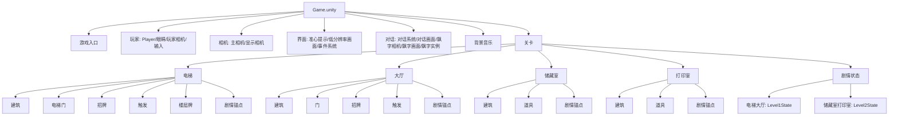
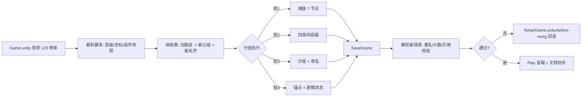
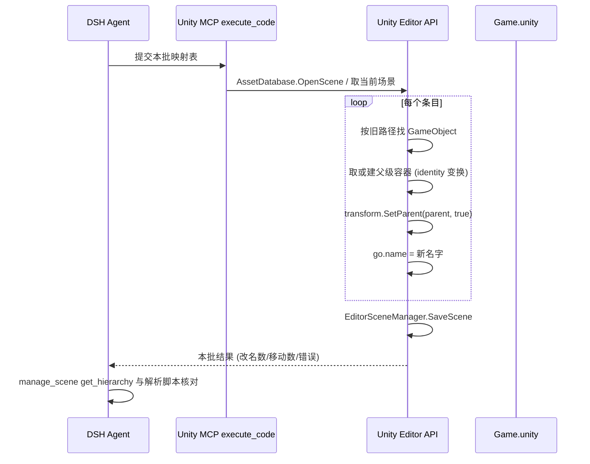

# Game 场景物体层级重构设计

- 日期：2026-11-16
- 项目：MakeYourChoice（Unity 2022.3.62f3c1 / URP 14.0.12）
- 对象：`Assets/Scenes/Game.unity`（唯一自有场景）
- 状态：设计已获用户批准，本文档为实现依据
- 交付方式：按用户全局 git 约定（只允许查询类 git 操作），本文档只写入工作区，不执行 commit

## 1. 背景与目标

`Game.unity` 已经堆到 123 个 GameObject，层级按「关卡一 / 关卡二」分区，但关卡二的交互道具（北面两扇门、蓝箭头、安全门）实际挂在 `Level1` 子树里，关卡一的大厅里又混着关卡二的触发区。结果是**按关卡找不到东西，按房间也找不到东西**。

本次重构只解决一件事：**让人能在 Hierarchy 里准确地找到东西**。

不做的事（明确排除）：

- 不改任何脚本（`.cs` 一行不改）、不改几何、不改材质、不改 `.yarn` 台词；
- 不做预制体化、不做关卡复用、不合并或拆分物体、不调任何组件参数；
- 不引入抽象层、不新增管理器、不改运行逻辑。

## 2. 验收判据

1. **一次命中**：任意玩法物体可用「空间 → 类别 → 名字」在 Hierarchy 搜索框一次搜到，同一父级下无重名、任意物体全路径唯一（`地板` 这类同名构件靠所属 `建筑` 分组区分，形如 `大厅/建筑/地板`）。
2. **骨架可见**：`关卡` 下折叠各房间节点，只凭折叠行就能读出整关布局（几个房间、房间之间怎么连）。
3. **名字可预测**：看到名字就知道类别与归属，不需点开看组件；层级里不出现 `A/B` 编号、不出现英文标记。

## 3. 现状问题（含证据）

| # | 问题 | 证据 |
| --- | --- | --- |
| 1 | 关卡归属失真 | `Level/Level1/Room/Door_North_Red`、`Door_North_Blue`（`Level2DoorInteract`）、`Sign_Arrow_Left/Right`（`Level2BlueArrow`）、`Door_Mid_Safe`（`Level2SafeDoorInteract`）共 5 个关卡二组件挂在 `Level1` 下；而关卡二的房间在 `Level2/Geometry` |
| 2 | 两关子结构不一致 | Level1 = `Elevator`/`Room`/`Triggers`（几何直摊）；Level2 = `Geometry`/`Props`/`Triggers`（几何再按房间包一层） |
| 3 | 剧情锚点混在玩法物体里 | `StoryAnchor` 11 个 + 具名锚点 4 个（`StoryAnchor_CabinetA/B`、`StoryAnchor_Copier`、`StoryAnchor_SafeDoor`），全是触发器/门/道具/招牌的子物体 |
| 4 | 重名 8 组 | `Floor`×4、`Ceiling`×4、`Wall_East`×3、`Wall_West`×3、`Slab`×3、`Hinge`×2、`Wall_North`×2、`Triggers`×2 |
| 5 | 根级 16 个对象平铺 | 3 台相机、4 个 Canvas、音频、入口、`Level`、`WorldLines` 同层；`ElevatorFloorDisplay`（到站演出）在根级而电梯几何在 `Level1/Elevator` 下 |
| 6 | 同类物体三套命名法 | 触发器有编号式（`Trigger_A_Start`）、机制式（`Trigger_DoorListen`）、房间式（`Trigger_Storage`）；道具用 `Prop_*` 前缀而门/墙/招牌不用 |
| 7 | 触发机制从名字看不出来 | `Trigger_RedText`、`Trigger_DoorListen` 没有碰撞体（每帧距离/视线判定），与 Box 触发区同放在 `Triggers` 下，层级上无法区分 |

## 4. 命名规则

1. **全部中文**，语义直接（`东墙`、`左门扇`、`柜子A`）。
2. **重名靠嵌套消歧，名字里不加房间前缀**：`大厅/建筑/东墙`，不是 `大厅_东墙`。
3. **分组节点只在同类 ≥ 2 个时建立**：大厅 3 扇门 → 建 `门`；电梯只有 1 扇门 → `电梯门` 直接挂 `电梯` 下。
4. **分组节点不挂组件**，只做归类；挂组件的才是实体。
5. **名字里不出现编号**：`Trigger_A_Start`、`Trigger_B_East`、8–16 号节点这类编号只留在脚本注释与策划表里，层级改成机制名。
6. **`关卡` 下只有「空间单元」和一个逻辑节点**（`剧情状态`），不存在 `Level1`/`Level2` 容器；关卡一二只活在脚本类名里。

## 5. 目标层级

### 5.1 根级：16 个平铺对象 → 7 个主题节点

```
游戏入口          GameBootstrap（单物体，不套容器）
玩家              Player（+ 眼睛 / 玩家相机 / cm）
└─ 输入           PlayerInputRouter
相机              主相机（Main Camera）/ 显示相机（DisplayCamera）
界面              准心提示（HUD）/ 低分辨率画面（LowResCanvas）/ 事件系统（EventSystem）
对话              对话系统 / 对话画面 / 飘字相机 / 飘字画面 / 飘字实例（WorldLines）
背景音乐          Bgm（单物体）
关卡              电梯 / 大厅 / 储藏室 / 打印室 / 剧情状态
```

`Dialogue3DCamera` 放 `对话` 而不是 `相机`：它只为飘字存在（主相机 `cullingMask` 排除 `Dialogue3D` 层，它只渲这一层），按**功能归属**而不是组件类型归属。

### 5.2 `关卡` 下的四个空间

```
关卡
├─ 电梯
│  ├─ 建筑            地板 / 天花板 / 南墙 / 东墙 / 西墙
│  ├─ 电梯门          左门扇(门板, 字_你) / 右门扇(门板, 字_好)
│  ├─ 招牌            红字_别开 / 退路箭头
│  ├─ 触发            开场 / 看红字 / 电梯倒计时
│  ├─ 黄箱子
│  ├─ 楼层牌          面板框架 / 面板屏幕 / 楼号 / 下一楼号 / 箭头1 / 箭头2
│  └─ 剧情锚点        开场_台词点 / 看红字_台词点 / 倒计时_台词点
├─ 大厅
│  ├─ 建筑            地板 / 天花板 / 东墙 / 西墙
│  │                 南墙_左 / 南墙_右 / 南墙_门楣
│  │                 北墙_左 / 北墙_中 / 北墙_右 / 北墙_门楣_左 / 北墙_门楣_右
│  │                 中间墙
│  ├─ 门              红门(铰链, 门板) / 蓝门(铰链, 门板) / 安全门(门板)
│  ├─ 招牌            禁止入内 / 地面箭头 / 左箭头 / 右箭头 / 红字_前方未开放(文字)
│  ├─ 触发            门前听风 / 缝隙西侧 / 缝隙东侧
│  └─ 剧情锚点        电梯门_台词点 / 听风_台词点 / 缝隙东_台词点 / 缝隙西_台词点
│                     左箭头_台词点 / 右箭头_台词点 / 安全门_台词点
├─ 储藏室
│  ├─ 建筑            地板 / 天花板 / 北墙 / 西墙 / 隔墙
│  ├─ 道具            柜子B / 空柜子
│  ├─ 进入储藏室（单触发，不建分组）
│  └─ 剧情锚点        进储藏室_台词点 / 柜子B_台词点
├─ 打印室
│  ├─ 建筑            地板 / 天花板 / 北墙 / 东墙
│  ├─ 道具            复印机(紫光) / 柜子A
│  ├─ 进入打印室（单触发，不建分组）
│  └─ 剧情锚点        进打印室_台词点 / 柜子A_台词点 / 复印机_台词点
└─ 剧情状态
   ├─ 电梯大厅       原 Level1 节点（挂 Level1State）
   └─ 储藏室打印室   原 Level2 节点（挂 Level2State）
```

### 5.3 关键判断与理由

| 判断 | 理由 |
| --- | --- |
| 房间归属按**世界坐标**判定，不按现有父级搬运 | 电梯 z≈-9.5~-4.65；大厅 z≈-4.65~4.65；储藏室 x<0、打印室 x>0，z≈4.65~10。现有父级有 5 处错配（问题 1） |
| `ElevatorFloorDisplay` 从根级搬进 `电梯/楼层牌` | 世界坐标 (1.86, 1.94, -4.86)，在电梯轿厢内贴着电梯门旁的墙面，与到站演出是一体 |
| `Wall_North_*` 全部留 `大厅/建筑` | 它们是 z=4.65 那面墙的五段 + 两块门楣；两间房自己的墙在 `Level2/Geometry/*` 里，已各自归位 |
| `Wall_Divider` → `储藏室/建筑/隔墙` | 唯一物体，物理上在 x=0 两房正中；按来源（从 `Wall_Storage` 另存）归到储藏室 |
| `Prop_Cabinet` → `储藏室/道具/空柜子` | 位于 x=-1.4，只有 BillBoard + 碰撞体、无任何交互脚本，不属于剧本里的「柜子A/B」 |
| `柜子A`/`柜子B` 保留字母 | `Level2.yarn` 台词与 `Level2State` 注释都按 A/B 表述，层级名与台词对齐 |
| 剧情锚点按房间分组，命名加 `_台词点` 后缀 | 四房锚点数 3/7/2/3 均 ≥2（满足规则 3）；后缀避免与招牌 `左箭头`、道具 `柜子A` 重名 |
| 两块红字靠名字区分 | 电梯里 `Sign_DontOpen`（内容「别开」）→ `红字_别开`；大厅北墙 `Canvas`+`TMP`（内容「前方的区域还未开放」）→ `红字_前方未开放/文字` |
| 招牌左右按**玩家视角**命名 | `Sign_Arrow_Left` 内容「→」在左门旁 → `左箭头`；与剧本「跟着蓝箭头走」一致 |
| `剧情状态` 靠改名实现，不新建物体 | 组件不能换物体：`Level1`、`Level2` 节点本身就是两个 State 的宿主，改名+搬家即可，零组件改动 |

### 5.4 已知遗留（本次不修）

- `左箭头_台词点` 与 `右箭头_台词点` 世界坐标完全重合 (0.45, 0.03, 3.73)，两条箭头台词从同一处飘出。属于演出调整，不在本次范围。
- `剧情状态/电梯大厅`（类 `Level1State`）、`剧情状态/储藏室打印室`（类 `Level2State`）的名字与脚本类名不对应。类名属代码，本次不改。

## 6. 执行方案

映射表驱动 + 分批 + 可回滚。全程在 Unity 编辑器里通过 MCP `execute_code` 完成，**不手写 YAML**。

1. 备份：`Assets/Scenes/Game.unity` → `Temp/Game.unity.before-reorg`（纯本地文件备份，不涉及 git）。
2. 映射表：脚本内建「旧路径 → 新父级路径 + 新名字」，对象按**旧路径**定位（重构前层级唯一可寻）。
3. 换父级一律 `SetParent(newParent, worldPositionStays: true)`，保证世界坐标、旋转不变；新容器一律 identity 变换。
4. 分批执行，每批后 `EditorSceneManager.SaveScene`：
   - 批 1：根级 7 节点（含 `Dialogue3DCamera`→`对话`）；
   - 批 2：四个房间容器（复用 `Elevator`/`Room`/`Storage`/`Print`，删除搬空的 `Triggers`/`Geometry`/`Props`）；
   - 批 3：房间内分组节点 + 全量改名；
   - 批 4：剧情锚点归位 + `剧情状态` 改名搬家。
5. 批间用 `manage_scene get_hierarchy` 与本地解析脚本双向核对，不靠肉眼。

预期物体数：123 − 4（搬空的容器）+ 19（新分组节点：根级 3、剧情状态 1、电梯 4、大厅 5、储藏室 3、打印室 3）= **138**。

## 7. 风险与回滚

| 风险 | 处理 |
| --- | --- |
| 改名断引用 | 无风险：Unity 序列化引用走 fileID；`Assets/Scripts` 经检索无 `Find`/`FindObjectOfType`/`transform.Find`/按名字取场景对象 |
| 换父级改变变换 | 新容器全为 identity，且一律 `worldPositionStays: true`；`Main Camera`、scale 为 0 的 Overlay Canvas、`Player`、玩家相机链均按此规则 |
| `cm` 节点被误动 | `cm` 是 Cinemachine 自动生成的管线子节点（`m_ComponentOwner`），保持原名与父级不动 |
| 某批出错 | 关闭场景不保存，用 `Temp/Game.unity.before-reorg` 覆盖回来，重开场景 |
| 编辑器失焦导致 Play 暂停 | `runInBackground: 0`；冒烟测试时保持 Unity 前台 |

## 8. 验收

1. **一次命中**：解析新场景全部 `m_Name`，要求零重名；对 `柜子A`、`安全门`、`红字_别开`、`左箭头_台词点`、`楼层牌` 打印完整路径，确认路径唯一。
2. **骨架可见**：贴出 `关卡` 展开一层的树，4 房间 + `剧情状态` 一行一个。
3. **名字可预测**：抽 10 个名字人工判断；检查无 `A/B` 编号残留、无英文标记残留。
4. **没丢东西**：物体数 = 138、组件总数与重构前一致、`MonoBehaviour` 引用无一悬空（对比重构前后解析快照）。
5. **Play 冒烟**：开始菜单 → 到站 → 开场剧情 → 开电梯门 → 看红字 → 听风 → 电梯倒计时；Console 无报错。
6. **文档同步**：更新 `AGENTS.md` 中失效的节点路径（`Level/Level1/...`、`Level/Level2/...`）与「已有能力」表的相关描述。

## 9. 结构图

### 9.1 架构图（目标层级分区）



### 9.2 数据流图（重构执行）



### 9.3 调用链图（单批执行的函数调用顺序）



## 10. 落地结果（2026-11-17）

按本设计分 4 批执行完毕，全程只动层级与名字，未改脚本、组件、几何与材质。

| 指标 | 重构前 | 重构后 |
| --- | --- | --- |
| 序列化 GameObject | 123 | **138**（− 4 个搬空的容器 + 19 个分组节点） |
| MonoBehaviour | 110 | **110**（未增未减） |
| 根级对象 | 16 | **7**（`游戏入口` / `玩家` / `相机` / `界面` / `对话` / `背景音乐` / `关卡`） |
| 重名 | 8 组 | **0**（同一父级下无重名，全路径唯一） |
| 纯英文名物体 | 多条 | 只有 `cm`（Cinemachine 管线节点，按设计保持原名） |

验收：`Temp/reorg/verify_reorg.py` 输出 `物体数: 138  期望: 138` / `RESULT: PASS`；138 条全路径无重复、无「有子无父」；无悬空 `fileID` 引用；重构前 123 个物体的 `fileID` 一个不少（只少了 4 个按计划删除的空容器）。

Play 冒烟：开始菜单 → 点「开始游戏」→ 到站演出（楼层牌滚到 `NaN`、电梯门左右滑开）→ 玩家可走动，Console 无 error（仅有既有的「单 EventSystem」提示）。

**未纳入统计的两个物体**：`关卡/打印室/道具/办公桌`（`metal_office_desk_1k`，FBX prefab 实例，其 GameObject 不写成 `!u!1` 文档，名字存在 `PrefabInstance` 的修改项里）与其 9 个 prefab 内部子物体（保留资产原名，属**唯一**允许英文的地方）。
