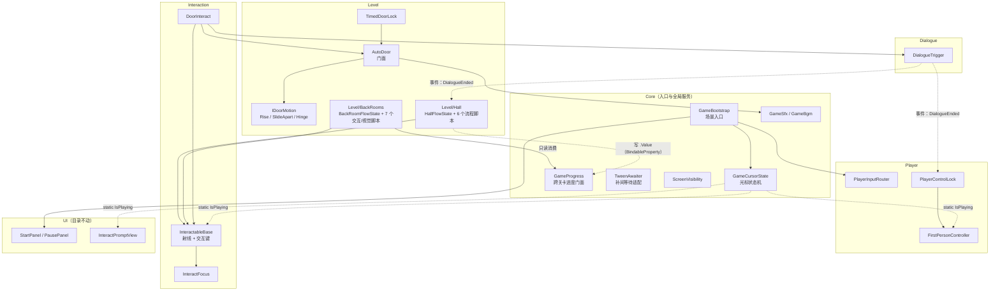
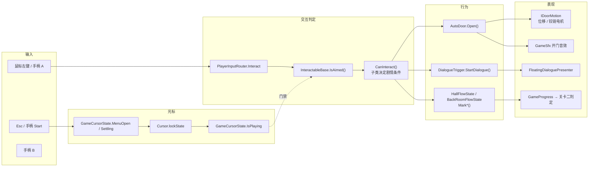
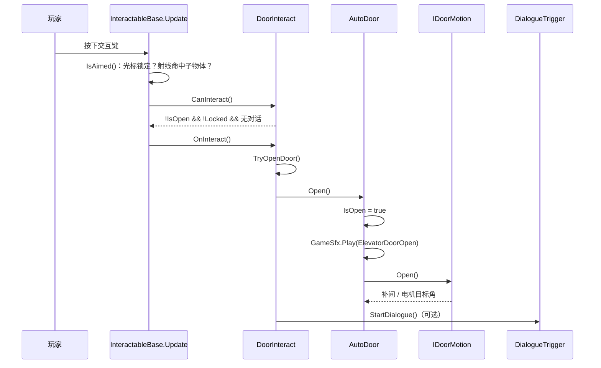
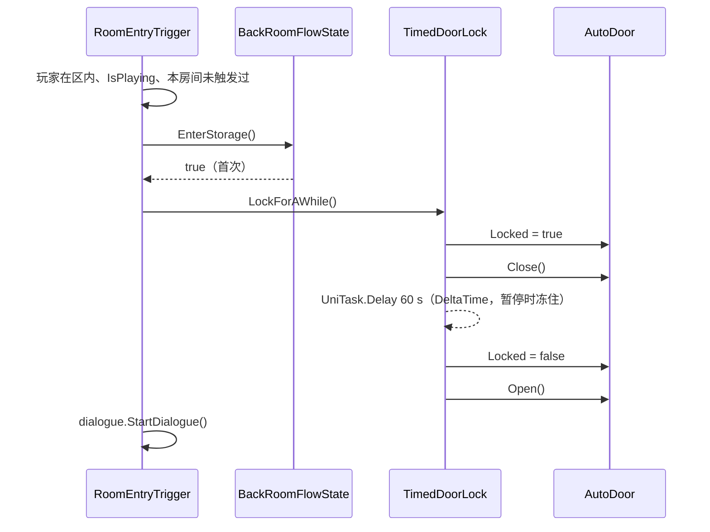

# Assets/Scripts 代码结构重构设计

- 日期：2026-11-17
- 项目：MakeYourChoice（Unity 2022.3.62f3c1 / URP 14.0.12）
- 对象：`Assets/Scripts/` 全部 47 个 `.cs`（约 4400 行），重构后 57 个 `.cs`
- 状态：已按本设计实施完成（2026-11-17，任务 1–9 全部落地，任务 10 验收通过）
- 交付方式：按用户全局 git 约定（只允许查询类 git 操作），本文档只写入工作区，不执行 commit

## 1. 背景与目标

`Assets/Scripts` 是 48 小时 Game Jam 原型长出来的代码：功能都在，但结构按「谁先写谁占地盘」分布。三个具体后果已经影响改动效率：

1. **同一段判定写了三遍**，而且散落在 `Level1/` 和 `Level2/` 两棵子树里，改一次交互条件要同时改 3 个文件；
2. **一个类扛多种职责**，`AutoDoor` 塞了三种开门方式，`BackRoomFlowState` 既存剧情进度又负责把红门锁 60 秒，`GameBootstrap` 既重置 UIKit 又驱动到站演出又管光标；
3. **「游玩中」这个隐式全局状态靠 `Cursor.lockState` 裸判断散在 11 处**，加任何新的暂停来源（比如以后的过场动画）都必须挨个补。

本次重构要解决的是**改动的成本**，不是功能：在不改变任何玩法行为、不改任何场景配置数值的前提下，把重复判定收成一处、把多职责类拆开、把目录按职责分层。

要做的事：

- 消除交互判定、光标判定、开门音效的重复；
- 按职责拆分 `AutoDoor`、`BackRoomFlowState`、`GameBootstrap`；
- 用只读门面切断关卡二对 `HallFlowState` 具体类的反向依赖；
- 目录按 `Core / Player / Interaction / Level` 分层；
- 4 个文件里的 9 个协程全部换成 UniTask（`async UniTask` + `destroyCancellationToken`），项目内不再出现 `StartCoroutine` / `IEnumerator` / `yield return` / `WaitForSeconds`。

不做的事（明确排除）：

- **不动 `Assets/Scripts/UI/` 的目录结构**，`PausePanel.cs`、`PausePanel.Designer.cs`、`StartPanel.cs`、`StartPanel.Designer.cs` 一行不改——它们是 QFramework UIKit + CodeGenKit 自动生成的，挪目录会让 `ProjectConfig.json` 的 `UIScriptDir`（`/Scripts/UI`）与资源索引错位。`InteractPromptView.cs` 只改一个判断条件，目录位置不动；
- **不改任何玩法数值、剧情节点名、门的开合角度与方向、触发区范围**；
- 不引入自研框架、DI 容器、ECS、事件总线；不新增程序集（`Assets/Scripts` 继续全部编入 `Assembly-CSharp`）；
- 不做预制体化、不合并/拆分场景物体、不调整 Hierarchy 层级；
- 不动 `Assets/Plugins`、`Assets/QFramework`、`Assets/QFrameworkData`；
- 不手改 `.meta`（移动脚本时把 `X.cs` 与 `X.cs.meta` 成对搬走，内容一个字都不改）。

## 2. 验收判据

1. **零丢失**：改完后 `Game.unity` 里没有任何 `Missing (Mono Script)` 或 Inspector 空引用警告，全部门的开合方式、角度、时长、触发区范围与改前逐项一致。
2. **零重复**：交互射线判定只存在一处（`InteractableBase.IsAimed`），`Cursor.lockState == Locked` 的读取只存在一处（`GameCursorState.IsPlaying`），开门音效只存在一处（`AutoDoor.Open`），「剧情结束」的通知只存在一处（`DialogueTrigger` 发 `DialogueEndedEvent`，消费者只订阅、不再轮询 `IsRunning`）。
3. **零行为变化**：Play 一遍走通第 12 节的 8 条流程，台词、时机、镜头、音量与改前完全一致。
4. **结构可读**：`Assets/Scripts` 下任意文件，只看所在目录就知道它属于入口/玩家/交互/关卡/对话/界面中的哪一层；`Level/BackRooms` 不再持有关卡一的状态类。
5. **零协程**：`Assets/Scripts` 下 `StartCoroutine`、`IEnumerator`、`yield return`、`WaitForSeconds` 零命中；所有等待都是 `UniTask.Delay(..., DelayType.DeltaTime)`，语义与原协程一致（暂停菜单里冻结、关闭后继续）。

## 3. 现状问题（含证据）

| # | 问题 | 证据 | 违反 |
| --- | --- | --- | --- |
| 1 | 交互射线判定写 3 份 | `Level2InteractBase.IsAimed()`（`Level2InteractBase.cs:52-67`）、`Level1DoorInteract.IsAimingAtDoor()`（`Level1DoorInteract.cs:57-82`）、`Level1SafeDoorInteract.IsAimingAtDoor()`（`Level1SafeDoorInteract.cs:59-79`）三段是同一段 `Physics.Raycast` + `IsChildOf` + 光标判断 | DRY |
| 2 | 交互骨架写 3 份 | 同上三个文件各自复制 `InteractFocus.Set/Clear` + `OnDisable` 清理 + `input.Interact.WasPressedThisFrame()` | DRY |
| 3 | 基类名字与职责不符 | `InteractableBase` 实为**通用**交互基类，只是关卡一那两个类没继承它；关卡二的 `CopierInteract`/`StorageCabinetInteract`/`GlowCabinetInteract`/`BlueArrowInteract`/`SafeDoorInteract` 全都继承它 | 命名 / S |
| 4 | `AutoDoor` 五种活干在一个类 | `AutoDoor.cs` 233 行：3 种开合策略 + 玩家触发 + DOTween 补间 + HingeJoint 电机；`Awake`（59-120）、`FixedUpdate`（122-142）、`Open`（165-194）、`Close`（197-225）各有 3 个 `mode` 分支，加第四种门要改 4 处 | S / O |
| 5 | `BackRoomFlowState` 两职责 | `BackRoomFlowState.cs` 137 行：9 个剧情 flag 的数据源 + `LockRedDoor()`/`UnlockRedDoorAfterDelay()` 协程（直接持有 `AutoDoor redDoor` 并操作它） | S |
| 6 | `GameBootstrap` 五职责 | `GameBootstrap.cs` 185 行：UIKit 静态重置（28-34）、开开始菜单（45-65）、到站演出 4 个协程（103-136）、光标状态机（142-164）、Esc 暂停面板（169-183） | S |
| 7 | 关卡二反向依赖关卡一具体类 | `Level2SafeDoorInteract.cs:16,59` 读 `level1State.DoorOpened`；`Level2BlueArrow.cs:14,30` 读 `level1State.EnteredRoom`。它们只需要两个布尔量，却拿到了持有电梯门引用的整个 `Level1State` | D / I |
| 8 | 「游玩中」判定散落 | `Cursor.lockState == CursorLockMode.Locked` 出现在 11 个读取点：`InteractableBase`、`ElevatorDoorInteract`、`SafeDoorHintInteract`、`HallEntryTrigger`、`ElevatorCountdown`、`DialogueZoneTrigger`、`TriggerVolume`、`FirstPersonController`、`PlayerControlLock`、`InteractPromptView`、`RoomEntryTrigger` | DRY |
| 9 | 开门音效写 3 份 | `Level1DoorInteract.cs:46`、`Level2DoorInteract.cs:23`、`Level2SafeDoorInteract.cs:72` 都是 `GameSfx.Play(GameSfx.ElevatorDoorOpen)` | DRY |
| 10 | 等待流程全靠协程 | 4 个文件 9 个 `IEnumerator`：`GameBgm`（`PlayLoop`/`FadeTo`）、`GameBootstrap`（`PlayArrivalSfx`/`ReleaseControlAfterSfx`）、`ElevatorFloorDisplay`（`IdleRoutine`/`ArrivalRoutine`/`SettleFloorToArrived`/`RollTo`）、`Level2State.UnlockRedDoorAfterDelay`；`StopCoroutine` 之后无法区分「被打断」与「已走完」，`ElevatorFloorDisplay` 还要额外维护两个 `Coroutine` 句柄 | S / 可维护性 |

以下三处**经核对确认不构成违规**，本设计不拆类（第一处只把解锁方式换成事件）：

| 位置 | 判断 | 理由 |
| --- | --- | --- |
| `DoorListenTrigger` | 看着像 3 职责（蹲点计时 + 剧情结束解锁 + 风声 AudioPlayer） | 三件事都围绕同一个剧情节点（`LV1_Listen`）的生命周期，属高内聚，**类不拆**。只把「剧情结束解锁」的每帧轮询换成 §8.4 的 `DialogueEndedEvent` 订阅——该事件在校验失败等早退路径也会发，所以「剧情没能播起来也要解锁」这条分支不会丢 |
| 4 个区域触发类 | 骨架重复 4 份（各 3 行守卫） | 抽基类每类只省 3 行，却要 4 处重新拖引用并多一层间接。真正容易漏的是“游玩中”判定，那一段已由判据 2 收口 |
| `HallFlowState` / `BackRoomFlowState` 两个 flag 类 | 结构相似 | 显式属性（`GotRealCard`、`TriedSafeDoorWithTempCard`）比 enum + 字典可读得多，合并属过度抽象，违反 KISS |

另有两处小重复，列为**可选项**（P4 收尾顺手做，做不做都不影响验收）：

- `DialogueBoxView.SetVisibleCount`（`DialogueBoxView.cs:54-57`）与 `FloatingLine.SetVisibleCount`（`FloatingLine.cs:125-128`）是同一行 `Mathf.Clamp(count, 0, text.textInfo.characterCount)`（`WorldLineView.SetVisibleCount` 只是转发，不算重复）→ 可抽 `TmpReveal.SetVisibleCount(TMP_Text, int)`；
- `WorldLineView.cs:38` 与 `Level1RedTextTrigger.cs:61` 都是 `~LayerMask.GetMask("Player")` → 可抽 `GameLayers.Player`。

## 4. 架构图



依赖方向只有一条链：`Entry(UI/Player) → Interaction → Level → Dialogue`。跨层通知只有两种出口：**一次性通知**走 QFramework 类型事件（`TypeEventSystem.Global`，事件类型定义在 `Core`，如 `DialogueEndedEvent`）；**只要「当前值」且会被反复读**的走 `BindableProperty`（`GameProgress` 的两个静态字段）。两者都不需要持有 `HallFlowState`，所以 `Core` 不依赖上层。

## 5. 数据流图



## 6. 调用链图

### 6.1 对准门按交互键



关卡一的电梯门把 `TryOpenDoor()` 覆写成 `state.OpenElevatorDoor()`，先过 `CanOpenDoor` 剧情闸门再真正开门——调用链其余部分不变。

### 6.2 点击开始到到站演出结束

```mermaid
sequenceDiagram
    participant SP as StartPanel
    participant GB as GameBootstrap
    participant FD as ElevatorFloorDisplay
    participant RM as ElevatorRideMotion
    participant CS as GameCursorState

    SP->>GB: StartRequested（Func&lt;bool&gt;）
    GB->>GB: _starting = true
    GB->>FD: ArriveAt(arrivalFloor, OnArrived)
    GB->>CS: Settling = true
    GB->>SP: UIKit.ClosePanel
    GB->>GB: PlayArrivalSfx(...).Forget()
    FD-->>GB: OnArrived()
    GB->>RM: Arrive()
    GB->>GB: ReleaseControlAfterSfx(...).Forget()
    GB->>CS: Settling = false
    CS-->>CS: LateUpdate 锁定光标
    Note over CS: 光标锁定 = 各触发区的“游玩中”信号
```

### 6.3 进入储藏室锁红门



## 7. 目标目录结构

```
Assets/Scripts/                      47 → 55 个 .cs
├── Core/                            入口与跨系统服务（namespace Game）
│   ├── GameBootstrap.cs             只做装配：重置 UIKit、开菜单、Esc、告知菜单状态
│   ├── GameCursorState.cs           ★新：光标唯一写入口 + static IsPlaying
│   ├── GameProgress.cs              ★新：跨关卡进度（两个 static BindableProperty）
│   ├── TweenAwaiter.cs              ★新：DOTween 补间 → await（UniTask）
│   ├── GameApplication.cs
│   ├── GameSfx.cs
│   ├── GameBgm.cs
│   └── ScreenVisibility.cs
├── Player/                          第一人称与输入
│   ├── PlayerInputRouter.cs
│   ├── FirstPersonController.cs
│   └── PlayerControlLock.cs
├── Interaction/                     可交互物公共层（namespace Game.Level）
│   ├── InteractableBase.cs          由 Level2InteractBase.cs 改写（类与文件同时改名）
│   ├── DoorInteract.cs              由 Level2DoorInteract.cs 改写（类与文件同时改名）
│   └── InteractFocus.cs             从 Game/ 移入
├── Level/
│   ├── Door/
│   │   ├── AutoDoor.cs              门面：锁定/开关状态、玩家触发、开门音效
│   │   ├── IDoorMotion.cs           ★新
│   │   ├── RiseDoorMotion.cs        ★新
│   │   ├── SlideApartDoorMotion.cs  ★新
│   │   ├── HingeDoorMotion.cs       ★新
│   │   └── TimedDoorLock.cs         ★新：关门并锁 N 秒
│   ├── Elevator/
│   │   ├── ElevatorFloorDisplay.cs
│   │   └── ElevatorRideMotion.cs
│   ├── Trigger/
│   │   ├── TriggerVolume.cs
│   │   └── DialogueZoneTrigger.cs
│   ├── Visual/
│   │   ├── LowResDisplay.cs
│   │   ├── YBillboard.cs
│   │   └── OverlayTextVisibility.cs
│   ├── Hall/                        大厅这一段流程（6 个，原地改名，见 7.2）
│   │   ├── HallFlowState.cs
│   │   ├── ElevatorDoorInteract.cs
│   │   ├── DoorListenTrigger.cs
│   │   ├── RedTextSightTrigger.cs
│   │   ├── HallEntryTrigger.cs
│   │   └── ElevatorCountdown.cs
│   └── BackRooms/                   储藏室 / 打印室两间北屋（8 个，原地改名，见 7.2）
│       ├── BackRoomFlowState.cs
│       ├── SafeDoorInteract.cs
│       ├── CopierInteract.cs
│       ├── StorageCabinetInteract.cs
│       ├── GlowCabinetInteract.cs
│       ├── BlueArrowInteract.cs
│       ├── RoomEntryTrigger.cs
│       └── BreathGlow.cs
├── Dialogue/                        不动
└── UI/                              完全不动
```

命名空间策略：**移动文件不修改 namespace**。Unity 不要求目录与命名空间一致，改 namespace 只是纯噪音（47 个文件的 `using` 全要动）。两个新核心类用 `namespace Game`（`Game.*` 是其嵌套命名空间，全项目免 `using`），改写后的 `InteractableBase`/`DoorInteract` 保留 `Game.Level`，因此 6 个 `: InteractableBase` 子类只需改父类名，其余文件零 `using` 变更。

### 7.1 移动/改名对照表

| 原路径 | 新路径 | 方式 |
| --- | --- | --- |
| `Game/GameBootstrap.cs`、`GameApplication.cs`、`GameSfx.cs`、`GameBgm.cs`、`ScreenVisibility.cs`（5 个） | `Core/` 同名 | 移动（`.cs` 与 `.cs.meta` 一起） |
| `Game/InteractFocus.cs` | `Interaction/InteractFocus.cs` | 移动（`.cs` 与 `.cs.meta` 一起） |
| `Game/PlayerInputRouter.cs`、`Level/FirstPersonController.cs`、`Level/Level1/PlayerControlLock.cs` | `Player/` 同名 | 移动（`.cs` 与 `.cs.meta` 一起） |
| `Level/AutoDoor.cs` | `Level/Door/AutoDoor.cs` | 移动（`.cs` 与 `.cs.meta` 一起） |
| `Level/ElevatorFloorDisplay.cs`、`Level/ElevatorRideMotion.cs` | `Level/Elevator/` | 移动（`.cs` 与 `.cs.meta` 一起） |
| `Level/TriggerVolume.cs`、`Level/DialogueZoneTrigger.cs` | `Level/Trigger/` | 移动（`.cs` 与 `.cs.meta` 一起） |
| `Level/LowResDisplay.cs`、`Level/YBillboard.cs`、`Level/OverlayTextVisibility.cs` | `Level/Visual/` | 移动（`.cs` 与 `.cs.meta` 一起） |
| `Level/Level1/` 全部 7 个 | `Level/Hall/` + 类名去数字（见 7.2） | 移动 + 类改名 |
| `Level/Level2/` 全部 10 个 | `Level/BackRooms/` 8 个 + `Interaction/` 2 个，全类改名（见 7.2） | 移动 + 类改名 |

### 7.2 类名去数字对照表

`Level1`/`Level2` 只说明「这扇门在第几个关卡出现」，不说明这个类干什么；而且关卡号一改（比如合并成一关）名字就撒谎。改成按职责命名后，同一段流程里的类名自解释。

命名后缀规则：能按交互键起作用的用 `…Interact`（对齐基类 `InteractableBase`），靠走进去或看过去触发的用 `…Trigger`（对齐 `DialogueZoneTrigger`），纯视觉表现不加后缀（`BreathGlow`）。

| 原类名 | 新类名 | 文件 |
| --- | --- | --- |
| `Level1State` | `HallFlowState` | `Level/Hall/HallFlowState.cs` |
| `Level1DoorInteract` | `ElevatorDoorInteract` | `Level/Hall/ElevatorDoorInteract.cs` |
| `Level1SafeDoorInteract` | ~~`SafeDoorHintInteract`~~ | 实施后确认全项目零引用，文件已删除 |
| `Level1DoorListenTrigger` | `DoorListenTrigger` | `Level/Hall/DoorListenTrigger.cs` |
| `Level1RedTextTrigger` | `RedTextSightTrigger` | `Level/Hall/RedTextSightTrigger.cs` |
| `Level1RoomEntryTrigger` | `HallEntryTrigger` | `Level/Hall/HallEntryTrigger.cs` |
| `Level1ElevatorCountdown` | `ElevatorCountdown` | `Level/Hall/ElevatorCountdown.cs` |
| `Level2State` | `BackRoomFlowState` | `Level/BackRooms/BackRoomFlowState.cs` |
| `Level2SafeDoorInteract` | `SafeDoorInteract` | `Level/BackRooms/SafeDoorInteract.cs` |
| `Level2Copier` | `CopierInteract` | `Level/BackRooms/CopierInteract.cs` |
| `Level2StorageCabinet` | `StorageCabinetInteract` | `Level/BackRooms/StorageCabinetInteract.cs` |
| `Level2GlowCabinet` | `GlowCabinetInteract` | `Level/BackRooms/GlowCabinetInteract.cs` |
| `Level2BlueArrow` | `BlueArrowInteract` | `Level/BackRooms/BlueArrowInteract.cs` |
| `Level2RoomTrigger` | `RoomEntryTrigger` | `Level/BackRooms/RoomEntryTrigger.cs` |
| `Level2Blink` | `BreathGlow` | `Level/BackRooms/BreathGlow.cs` |
| `Level2InteractBase` | `InteractableBase` | `Interaction/InteractableBase.cs` |
| `Level2DoorInteract` | `DoorInteract` | `Interaction/DoorInteract.cs` |

补充：`PlayerControlLock`、`TriggerVolume`、`DialogueZoneTrigger` 名字已经说明职责，不动。Yarn 里的节点名 `LV1_*` / `LV2_*` 是台词资源 ID，跟着 .yarn 文件走，与 C# 类名无关，不动。字段名 `level1State` 属于哪个关卡的数据由类型决定，留给任务 6 换成 `GameProgress` 时一并处理，本任务不改。

### 7.3 为什么移动是安全的

Unity 用 `.meta` 里的 GUID 解析场景/预制体里的脚本引用，与文件路径无关。移动时把 `.cs` 与同名的 `.cs.meta` 成对搬走（不新建、不重写 `.meta`），GUID 不变 → 场景、预制体引用全部自动跟上。

类改名同样安全：**改写已有文件而不是新建文件**，`.meta`（含 GUID）留在原处，Unity 只是把 Inspector 里显示的组件名换掉；改名后新旧序列化字段名完全一致，Inspector 里已填的引用与数值原样保留。

## 8. 改动 A：交互层收口

### 8.1 `Interaction/InteractableBase.cs`（原 `InteractableBase`，69 行）

```csharp
using Sirenix.OdinInspector;
using UnityEngine;

namespace Game.Level
{
    /// <summary>
    /// 可交互物的公共部分：玩家视线正对物体时登记准心提示，按交互键触发 <see cref="OnInteract"/>。
    /// 光标未锁定（菜单 / 到站演出中）时一律不响应交互，也不显示提示。
    /// </summary>
    public abstract class InteractableBase : MonoBehaviour
    {
        [SerializeField, Required, LabelText("视线起点（玩家眼睛）")]
        protected Transform eye;

        [SerializeField, LabelText("交互距离")]
        protected float maxDistance = 3f;

        void Update()
        {
            if (!IsAimed())
            {
                InteractFocus.Clear(this);
                return;
            }

            InteractFocus.Set(this);

            var input = PlayerInputRouter.Instance;
            if (input != null && input.Interact.WasPressedThisFrame())
            {
                OnInteract();
            }
        }

        void OnDisable() => InteractFocus.Clear(this);

        /// <summary>当前是否允许交互（剧情状态是否满足、有没有对话正在播）。</summary>
        protected abstract bool CanInteract();

        /// <summary>玩家按交互键时调用；此时已确认视线对准且 <see cref="CanInteract"/> 为真。</summary>
        protected abstract void OnInteract();

        /// <summary>光标锁定、视线对准自己的子物体且没有被遮挡。</summary>
        bool IsAimed()
        {
            if (eye == null || !GameCursorState.IsPlaying || !CanInteract())
            {
                return false;
            }

            // 视线从眼睛沿着朝向打一条射线，射线起点在玩家胶囊体内部，不会打到自己。
            if (!Physics.Raycast(eye.position, eye.forward, out var hit, maxDistance, ~0,
                    QueryTriggerInteraction.Ignore))
            {
                return false;
            }

            return hit.collider.transform.IsChildOf(transform);
        }
    }
}
```

- 字段名 `eye`、`maxDistance`、序列化顺序不变 → 场景里所有已填的眼睛引用与距离值不丢。
- `Update` 的判定顺序调整（原来先 Set/Clear 再判断输入），行为等价：原实现同样在 `aimed == false` 时提前返回。

### 8.2 `Interaction/DoorInteract.cs`（原 `DoorInteract`，27 行）

```csharp
using Game.Dialogue;
using Sirenix.OdinInspector;
using UnityEngine;

namespace Game.Level
{
    /// <summary>
    /// 对准门板按交互键开门；可配置一段开门剧情（关卡一的电梯门用这个）。
    /// </summary>
    public class DoorInteract : InteractableBase
    {
        [SerializeField, Required, LabelText("门")]
        protected AutoDoor door;

        [SerializeField, LabelText("开门剧情")]
        protected DialogueTrigger openDialogue;

        /// <summary>开门剧情正在播放。</summary>
        protected bool DialogueRunning => openDialogue != null && openDialogue.IsRunning;

        protected override bool CanInteract()
        {
            return door != null && !door.IsOpen && !door.Locked && !DialogueRunning;
        }

        protected override void OnInteract()
        {
            if (!TryOpenDoor())
            {
                return;
            }

            if (openDialogue != null)
            {
                openDialogue.StartDialogue();
            }
        }

        /// <summary>把门打开，返回是否真的打开了；关卡一的电梯门要先过剧情闸门，所以留成虚方法。</summary>
        protected virtual bool TryOpenDoor()
        {
            door.Open();
            return true;
        }
    }
}
```

关卡二两扇北门原本 `DoorInteract` 里只有 `CanInteract` + `OnInteract` 两段，现在**直接改挂 `DoorInteract` 即可**（组件按 GUID 解析，字段 `door`/`eye`/`maxDistance` 同名同义）。

### 8.3 三个子类的最终形态

| 类 | 父类 | `CanInteract()` | `OnInteract()` / 覆写 |
| --- | --- | --- | --- |
| `ElevatorDoorInteract` | `DoorInteract` | `base.CanInteract() && state != null && !state.DoorOpened && state.CanOpenDoor` | 覆写 `TryOpenDoor()` → `state != null && state.OpenElevatorDoor()` |
| ~~`SafeDoorHintInteract`~~ | `InteractableBase` | 原计划按上表改造，实施后确认全项目零引用（场景「安全门」只挂 `SafeDoorInteract`，关卡一「打不开」台词由它的 `noCardNode` 承担），文件已删除 | — |
| `SafeDoorInteract` | `InteractableBase` | 原逻辑不变，`level1State` 换成 `progress` | 原逻辑不变，但删掉 `GameSfx.Play(GameSfx.ElevatorDoorOpen)` 那行（音效已移进 `AutoDoor.Open`） |

`CopierInteract`、`StorageCabinetInteract`、`GlowCabinetInteract`、`BlueArrowInteract` 只把父类名从 `InteractableBase` 改成 `InteractableBase`，其余不动（各 1 行）。

`ElevatorDoorInteract` 因为基类要判断 `!door.IsOpen && !door.Locked`，需要在 Inspector 里**新拖一个 `门` 引用**（AutoDoor），见第 11 节第 4 步。

### 8.4 `Dialogue/DialogueEndedEvent.cs`（新增：剧情结束通知）

三个类原本各自每帧轮询 `DialogueTrigger.IsRunning` 来判断「我这段剧情播完了」：

| 消费者 | 原轮询 | 语义 |
| --- | --- | --- |
| `DoorListenTrigger` | `!state.ListenFinished && !dialogue.IsRunning` → `MarkListenFinished()` | 风声剧情播完（或压根没播起来）就解锁电梯门 |
| `PlayerControlLock` | 每帧等 `gate.IsRunning` 变 false（另带 `waitTimeout` 兜底） | 开场剧情播完才把控制权还回去；实现时改成订阅事件 + `waitTimeout` 兜底（见 §8.4 末段） |
| `RoomEntryTrigger` | `dialogue.IsRunning` 时跳过触发 | 播放中再走进来不重复触发 |

三者语义一致：**「这段剧情结束了」**，而不是「成功播完了」——八段校验任一不通过、对话根本没启动，也必须算结束，否则玩家会永久卡住。旧代码靠每帧轮询天然兜住了这个分支，所以事件要在 `finally` 里发并带 `Completed` 标志：

```csharp
namespace Game.Dialogue
{
    /// <summary>一段对话结束（正常播完，或被前置校验拦下）；订阅者据此解锁后续流程。</summary>
    public readonly struct DialogueEndedEvent
    {
        public DialogueEndedEvent(DialogueTrigger trigger, bool completed)
        {
            Trigger = trigger;
            Completed = completed;
        }

        /// <summary>结束的这段对话所在的对象，订阅者用来判断是不是自己那段。</summary>
        public DialogueTrigger Trigger { get; }

        /// <summary>true 表示完整播到结束；false 表示校验未通过或中途取消。</summary>
        public bool Completed { get; }
    }
}
```

`DialogueTrigger` 把现有 `async void StartDialogue(string node)` 的正文改名为 `RunDialogueAsync(string node)`（返回 `bool`：八段校验任一不通过 `return false`，`await runner.StartDialogue(node)` 之后 `return true`），外面包一层保证任何退出路径都发事件：

```csharp
        /// <summary>开始播放默认节点的对话；已经在播时忽略。</summary>
        public void StartDialogue()
        {
            StartDialogue(nodeName);
        }

        /// <summary>开始播放指定节点的对话；结束时（含失败）发 <see cref="DialogueEndedEvent"/>。</summary>
        public async void StartDialogue(string node)
        {
            var completed = false;
            try
            {
                completed = await RunDialogueAsync(node);
            }
            finally
            {
                TypeEventSystem.Global.Send(new DialogueEndedEvent(this, completed));
            }
        }
```

`IsRunning` 保持原样——`CanInteract()` 那类每帧判定仍然需要「此刻是否在播」。

三个消费者改成订阅（`OnEnable` 注册，`UnRegisterWhenDisabled` 保证随组件失效注销）：

```csharp
        void OnEnable()
        {
            TypeEventSystem.Global.Register<DialogueEndedEvent>(OnDialogueEnded)
                .UnRegisterWhenDisabled(this);
        }

        void OnDialogueEnded(DialogueEndedEvent e)
        {
            if (e.Trigger != listenDialogue)
            {
                return;
            }

            // 原来的解锁逻辑：MarkListenFinished() + StopWind()
        }
```

`DoorListenTrigger` 只改这一处（蹲点计时、风声 `AudioPlayer` 生命周期全部保留）；`RoomEntryTrigger` 保留「本房间已触发过就不再触发」的 flag 判定。事件类型定义在 `Dialogue` 层、消费者在下层订阅，依赖方向不变。

**`PlayerControlLock` 的解锁条件（实现时修正过一次）**：不能只认自己那段剧情的结束事件。`DialogueTrigger.IsRunning` 是 `runner.IsDialogueRunning || presenter.IsBusy`，而全场景共用一个 `FloatingDialoguePresenter`——别人的剧情在播时 `gate.IsRunning` 也为 true，`_locked` 会被别人的剧情点亮；等那段剧情结束，事件里的 `Trigger` 不是自己的，解锁被挡掉，而 `_locked` 又让 `Update` 直接返回，`waitTimeout` 兜底永远执行不到，玩家被永久锁在原地。最终实现是：结束事件到来且 `!_locked && !gate.IsRunning` 时才 `Release()`；`_elapsed` 兜底挪进「已上锁」分支，保证任何路径都能解锁。

## 9. 改动 B：门的策略分离

### 9.1 `Level/Door/IDoorMotion.cs`

```csharp
namespace Game.Level
{
    /// <summary>门的一种开合方式：自己管自己的门扇位移或物理，AutoDoor 只负责开关状态与触发。</summary>
    public interface IDoorMotion
    {
        /// <summary>按场景配置记录关闭位、设置铰链限位；配置不全时打印错误并返回 false。</summary>
        bool TryConfigure();

        void Open();

        void Close();

        /// <summary>FixedUpdate 驱动（目前只有铰链门需要）。</summary>
        void FixedTick();

        /// <summary>释放补间等运行时句柄。</summary>
        void Dispose();
    }
}
```

三个实现分别接管原 `AutoDoor` 里对应的一段：

| 实现 | 构造参数 | 接管原代码 |
| --- | --- | --- |
| `RiseDoorMotion` | `doorPanel, openHeight, duration, autoClose, closeDelay` | `Awake` 98-109、`Open` 183-188、`Close` 210-216 |
| `SlideApartDoorMotion` | `leftLeaf, rightLeaf, slideDistance, duration, autoClose, closeDelay` | `Awake` 111-119、`Open` 190-193、`Close` 218-224 |
| `HingeDoorMotion` | `hinge, hingeOpenAngle, hingeSpeed, hingeGain, hingeMotorForce, autoClose, closeDelay` | `Awake` 61-96、`FixedUpdate` 122-142、`Open` 175-181、`Close` 202-208 |

错误文案逐字保留（`AutoDoor 未指定门扇`、`AutoDoor 未指定左右门扇`、`AutoDoor 未指定铰链关节`、`AutoDoor 的铰链关节缺少刚体`），`Debug.LogError(msg, context)` 的 context 仍传 `AutoDoor` 实例，保证 Console 里点一下还是定位到那扇门。

### 9.2 `Level/Door/AutoDoor.cs`（233 行 → 约 95 行）

```csharp
namespace Game.Level
{
    /// <summary>
    /// 玩家靠近时打开的门；触发区挂在根节点，门扇作为子物体按 <see cref="mode"/> 开合。
    /// 锁住时玩家靠近也不开门、调用 <see cref="Open"/> 也无效，由剧情脚本控制。
    /// </summary>
    public sealed class AutoDoor : MonoBehaviour
    {
        // ↓ 原有 14 个序列化字段全部原样保留：字段名不变 → 所有门在场景/预制体里的配置值不丢
        [LabelText("开门方式"), SerializeField] AutoDoorMode mode = AutoDoorMode.Rise;
        [LabelText("门扇（整体向上时使用）"), SerializeField] Transform doorPanel;
        [LabelText("升起高度"), SerializeField] float openHeight = 2.5f;
        [LabelText("单侧滑动距离（两扇向两侧时使用）"), SerializeField] float slideDistance = 1.5f;
        [LabelText("左门扇"), SerializeField] Transform leftLeaf;
        [LabelText("右门扇"), SerializeField] Transform rightLeaf;
        [LabelText("铰链关节（旋转门使用）"), SerializeField] HingeJoint hinge;
        [LabelText("开门角度（旋转门使用，负值反向转）"), SerializeField] float hingeOpenAngle = -95f;
        [LabelText("最大角速度（旋转门使用，度/秒）"), SerializeField] float hingeSpeed = 150f;
        [LabelText("角度跟随刚度（旋转门使用）"), SerializeField] float hingeGain = 4f;
        [LabelText("电机力矩上限（旋转门使用）"), SerializeField] float hingeMotorForce = 600f;
        [LabelText("开关门时长"), SerializeField] float duration = 0.6f;
        [LabelText("自动关门"), SerializeField] bool autoClose;
        [LabelText("关门延迟"), SerializeField] float closeDelay = 2f;

        IDoorMotion _motion;

        /// <summary>锁住时玩家靠近也不开门、调用 <see cref="Open"/> 也无效；由剧情脚本控制。</summary>
        public bool Locked { get; set; }

        /// <summary>门当前是否已经打开（升到顶 / 滑到两侧 / 转到开门角度）；用于交互提示与防重复开门。</summary>
        public bool IsOpen { get; private set; }

        void Awake()
        {
            _motion = mode switch
            {
                AutoDoorMode.Rise => new RiseDoorMotion(
                    this, doorPanel, openHeight, duration, autoClose, closeDelay),
                AutoDoorMode.SlideApart => new SlideApartDoorMotion(
                    this, leftLeaf, rightLeaf, slideDistance, duration, autoClose, closeDelay),
                _ => new HingeDoorMotion(
                    this, hinge, hingeOpenAngle, hingeSpeed, hingeGain, hingeMotorForce, autoClose, closeDelay),
            };

            if (!_motion.TryConfigure())
            {
                enabled = false;
            }
        }

        void FixedUpdate() => _motion?.FixedTick();

        void OnDestroy() => _motion?.Dispose();

        void OnTriggerEnter(Collider other)
        {
            if (Locked || !other.CompareTag("Player"))
            {
                return;
            }

            Open(playSound: false);
        }

        void OnTriggerExit(Collider other)
        {
            if (!other.CompareTag("Player") || !autoClose)
            {
                return;
            }

            Close();
        }

        /// <summary>打开门；锁住、已经打开或配置有误时不响应。</summary>
        /// <param name="playSound">是否播开门音效：玩家交互开门要响，触发式自动开与定时锁自动重开不响。</param>
        public void Open(bool playSound = true)
        {
            if (Locked || IsOpen)
            {
                return;
            }

            IsOpen = true;
            if (playSound)
            {
                GameSfx.Play(GameSfx.ElevatorDoorOpen);
            }

            _motion.Open();
        }

        /// <summary>把门放回关闭位置。</summary>
        public void Close()
        {
            if (!IsOpen)
            {
                return;
            }

            IsOpen = false;
            _motion.Close();
        }
    }
}
```

三处行为说明：

1. `Open()` 增加 `IsOpen` 短路：原实现对已开的门再调一次会重跑一遍补间（视觉无变化）。现在直接忽略，**顺带修掉「同一扇门被多个碰撞体触发、开门声播两次」的隐患**。
2. `Close()` 增加 `!IsOpen` 短路：与「对已关闭的门再补间回原位」视觉等价。
3. 开门音效从 3 个交互类移到这里（判据 2），因为「门开了就该响」是门自己的行为；`Locked` 的短路保证锁着的门不响。**非交互路径传 `playSound: false`**——`OnTriggerEnter` 的自动开门与 `TimedDoorLock` 的 60 s 后重开都不播，保证「只有玩家交互开门才响」这一听感与改前完全一致（判据 3）。

**为什么不把三个 motion 做成 MonoBehaviour 子组件**：那样 14 个配置字段要跟着搬家，`Assets/Prefabs/Level/AutoDoor.prefab` 与场景里 4 扇门全部要重连，风险远高于收益。纯 C# 策略 + 字段留在 `AutoDoor` 是零迁移方案（组合优于继承，也不违反项目「不引入复杂抽象层」的约定——只有一个接口和三个各约 40 行的类）。

### 9.3 `Level/Door/TimedDoorLock.cs`（从 `BackRoomFlowState` 拆出）

```csharp
using System;
using System.Threading;
using Cysharp.Threading.Tasks;
using Sirenix.OdinInspector;
using UnityEngine;

namespace Game.Level
{
    /// <summary>把门关上并锁住一段时间，时间一到自动解锁并重新打开。</summary>
    public sealed class TimedDoorLock : MonoBehaviour
    {
        [SerializeField, Required, LabelText("门")]
        AutoDoor door;

        [SerializeField, LabelText("锁定时长（秒）")]
        float lockSeconds = 60f;

        CancellationTokenSource _countdown;

        /// <summary>关门并锁定；重复调用会重新计时。</summary>
        public void LockForAWhile()
        {
            if (door == null)
            {
                Debug.LogError($"{name} 没有指定门，锁定不会生效。", this);
                return;
            }

            CancelCountdown();
            _countdown = CancellationTokenSource.CreateLinkedTokenSource(destroyCancellationToken);

            door.Locked = true;
            door.Close();
            UnlockAfterDelay(_countdown.Token).Forget();
        }

        /// <summary>等满 <see cref="lockSeconds"/> 秒再解锁；被打断（重新计时或物体销毁）时直接退出。</summary>
        async UniTaskVoid UnlockAfterDelay(CancellationToken cancellationToken)
        {
            try
            {
                await UniTask.Delay(TimeSpan.FromSeconds(lockSeconds), DelayType.DeltaTime, cancellationToken: cancellationToken);
            }
            catch (OperationCanceledException)
            {
                return;
            }

            CancelCountdown();
            door.Locked = false;
            door.Open(playSound: false);
        }

        void CancelCountdown()
        {
            if (_countdown == null)
            {
                return;
            }

            _countdown.Cancel();
            _countdown.Dispose();
            _countdown = null;
        }

        void OnDestroy()
        {
            CancelCountdown();
        }
    }
}
```

`BackRoomFlowState`（137 行 → 约 105 行）随之**只剩剧情 flag**：

- 删除 `redDoor`、`redDoorLockSeconds`、`_unlockRoutine`、`LockRedDoor()`、`UnlockRedDoorAfterDelay()`、`using System.Collections`；
- `EnterStorage()` 改为返回 `bool`（是否为首次），不再碰门；
- 类注释删掉「并负责玩家进储藏室后红色门自动锁上一分钟」。

`RoomEntryTrigger` 的储藏室分支改为：

```csharp
if (room == Room.PrintRoom)
{
    state.MarkEnteredPrintRoom();
}
else if (state.EnterStorage() && redDoorLock != null)
{
    redDoorLock.LockForAWhile();
}

dialogue.StartDialogue();
```

新增序列化字段 `[SerializeField, Required, LabelText("红色门定时锁")] TimedDoorLock redDoorLock;`。

## 10. 改动 C/D/E：光标状态机、跨关卡进度门面、协程 → UniTask

### 10.1 `Core/GameCursorState.cs`

```csharp
using UnityEngine;

namespace Game
{
    /// <summary>
    /// 光标的唯一写入口：菜单打开与到站演出期间解锁光标，其余时间锁定并隐藏，进入第一人称。
    /// 光标锁定同时被各触发区当作「游玩中」信号，所以这里只读地暴露 <see cref="IsPlaying"/>。
    /// </summary>
    [DefaultExecutionOrder(100)]
    public sealed class GameCursorState : MonoBehaviour
    {
        /// <summary>玩家现在是否处于可操作状态（光标已锁定）。</summary>
        public static bool IsPlaying => Cursor.lockState == CursorLockMode.Locked;

        /// <summary>菜单是否打开（由 GameBootstrap 每帧告知）。</summary>
        public bool MenuOpen { get; set; }

        /// <summary>到站演出是否还在播：期间不显示光标，但也不能操作。</summary>
        public bool Settling { get; set; }

        // 放在 LateUpdate：保证本帧内所有读取方都先拿到上一帧已生效的状态，写入时机唯一且确定。
        void LateUpdate()
        {
            bool unlock = MenuOpen || Settling;

            if (unlock)
            {
                if (Cursor.lockState != CursorLockMode.None)
                {
                    Cursor.lockState = CursorLockMode.None;
                }

                // 菜单里要用光标点按钮；演出期间没有可点的东西，藏起来免得鼠标在画面里乱跑。
                if (Cursor.visible != MenuOpen)
                {
                    Cursor.visible = MenuOpen;
                }
            }
            else if (Cursor.lockState != CursorLockMode.Locked)
            {
                Cursor.lockState = CursorLockMode.Locked;
                Cursor.visible = false;
            }
        }
    }
}
```

`IsPlaying` 之所以读 `Cursor.lockState` 而不是另存一个布尔量：光标锁定就是当前项目里「能不能操作」的唯一事实，读它保证新状态机与 11 个旧判断点是同一个语义，不存在两套真相。

`GameBootstrap`（185 行 → 约 130 行）改为：

```csharp
[RequireComponent(typeof(GameCursorState))]
public class GameBootstrap : MonoBehaviour
{
    // floorDisplay / rideMotion / arrivalFloor / arrivalSfxLead 四个字段不变
    bool _starting;
    GameCursorState _cursor;

    void Awake()
    {
        _cursor = GetComponent<GameCursorState>();
        // ResKit 初始化的 #if !UNITY_EDITOR 分支不变
    }

    void Update()
    {
        var input = PlayerInputRouter.Instance;
        if (input != null && input.Menu.WasPressedThisFrame())
        {
            TogglePausePanel();
        }

        _cursor.MenuOpen = UIKit.GetPanel<StartPanel>() != null || UIKit.GetPanel<PausePanel>() != null;
    }

    // UpdateCursorState() 整个方法删除
    // 原 _settling 字段改写成 _cursor.Settling = true / false（OnStartRequested 与 ReleaseControlAfterSfx）
}
```

`[RequireComponent]` 让 Unity 在编译时自动给入口物体补上 `GameCursorState`——不需要手动加组件，只需保存一次场景（第 11 节第 1 步）。

### 10.2 11 处光标判断替换

| 文件 | 原 | 新 |
| --- | --- | --- |
| `InteractableBase`（原 3 份） | `Cursor.lockState != Locked` | `!GameCursorState.IsPlaying` |
| `DialogueZoneTrigger.cs:32` | 同上 | 同上 |
| `TriggerVolume.cs:61` | `requireCursorLocked && Cursor.lockState != Locked` | `requireCursorLocked && !GameCursorState.IsPlaying` |
| `FirstPersonController.cs:30` | 同上 | 同上 |
| `PlayerControlLock.cs:54` | 同上 | 同上 |
| `ElevatorCountdown.cs:38` | 同上 | 同上 |
| `HallEntryTrigger.cs:37` | 同上 | 同上 |
| `RoomEntryTrigger.cs:47` | 同上 | 同上 |
| `InteractPromptView.cs:40` | `Cursor.lockState == Locked && !IsDialoguePlaying()` | `GameCursorState.IsPlaying && !PlayerControlLock.IsLocked` |

`InteractPromptView` 的文件位置与其余代码不动（UI 目录硬约束）。

> **2026-11-18 更新（剧情播放中允许交互）**：原先的 `!IsDialoguePlaying()` 会在**任何**剧情播放时隐藏准心与交互键提示，导致玩家在剧情中看不到交互入口。改成 `!PlayerControlLock.IsLocked`：只有开场剧情（唯一的控制锁）期间隐藏，其他剧情播放中照常显示。同时删掉了本类对 `FloatingDialoguePresenter` 的依赖（`presenter` 字段、`Awake`、`IsDialoguePlaying()`），改为 `using Game.Level;` 读 `PlayerControlLock.IsLocked`。

### 10.3 `Core/GameProgress.cs`

```csharp
using QFramework;

namespace Game
{
    /// <summary>
    /// 跨关卡剧情的只读进度。用 <see cref="BindableProperty{T}"/> 同时提供「读」与「变更通知」：
    /// 置位方直接写 <c>.Value</c>，消费方读 <c>.Value</c> 或 <c>Register</c> 订阅，
    /// 所以它既不持有 <see cref="Game.Level.HallFlowState"/>，也不需要额外的事件类型与中间缓存。
    /// </summary>
    public static class GameProgress
    {
        /// <summary>电梯门是否已经打开（关卡一触发 2）。</summary>
        public static readonly BindableProperty<bool> ElevatorDoorOpened = new BindableProperty<bool>(false);

        /// <summary>玩家是否已经第一次走进大厅（中间墙两侧的缝隙共用）。</summary>
        public static readonly BindableProperty<bool> EnteredLobby = new BindableProperty<bool>(false);

        /// <summary>把两个进度复位。关掉 Domain Reload 后静态值会跨 Play 残留，入口必须调用。</summary>
        public static void Reset()
        {
            ElevatorDoorOpened.SetValueWithoutEvent(false);
            EnteredLobby.SetValueWithoutEvent(false);
        }
    }
}
```

`HallFlowState` 在 `namespace Game.Level`、`GameProgress` 在父命名空间 `Game`，子命名空间自动可见父命名空间，所以置位侧不需要额外 `using`：


`HallFlowState` 在两个既有的置位点各写一次 `Value`：

```csharp
        /// <summary>记录玩家已经到过触发点 B；两侧缝隙共用，保证“第一次位于 B”只播一次。</summary>
        public void MarkEnteredRoom()
        {
            if (EnteredRoom)
            {
                return;
            }

            EnteredRoom = true;
            GameProgress.EnteredLobby.Value = true;
        }

        /// <summary>打开电梯门；门已经打开或仍在锁定中时什么都不做。返回是否真的打开了门。</summary>
        public bool OpenElevatorDoor()
        {
            if (DoorOpened || !CanOpenDoor)
            {
                return false;
            }

            if (elevatorDoor == null)
            {
                Debug.LogError("HallFlowState 未指定电梯门", this);
                return false;
            }

            DoorOpened = true;
            GameProgress.ElevatorDoorOpened.Value = true;
            elevatorDoor.Open();
            return true;
        }
```

静态属性不依赖任何场景物体，**不需要在场景里摆 `GameProgress`**，也就没有「忘了激活导致进度恒为 false」这类故障。代价是关掉 Domain Reload 后静态值会跨 Play 残留，所以必须在 `GameBootstrap.ResetUIKitState()` 里调一次 `GameProgress.Reset()`（见第 13 节风险表）。

改动的两处消费方：

| 文件 | 原 | 新 |
| --- | --- | --- |
| `Level/BackRooms/SafeDoorInteract.cs:16,59` | `HallFlowState level1State;` / `!level1State.DoorOpened` | 删掉该字段与 null 检查 / `!GameProgress.ElevatorDoorOpened.Value` |
| `Level/BackRooms/BlueArrowInteract.cs:14,30` | `HallFlowState level1State;` / `level1State.EnteredRoom` | 删掉该字段与 null 检查 / `GameProgress.EnteredLobby.Value` |

两处的 `level1State` 字段、它的 `[SerializeField, Required, LabelText(...)]` 以及 `CanInteract()` 里的 null 检查整个删掉——`GameProgress` 是静态的，Inspector 里什么都不用拖。改完后 `Level/BackRooms` 下不再有任何对关卡一状态类的引用（判据 4）。

### 10.4 改动 E：协程 → UniTask

#### 为什么要换

协程靠 `MonoBehaviour.StartCoroutine` 驱动 `IEnumerator` 状态机：返回不了结果、`StopCoroutine` 之后分不清「被打断」和「已走完」、取消与收尾都只能靠手写标志位。项目已经装了 UniTask 2.5.11（`Assets/Plugins/UniTask`，其 `UniTask.asmdef` 是 `autoReferenced`，`Assets/Scripts` 里直接 `using Cysharp.Threading.Tasks;` 即可，不需要给 `Assets/Scripts` 建 asmdef）。趁这次拆分把存量 4 个文件里的 9 个协程一起换掉，避免以后一半协程一半 async。

#### 四条转换规则

| 旧写法 | 新写法 | 注意 |
| --- | --- | --- |
| `new WaitForSeconds(x)` | `UniTask.Delay(TimeSpan.FromSeconds(x), DelayType.DeltaTime, cancellationToken: ct)` | **必须显式 `DelayType.DeltaTime`**。`WaitForSeconds` 受 `Time.timeScale` 影响，暂停面板把 timeScale 设成 0 时会冻结；UniTask 默认的 `DelayType.Realtime` 不受 timeScale 影响，会让红门 60 s 在暂停菜单里继续倒数 |
| `yield return null` | `await UniTask.NextFrame(ct)` | 帧等待与 timeScale 无关，与原来一致 |
| `StartCoroutine(F())` | `F(destroyCancellationToken).Forget()` | 组件销毁时自动取消，不需要再存 `Coroutine` 字段 |
| `Coroutine` 字段 + `StopCoroutine` | `CancellationTokenSource.CreateLinkedTokenSource(destroyCancellationToken)`，重启前 `Cancel()` + `Dispose()` | 只有「可被打断重启」的两条流程需要：电梯待机滚动、到站演出 |

写法约束两条：

- 入口一律 `async UniTaskVoid` + `.Forget()`，**不写 `async void`**——`async void` 抛出的异常会直接崩到引擎回调里，`.Forget()` 至少会让 `UniTaskScheduler` 记录日志；
- 方法体最外层包 `catch (OperationCanceledException) { }`，把取消当成正常退出。否则退出 Play 时会在 Console 刷一串取消异常。

#### `Core/TweenAwaiter.cs`（新增，唯一与 DOTween 的等待适配点）

```csharp
using System.Threading;
using Cysharp.Threading.Tasks;
using DG.Tweening;

namespace Game
{
    /// <summary>
    /// 把 DOTween 补间/序列变成可 await 的等待。补间被 Kill 或 token 取消时立即返回，
    /// 不抛取消异常——调用方按「已经停下」继续收尾即可。
    /// </summary>
    public static class TweenAwaiter
    {
        /// <summary>等待补间播完；<paramref name="tween"/> 已结束或为空时立即返回。</summary>
        public static async UniTask WaitForCompletionAsync(this Tween tween, CancellationToken cancellationToken = default)
        {
            if (tween == null || !tween.IsActive())
            {
                return;
            }

            var done = new UniTaskCompletionSource();
            tween.OnComplete(() => done.TrySetResult());
            tween.OnKill(() => done.TrySetResult());

            using (cancellationToken.Register(() =>
                   {
                       if (tween.IsActive())
                       {
                           tween.Kill();
                       }
                   }))
            {
                await done.Task;
            }
        }
    }
}
```

`OnKill` 也要 `TrySetResult`：`ElevatorFloorDisplay` 的到站流程会在中途 `Kill` 旧补间，只挂 `OnComplete` 的话被 Kill 的那次等待永远不返回，协程就卡死了。

#### 为什么不直接用 UniTask 自带的 DOTween 支持

UniTask 提供了 `tween.AsyncWaitForCompletion()`，但它由 `UniTask.DOTween.asmdef` 里的 `versionDefines` 打开——条件是有 `com.demigiant.dotween` 这个包。本项目 DOTween 是 `Assets/Plugins/Demigiant` 下的 `DOTween.dll` 加散装 `DOTween/Modules/*.cs`（直接编进 Assembly-CSharp），既没有 `DOTween.Modules` 程序集可引用，也不会触发那个 define。实测 `Library/ScriptAssemblies/UniTask.DOTween.dll` 只有 4096 字节的空壳，`AsyncWaitForCompletion()` 编译不出来。

补齐它需要给 `Assets/Plugins/Demigiant` 加 asmdef 并改动只读插件目录，违反项目约定（`Assets/Plugins` 只读），所以自写这 15 行适配器。

#### 逐文件改动

| 文件 | 现状 | 改成 |
| --- | --- | --- |
| `Core/GameBgm.cs` | `PlayLoop`、`FadeTo` 两个 `IEnumerator` | `async UniTaskVoid PlayLoop(CancellationToken)` + `async UniTask FadeTo(float target, float duration, CancellationToken)`；`FadeTo` 仍用 `Time.unscaledDeltaTime` 累加（原有注释：暂停菜单打开时也要正常过渡），只把 `yield return null` 换成 `await UniTask.NextFrame(ct)`；调用点 `PlayLoop(destroyCancellationToken).Forget()` |
| `Core/GameBootstrap.cs` | `PlayArrivalSfx`、`ReleaseControlAfterSfx` | 两个 `async UniTaskVoid`；`WaitForSeconds` → `UniTask.Delay(..., DelayType.DeltaTime)`；两处 `StartCoroutine(...)` 改 `...(destroyCancellationToken).Forget()` |
| `Level/Elevator/ElevatorFloorDisplay.cs` | 4 个 `IEnumerator` + `Coroutine _idleRoutine/_arrivalRoutine` + `StopAllCoroutines` + 2 处 `yield return _rollSequence.WaitForCompletion()` | 4 个 `async UniTask`（`IdleRoutine`、`ArrivalRoutine`、`SettleFloorToArrived`、`RollTo`，都带 `CancellationToken`）+ 两个 `CancellationTokenSource`；`StopIdle()`/`StopArrival()` 改成 `Cancel()` + `Dispose()` + 置空；`OnDestroy` 取消两条流程而不是 `StopAllCoroutines`；两处等待改成 `await _rollSequence.WaitForCompletionAsync(ct)` |
| `Level/Door/TimedDoorLock.cs`（改动 B 新建） | 直接写成 async | `async UniTaskVoid UnlockAfterDelay(CancellationToken)` + `UniTask.Delay(lockSeconds, DeltaTime)`，重复 `LockForAWhile()` 时先取消旧 token（对应原来 `StopCoroutine` 的语义，见 9.3） |
| `Dialogue/*` | `async void StartDialogue(string)`，Yarn 的 `YarnTask` | **不动**：`YarnTask` 不是 `UniTask`，`FloatingDialoguePresenter` 的虚方法签名由 Yarn 的 `DialoguePresenterBase` 规定；`async void` 入口由 UnityEvent / 交互键直接调用，改成 `UniTaskVoid` 反而要多包一层 |

## 11. 必须在 Unity 编辑器里手动做的 3 件事

> 场景与预制体不手写 YAML（项目约定），以下动作在 Unity 里完成，或通过 Unity MCP 完成。

1. **保存场景以获得 `GameCursorState`**：脚本编译后 `[RequireComponent]` 会自动给挂着 `GameBootstrap` 的物体加上 `GameCursorState` 组件，Ctrl+S 保存 `Assets/Scenes/Game.unity`。
2. **红门加 `TimedDoorLock`**：红门物体上加组件，`锁定时长` 填 `60`；`RoomEntryTrigger`（储藏室那台）把 `红色门定时锁` 拖上。原 `BackRoomFlowState` 上的 `红色门`、`红色门锁定时间` 两个字段随代码删除，值在这里重填。
3. **`ElevatorDoorInteract` 补 `门` 引用**：把电梯门的 `AutoDoor` 拖进新增的 `门` 字段（基类要用它判断 `IsOpen`/`Locked`）。

其余引用（移动过的脚本、改名过的脚本、`InteractableBase` 与它的子类）靠 GUID 自动解析，不需要手拖。

有件事**不用做、也别去找**：`GameProgress` 是静态类，没有组件可挂，场景里不加东西也不拖引用；`SafeDoorInteract`/`BlueArrowInteract` 上删掉的「关卡一状态」字段随之消失，不会在 Inspector 留残影。

## 12. 实施顺序与验收

| 阶段 | 内容 | 期望时长 | 回退粒度 |
| --- | --- | --- | --- |
| P1 | 改动 A：`InteractableBase` + `DoorInteract` + 3 个子类改父类 | 1 h | 单文件 |
| P2 | 目录移动（`Move-Item` 成对搬 `.cs` + `.cs.meta` + 编译检查） | 40 min | 整目录 |
| P3 | 改动 B：`IDoorMotion` + 3 实现 + `TimedDoorLock` + `BackRoomFlowState` 精简 | 2 h | 单文件 |
| P4 | 改动 C：`GameCursorState` + 8 处读取点替换 + 保存场景 | 1.5 h | 需回退场景改动 |
| P5 | 改动 D：`GameProgress`（BindableProperty）+ `DialogueEndedEvent` + 2 处订阅 | 1.5 h | 单文件 |
| P6 | 改动 E：`TweenAwaiter` + `GameBgm`/`GameBootstrap`/`ElevatorFloorDisplay` 转 UniTask | 1 h | 单文件 |
| P7（可选） | `TmpReveal`、`GameLayers` 两处小重复 | 20 min | 单文件 |

每阶段结束在编辑器里等编译完成、确认 Console 零报错，再进下一阶段；P6 结束做完整 Play 验收（P7 可选，做完再跑一次）。

Play 验收清单（Console 零报错、零 `Missing (Mono Script)`）：

1. 开始菜单 → 到站演出期间光标不可见且不可操作 → 演出结束后自动锁定并进入第一人称；
2. 电梯门对准出现交互提示、按键开门、开门音效**只响一次**、开门剧情播放；
3. 看过红字后门锁住（无提示、按了没反应）→ 贴门 3 s 听风声 → 播完解锁可开；
4. 大厅缝隙进入播一次；电梯里待满 5 分钟触发超时结局；
5. 两扇北门对准才开、开合角度与旋转方向与改前一致；红门在进储藏室后关闭、60 s 后自动解锁并打开；
6. 临时卡试安全门 → 柜子解锁；真卡 → 安全门升起并抛出 `exitOpened`；
7. 暂停面板音量滑杆、Esc 开关、手柄 B 返回、手柄导航焦点全部正常；
8. 暂停菜单打开时，BGM 淡入淡出、电梯楼层待机滚动、红门 60 s 计时、到站演出全部冻结，关闭菜单后继续（`DelayType.DeltaTime` 是否生效就看这一条）。

## 13. 风险与回退

| 风险 | 影响 | 应对 |
| --- | --- | --- |
| 类改名后场景组件变成 `Missing Script` | 门/触发区失效 | 改名一律改写已有文件（`.meta` 与 GUID 不动），改完立刻看 Console；P1 结束先 Play 一次确认两扇北门照常开 |
| 移动文件时漏搬 `.meta` | 该脚本的引用全丢 | 用 `Move-Item` 把 `.cs` 与同名 `.cs.meta` 成对搬；P2 结束后用 `Get-ChildItem` 或 `git status` 核对每个 `.cs` 都有同名 `.meta` |
| 静态 `BindableProperty` 跨 Play 残留（关 Domain Reload） | 上一局的「电梯门已开 / 已进大厅」留到下一次 Play，关卡二安全门与蓝箭头一开局就可用 | `GameBootstrap.ResetUIKitState()` 里调 `GameProgress.Reset()`；Play 验收第 6 条核对进度从零开始 |
| 事件订阅漏注销 | 关闭 Domain Reload 后重复订阅，一次对话结束触发多次解锁 | 所有订阅一律链 `.UnRegisterWhenDisabled(this)`；连续 Play 两次确认没有重复回调 |
| `[RequireComponent]` 自动加组件后场景没保存 | 下次打开又没了 | P4 结束立刻 Ctrl+S，并用 `git status` 看到 `Game.unity` 有改动 |
| `AutoDoor.Open` 增加短路后，某个依赖「重复 Open 重新起补间」的时序失效 | 门停在半开 | 只有 `HallFlowState.OpenElevatorDoor` 与 `DoorInteract.CanInteract` 会调 `Open`，两者都已前置挡住重复调用；Play 验收第 5 条专门核对 |
| `TimedDoorLock` 的 60 s 没在 Inspector 填 | 红门瞬间重开 | 第 11 节第 3 步显式填；验收第 5 条含「60 s 后自动开」 |
| 换 UniTask 后暂停菜单不再冻结 | 红门 60 s 继续倒数、电梯楼号继续滚动，与改前行为不同 | 所有定时等待显式 `DelayType.DeltaTime`；Play 验收第 8 条专门核对暂停时的四项冻结 |
| UniTask 不随 GameObject 失活而暂停（协程会） | 物体被 `SetActive(false)` 时 async 流程仍在推进 | 涉及的三处都在常驻物体上（`GameBgm`/`GameBootstrap`/`ElevatorFloorDisplay`），全程不失活；`ElevatorFloorDisplay` 只切 `enabled` 不切物体 |
| `.Forget()` 的取消被当成异常上报 | 退出 Play 或打断流程时 Console 刷 `OperationCanceledException` | 每个 async 方法最外层 `catch (OperationCanceledException)` 静默退出；P6 验收含「反复进出 Play 无异常」 |
| 5 天工期不足 | 交付延期 | P1/P2/P3 是纯代码改动、可随时停在中途（每阶段都可编译可运行）；P4 若时间紧可整体推迟，它只影响判据 4，不影响判据 1–3 |

回退方式：本设计不新增分支（用户全局 git 约定禁止分支操作），每个阶段结束前用 `git status` / `git diff --stat` 记录改动面；需要回退时按阶段手工还原对应文件（P4 另需还原 `Game.unity`）。
